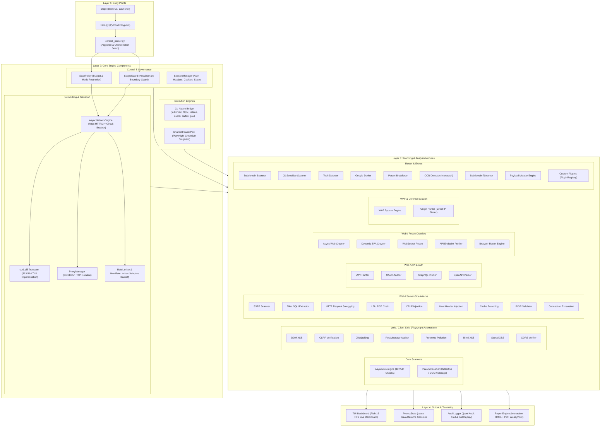
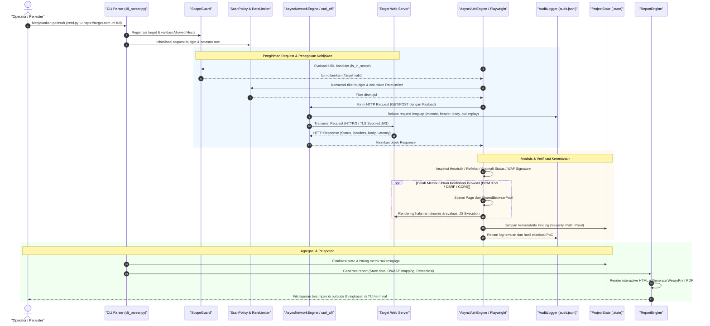
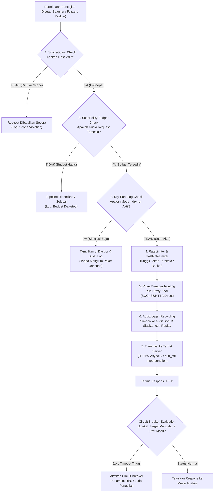

# 📐 Arsitektur Verdamt-Snipe v1.4.5 NEXUS

Dokumen ini menyajikan arsitektur teknis komprehensif dari **Verdamt-Snipe v1.4.5 NEXUS**, sebuah framework pengujian penetrasi dan audit keamanan web modern berbasis asinkron (*async-first*). Framework ini memadukan eksekusi concurency tinggi Python AsyncIO, binary eksternal Go Native, otomasi browser Chromium tingkat dalam (Playwright), penyamaran TLS fingerprint (`curl_cffi`), serta pipeline serangan modular yang terkelola secara ketat melalui audit log dan kebijakan keamanan (*scan policy*).

Untuk panduan instalasi cepat, opsi CLI, dan alur penggunaan praktis, silakan merujuk ke [README.md](file:///home/oblivion/verdamt-snipe/README.md).

---

## 2. High-Level Architecture

Arsitektur Verdamt-Snipe dibangun di atas 4 lapisan utama (*architectural layers*) yang memisahkan antara antarmuka pengguna, mesin inti, modul inspeksi/eksploitasi, dan saluran keluaran laporan.



---

## 3. Runner Pipeline Architecture

Sistem eksekusi Verdamt-Snipe diorganisir ke dalam **7 mode pemindaian** dengan alur pipeline bertahap (*multi-phase*), runner mandiri (*standalone*), serta mesin flooding adaptif (*poisoning*).

```mermaid
flowchart TD
    START(["Inisialisasi CLI (verd.py)"]) --> MODE_SEL{"Evaluasi Mode Scan"}

    %% 5-Phase Assault Pipeline (Modes: recon, app, assault, full)
    subgraph PIPELINE["5-Phase Pipeline Architecture"]
        P0["Phase 0: Surface Discovery<br/>(runners/surface.py)"]
        P1["Phase 1: Recon & Intel Gathering<br/>(runners/recon_intel.py)"]
        P2["Phase 2: Deep Application Analysis<br/>(runners/app_analysis.py)"]
        P3["Phase 3: Vulnerability Assault<br/>(runners/vuln_assault.py)"]
        P45["Phase 4-5: Verification & Reporting<br/>(reports/engine.py & VulnVerifier)"]

        P0 --> P1
        P1 --> P2
        P2 --> P3
        P3 --> P45
    end

    %% Orchestrator Modes
    MODE_SEL -->|"mode: recon"| P0
    MODE_SEL -->|"mode: app"| P2
    MODE_SEL -->|"mode: assault"| P3
    MODE_SEL -->|"mode: full (full_assault.py)"| P0

    %% Recon-Light Standalone Runner
    subgraph RECON_LIGHT["Mode: recon-light (Standalone)"]
        RL_RUN["runners/recon_light.py"]
        RL_RUN --> RL_DNS["Subdomain Passive Enumeration"]
        RL_RUN --> RL_PROBE["Fast HTTP Probing (httpx)"]
        RL_RUN --> RL_TECH["Quick Fingerprint & Header Audit"]
        RL_TECH --> RL_OUT["Output JSON / Konsol Cepat"]
    end
    MODE_SEL -->|"mode: recon-light"| RL_RUN

    %% Nuclei Runner
    subgraph NUCLEI_MODE["Mode: nuclei (Template Engine)"]
        NUC_RUN["Go Bridge Nuclei Integration"]
        NUC_RUN --> NUC_EXEC["Eksekusi Template Resmi & Custom"]
        NUC_EXEC --> NUC_COLLECT["Koleksi Temuan & Normalisasi Severity"]
    end
    MODE_SEL -->|"mode: nuclei"| NUC_RUN

    %% Poisoning Package
    subgraph POISON_PKG["Mode: poisoning (runners/poison/)"]
        POIS_ORCH["orchestrator.py<br/>(Poison Orchestrator)"]
        POIS_STATE["state.py<br/>(Tracker State & Heuristik)"]
        POIS_WAVE["wave.py<br/>(Adaptive Wave Scheduler)"]
        POIS_FLOOD["flood.py<br/>(HTTP/2 Stream Concurrent Flooder)"]

        POIS_ORCH --> POIS_STATE
        POIS_ORCH --> POIS_WAVE
        POIS_WAVE --> POIS_FLOOD
        POIS_FLOOD --> POIS_STATE
    end
    MODE_SEL -->|"mode: poisoning"| POIS_ORCH

    %% Final outputs
    P45 --> REPORT_GEN[("Laporan HTML / PDF / JSONL")]
    RL_OUT --> REPORT_GEN
    NUC_COLLECT --> REPORT_GEN
    POIS_STATE --> REPORT_GEN
```



---

## 4. Data Flow Diagram

Diagram urutan (*sequence diagram*) berikut menggambarkan perjalanan data dari input argumen awal, validasi lingkup proteksi, penembakan payload, validasi berbasis browser, hingga pembuatan laporan final.



---

## 5. Detail Komponen

### 5.1 CLI Parser & Entry Points
- **Tujuan**: Mengurai argumen baris perintah, memvalidasi dependensi sistem, menginisialisasi konfigurasi logging, serta memilih *runner* eksekusi yang tepat.
- **Berkas Kunci**:
  - [verd.py](file:///home/oblivion/verdamt-snipe/verd.py)
  - [snipe](file:///home/oblivion/verdamt-snipe/snipe)
  - [core/cli_parser.py](file:///home/oblivion/verdamt-snipe/core/cli_parser.py)
- **Kelas & Fungsi Penting**:
  - `parse_args()`: Mengurai bendera seperti `-u`, `-m`, `--threads`, `--proxy`, `--headers`, `--dry-run`.
  - `bootstrap()` / `main()`: Inisialisasi loop async dan pemilihan runner pipeline.
  - `validate_environment()`: Memeriksa ketersediaan library Python, binary Go, serta browser Playwright.
- **Ketergantungan**: [core/scope.py](file:///home/oblivion/verdamt-snipe/core/scope.py), [core/policy.py](file:///home/oblivion/verdamt-snipe/core/policy.py), [core/ui.py](file:///home/oblivion/verdamt-snipe/core/ui.py).

### 5.2 AsyncNetworkEngine & HTTP Client
- **Tujuan**: Mesin transmisi HTTP asinkron berkecepatan tinggi yang mendukung multiplexing HTTP/2, pooling koneksi, keep-alive, pengelolaan redirect, serta integrasi *circuit breaker* saat target mengalami degradasi.
- **Berkas Kunci**:
  - [core/client.py](file:///home/oblivion/verdamt-snipe/core/client.py)
  - [core/circuit_breaker.py](file:///home/oblivion/verdamt-snipe/core/circuit_breaker.py)
- **Kelas & Fungsi Penting**:
  - `AsyncNetworkEngine`: Wrapper tingkat tinggi untuk `httpx.AsyncClient` dengan retry terotomatisasi.
  - `send_request(method, url, ...)`: Menjalankan HTTP request dengan penegakan batasan timeout dan error recovery.
  - `CircuitBreaker`: Menghitung rasio kegagalan (5xx/timeout) dan menjeda penyerangan sementara waktu untuk mencegah server target down.
- **Ketergantungan**: [core/ratelimit.py](file:///home/oblivion/verdamt-snipe/core/ratelimit.py), [core/proxy.py](file:///home/oblivion/verdamt-snipe/core/proxy.py), [core/audit.py](file:///home/oblivion/verdamt-snipe/core/audit.py).

### 5.3 TLS Impersonation (`curl_cffi`)
- **Tujuan**: Memalsukan sidik jari TLS (JA3, JA4, Akamai HTTP/2 Fingerprint) agar paket request yang dikirimkan tidak diblokir oleh sistem perlindungan anti-bot seperti Cloudflare Turnstile, Akamai Bot Manager, atau AWS WAF.
- **Berkas Kunci**:
  - [core/tls_transport.py](file:///home/oblivion/verdamt-snipe/core/tls_transport.py)
- **Kelas & Fungsi Penting**:
  - `CurlCffiTransport`: Adapter async transport yang mengimplementasikan antarmuka transport `httpx` menggunakan engine `curl_cffi`.
  - `impersonate_profile("chrome120" | "safari16_0")`: Memilih profil penyamaran spesifik platform browser.
- **Ketergantungan**: `curl_cffi.requests.AsyncSession`, [core/client.py](file:///home/oblivion/verdamt-snipe/core/client.py).

### 5.4 Go Native Bridge
- **Tujuan**: Mengintegrasikan fungsionalitas binary native Go berkinerja tinggi langsung ke dalam alur kerja Python tanpa overhead kompilasi manual setiap runtime.
- **Berkas Kunci**:
  - [core/go_bridge.py](file:///home/oblivion/verdamt-snipe/core/go_bridge.py)
  - Direktori binary: [go/](file:///home/oblivion/verdamt-snipe/go/)
- **Kelas & Fungsi Penting**:
  - `GoBridge`: Manajer subprocess asinkron untuk mengeksekusi binary.
  - `run_subfinder(domain)`: Eksekusi enumerasi pasif subdomain.
  - `run_httpx(hosts)`: Probing HTTP massal dengan deteksi port cepat.
  - `run_katana(url)`: Web crawler headless Go dengan parsing JS agresif.
  - `run_nuclei(targets, templates)`: Penyerangan terarah berbasis template YAML.
  - `run_dalfox(urls)` & `run_gau(domain)`: Pengujian XSS dan pengumpulan historical URL dari alienvault/wayback.
- **Ketergantungan**: Subprocess AsyncIO OS Linux, [core/scope.py](file:///home/oblivion/verdamt-snipe/core/scope.py).

### 5.5 Playwright SharedBrowserPool
- **Tujuan**: Mengelola pool instans Chromium headless tunggal (*Singleton*) yang aman dari kebocoran memori (*memory leak*), digunakan oleh 10 modul uji klien untuk mengevaluasi DOM secara langsung.
- **Berkas Kunci**:
  - [core/browser_pool.py](file:///home/oblivion/verdamt-snipe/core/browser_pool.py)
- **Kelas & Fungsi Penting**:
  - `SharedBrowserPool`: Mengontrol siklus hidup browser Chromium terbagi.
  - `acquire_context()` & `release_context()`: Mengisolasi sesi (cookies, cache) per pengujian dalam `BrowserContext` yang ringan tanpa perlu membuka ulang proses browser.
  - `safe_goto(page, url)`: Memuat halaman dengan timeout adaptif dan pencegahan hanging script.
- **Ketergantungan**: `playwright.async_api`, [core/session.py](file:///home/oblivion/verdamt-snipe/core/session.py).

### 5.6 Scanner Engine (`AsyncVulnEngine` & `ParamClassifier`)
- **Tujuan**: Inti analisis kerentanan terstruktur yang mengklasifikasikan tipe parameter dan melakukan 12 pengujian kerentanan utama secara paralel.
- **Berkas Kunci**:
  - [modules/scanners/engine.py](file:///home/oblivion/verdamt-snipe/modules/scanners/engine.py)
  - [modules/scanners/param_classifier.py](file:///home/oblivion/verdamt-snipe/modules/scanners/param_classifier.py)
- **Kelas & Fungsi Penting**:
  - `AsyncVulnEngine`: Melakukan orkestrasian 12 teknik fuzzing (SQLi, XSS, SSRF, LFI, SSTI, Open Redirect, RCE, IDOR, Header Injection, XXE, Prototype Pollution, Info Leak).
  - `ParamClassifier.classify(param_name, sample_value)`: Mengelompokkan parameter ke kategori: reflektif, numerik, jalur file, URL redirect, atau data mentah JSON.
- **Ketergantungan**: [core/client.py](file:///home/oblivion/verdamt-snipe/core/client.py), [modules/extras/oob_detector.py](file:///home/oblivion/verdamt-snipe/modules/extras/oob_detector.py).

### 5.7 WAF Bypass System
- **Tujuan**: Mendeteksi penyedia WAF aktif (Cloudflare, Akamai, Imperva, ModSecurity) dan menerapkan teknik mutasi payload (encoding, case alternation, chunked transfer, HPP) serta pemburu origin IP.
- **Berkas Kunci**:
  - [modules/waf/bypass.py](file:///home/oblivion/verdamt-snipe/modules/waf/bypass.py)
  - [modules/waf/origin_hunter.py](file:///home/oblivion/verdamt-snipe/modules/waf/origin_hunter.py)
- **Kelas & Fungsi Penting**:
  - `WAFBypassEngine.mutate_payload(payload, waf_type)`: Menghasilkan varian payload yang disamarkan.
  - `OriginHunter.hunt_origin(domain)`: Memeriksa DNS history, sertifikat SSL non-SNI, serta layanan hosting untuk mencari IP server asli di balik proxy WAF.
- **Ketergantungan**: [core/client.py](file:///home/oblivion/verdamt-snipe/core/client.py), [modules/recon/subdomain.py](file:///home/oblivion/verdamt-snipe/modules/recon/subdomain.py).

### 5.8 Rate Limiting & Resilience
- **Tujuan**: Mencegah pemblokiran IP oleh server target dan mematuhi batas kecepatan jaringan dengan token-bucket adaptif dan backoff otomatis jika terdeteksi status `HTTP 429` atau `503`.
- **Berkas Kunci**:
  - [core/ratelimit.py](file:///home/oblivion/verdamt-snipe/core/ratelimit.py)
- **Kelas & Fungsi Penting**:
  - `RateLimiter`: Pengontrol RPS global.
  - `HostRateLimiter`: Pengontrol RPS terisolasi per domain/subdomain sasaran.
  - `adjust_rate(status_code)`: Mengurangi kecepatan secara otomatis ketika target kewalahan dan menaikkan kembali secara bertahap (*exponential backoff / additive increase*).
- **Ketergantungan**: `asyncio.Semaphore`, `asyncio.sleep`.

### 5.9 Policy & Scope Management
- **Tujuan**: Memastikan scanner hanya menyerang target yang diizinkan (*in-scope*) dan mematuhi kuota request maksimal (*budget request*).
- **Berkas Kunci**:
  - [core/scope.py](file:///home/oblivion/verdamt-snipe/core/scope.py)
  - [core/policy.py](file:///home/oblivion/verdamt-snipe/core/policy.py)
- **Kelas & Fungsi Penting**:
  - `ScopeGuard.is_in_scope(url)`: Evaluasi berbasis regex dan eTLD+1 terhadap daftar domain yang diizinkan (`--allowed-hosts`).
  - `ScanPolicy.check_budget()`: Menolak request baru jika kuota `--max-requests` telah tercapai.
- **Ketergantungan**: Tidak memiliki dependensi eksternal jaringan (operasi murni komputasi lokal).

### 5.10 Session & State Management
- **Tujuan**: Menangani persistensi autentikasi lintas request serta memfasilitasi mekanisme jeda dan lanjutkan pemindaian (*Save/Resume*) melalui snapshot berkas `.state`.
- **Berkas Kunci**:
  - [core/session.py](file:///home/oblivion/verdamt-snipe/core/session.py)
  - [core/state.py](file:///home/oblivion/verdamt-snipe/core/state.py)
- **Kelas & Fungsi Penting**:
  - `SessionManager`: Mengelola header Bearer token, session cookies, dan otentikasi basic.
  - `ProjectState.save(filepath)` & `ProjectState.load(filepath)`: Melakukan serialisasi kondisi runner, temuan kerentanan, dan endpoint yang sudah/belum dipindai.
- **Ketergantungan**: Modul serialisasi JSON.

### 5.11 Audit System
- **Tujuan**: Menjamin akuntabilitas pengujian (*OpSec & Compliance*) dengan merekam seluruh payload dan respons ke dalam format log terstruktur JSONL yang dapat di-*replay* langsung menggunakan utilitas `curl`.
- **Berkas Kunci**:
  - [core/audit.py](file:///home/oblivion/verdamt-snipe/core/audit.py)
- **Kelas & Fungsi Penting**:
  - `AuditLogger.log_request_response(req, resp)`: Menyimpan data request/response biner/teks dengan timestamp presisi milidetik.
  - `to_curl_replay(entry)`: Mengonversi baris log audit menjadi baris perintah executable `curl -X ...`.
- **Ketergantungan**: Format berkas `outputs/audit_<timestamp>.jsonl`.

### 5.12 Report Engine
- **Tujuan**: Mengagregasi seluruh temuan hasil pemindaian, memetakannya ke standar kepatuhan OWASP Top 10, menyertakan rekomendasi remediasi, dan merender output menjadi dashboard HTML interaktif dan dokumen PDF siap cetak.
- **Berkas Kunci**:
  - [reports/engine.py](file:///home/oblivion/verdamt-snipe/reports/engine.py)
  - [reports/owasp_mapper.py](file:///home/oblivion/verdamt-snipe/reports/owasp_mapper.py)
  - [reports/remediation.py](file:///home/oblivion/verdamt-snipe/reports/remediation.py)
- **Kelas & Fungsi Penting**:
  - `ReportEngine.generate_html()`: Membuat file HTML mandiri dengan tab JS interaktif, filter tingkat keparahan (*Critical/High/Medium/Low/Info*), dan sintaks PoC.
  - `ReportEngine.generate_pdf()`: Mengonversi template laporan ke dokumen PDF profesional via WeasyPrint.
  - `OWASPMapper.map_vuln(vuln_type)`: Menentukan kategori OWASP A01:2021 hingga A10:2021 yang relevan.
- **Ketergantungan**: `jinja2`, `weasyprint`, [core/state.py](file:///home/oblivion/verdamt-snipe/core/state.py).

### 5.13 TUI Dashboard
- **Tujuan**: Menyediakan antarmuka terminal militer modern (*tactical console*) dengan rendering live 15 FPS berbasis Rich tanpa memperlambat thread pemrosesan asinkron.
- **Berkas Kunci**:
  - [core/ui.py](file:///home/oblivion/verdamt-snipe/core/ui.py)
- **Kelas & Fungsi Penting**:
  - `TacticalDashboard`: Mengatur layout 3-kolom konsol (Kolom Kiri: Status Pipeline & Target, Kolom Tengah: Sparkline RPS & Log Live, Kolom Kanan: Metrik Temuan Kerentanan & Hardware CPU/RAM).
  - `update_metrics(rps, findings, current_phase)`: Refresh status secara berkala.
- **Ketergantungan**: `rich.live`, `rich.layout`, `rich.panel`, `psutil`.

### 5.14 Poison Mode Orchestrator
- **Tujuan**: Engine khusus untuk pengujian ketahanan konkurensi, race condition, dan manipulasi cache/parameter (*Cache Poisoning & Race Condition Assault*) melalui penyerangan wave-based dan multiplexed stream flooding.
- **Berkas Kunci**:
  - [runners/poison/orchestrator.py](file:///home/oblivion/verdamt-snipe/runners/poison/orchestrator.py)
  - [runners/poison/state.py](file:///home/oblivion/verdamt-snipe/runners/poison/state.py)
  - [runners/poison/wave.py](file:///home/oblivion/verdamt-snipe/runners/poison/wave.py)
  - [runners/poison/flood.py](file:///home/oblivion/verdamt-snipe/runners/poison/flood.py)
- **Kelas & Fungsi Penting**:
  - `PoisonOrchestrator`: Mengatur jadwal gelombang serangan (*waves*).
  - `WaveScheduler`: Mengelompokkan paket request untuk dilepaskan pada mikrodetik yang sama (*last-byte sync*).
  - `StreamFlooder`: Memanfaatkan multiplexing HTTP/2 untuk menyalurkan puluhan request simultan dalam satu koneksi TCP tunggal.
- **Ketergantungan**: [core/client.py](file:///home/oblivion/verdamt-snipe/core/client.py), [core/ratelimit.py](file:///home/oblivion/verdamt-snipe/core/ratelimit.py).

---

## 6. Directory Structure

Berikut adalah struktur direktori lengkap repositori Verdamt-Snipe beserta anotasi perannya:

```
verdamt-snipe/
├── verd.py                       # Titik masuk utama Python CLI
├── snipe                         # Skrip launcher Bash praktis
├── ARCHITECTURE.md               # Dokumentasi arsitektur sistem (berkas ini)
├── README.md                     # Panduan pengguna dan ringkasan fitur
├── requirements.txt              # Daftar dependensi Python
├── config/                       # Konfigurasi default sistem
│   └── settings.yaml             # File konfigurasi global (timeout, user-agent, dll.)
├── core/                         # Komponen fondasi inti framework
│   ├── __init__.py
│   ├── audit.py                  # AuditLogger & generator replay curl
│   ├── browser_pool.py           # SharedBrowserPool (Playwright singleton)
│   ├── circuit_breaker.py        # Proteksi pemutusan koneksi otomatis
│   ├── cli_parser.py             # Parser argumen baris perintah
│   ├── client.py                 # AsyncNetworkEngine (HTTP/2 async client)
│   ├── go_bridge.py              # Interface eksekusi binary Go Native
│   ├── policy.py                 # ScanPolicy & batasan budget request
│   ├── proxy.py                  # ProxyManager (HTTP/SOCKS5 rotating pool)
│   ├── ratelimit.py              # RateLimiter & HostRateLimiter
│   ├── scope.py                  # ScopeGuard (verifikasi host & domain)
│   ├── session.py                # SessionManager (auth tokens, cookies)
│   ├── state.py                  # ProjectState (save/resume sesi .state)
│   ├── tls_transport.py          # Adapter curl_cffi untuk TLS impersonation
│   └── ui.py                     # Tactical TUI Dashboard (Rich 15 FPS)
├── modules/                      # Modul-modul inspeksi dan penyerangan keamanan
│   ├── auth/                     # Pengujian autentikasi
│   │   ├── auth_tester.py        # Brute-force & credential stuffing engine
│   │   └── waf_bypass.py         # Teknik encoding bypass auth
│   ├── custom/                   # Sistem plugin eksternal
│   │   ├── __init__.py           # Plugin loader & registry
│   │   └── example_jwt.py        # Contoh implementasi plugin JWT custom
│   ├── extras/                   # Utilitas pendukung eksploitasi
│   │   ├── arjun_wrapper.py      # Integrasi brute-force parameter Arjun
│   │   ├── oob_detector.py       # Interaksi OOB (Out-of-Band via Interactsh)
│   │   └── takeover.py           # Pemeriksa celah Subdomain Takeover
│   ├── recon/                    # Modul pengumpulan informasi target
│   │   ├── dorker.py             # Automasi Google Hacking / Dorking
│   │   ├── js_scanner.py         # Ekstraktor secret & endpoint dari file JavaScript
│   │   ├── subdomain.py          # Wrapper integrasi DNS/Subdomain scanner
│   │   └── tech_detect.py        # Pendeteksi stack teknologi web & library
│   ├── scanners/                 # Mesin scanner kerentanan server-side inti
│   │   ├── engine.py             # AsyncVulnEngine (12 metode pengujian utama)
│   │   └── param_classifier.py   # Heuristik klasifikasi parameter input
│   ├── waf/                      # Komponen analisis WAF
│   │   ├── bypass.py             # Logika mutasi payload anti-WAF
│   │   └── origin_hunter.py      # Pemburu IP server asli (bypassing Cloudflare/CDN)
│   └── web/                      # Modul spesialisasi web & browser
│       ├── api_auth/             # Modul pengujian API dan token
│       │   ├── graphql_profiler.py # Introspeksi dan audit API GraphQL
│       │   ├── jwt_hunter.py       # Audit kelemahan tanda tangan JWT
│       │   ├── oauth_auditor.py    # Pengujian kelemahan alur OAuth 2.0
│       │   └── openapi_parser.py   # Pengurai skema OpenAPI / Swagger
│       ├── client_side/          # Modul otomasi Playwright Chromium
│       │   ├── blind_xss.py        # Pengujian injeksi Blind XSS
│       │   ├── clickjacking.py     # Validasi iframe framing & header X-Frame-Options
│       │   ├── cors_verify.py      # Verifikasi eksploitasi CORS misconfiguration
│       │   ├── csrf.py             # Generator & verifikator PoC CSRF
│       │   ├── dom_xss.py          # Evaluasi sink & source DOM XSS di browser
│       │   ├── postmessage.py      # Pendengar & auditor event PostMessage
│       │   ├── proto_pollution.py  # Pendeteksi manipulasi Object.prototype klien
│       │   └── stored_xss.py       # Pengecekan persistensi Stored XSS
│       ├── recon_crawlers/       # Crawler & profiler endpoint aplikasi
│       │   ├── api_profiler.py     # Penemu endpoint REST API tersembunyi
│       │   ├── browser_recon.py    # Screenshot & DOM capturing
│       │   ├── crawler.py          # Web crawler rekursif asinkron
│       │   ├── spa_crawler.py      # Dynamic SPA crawler berbasis event klik
│       │   └── websocket_recon.py  # Inspeksi pesan & handshake WebSocket
│       └── server_side/          # Modul pengujian kerentanan server lanjutan
│           ├── blind_sqli.py       # Ekstraktor data Blind SQLi berbasis biner/waktu
│           ├── cache_poison.py     # Pengecekan Cache Poisoning via unkeyed header
│           ├── conn_exhaust.py     # Audit ketahanan koneksi (Slowloris/DoS test)
│           ├── crlf.py             # Pendeteksi CRLF / HTTP Response Splitting
│           ├── host_header.py      # Audit kerentanan manipulasi Host Header
│           ├── idor.py             # Validator IDOR bertingkat
│           ├── lfi_rce.py          # Rantai eksploitasi LFI menuju Remote Code Execution
│           ├── smuggling.py        # Pengujian HTTP Desync / Request Smuggling (CL.TE/TE.CL)
│           ├── sqli_extractor.py   # Ekstraktor error-based & union-based SQLi
│           └── ssrf.py             # Pengujian SSRF berbasis protokol cloud/metadata
├── runners/                      # Pengendali alur kerja tahapan eksekusi
│   ├── app_analysis.py           # Runner Phase 2 (Analisis Struktur Aplikasi)
│   ├── full_assault.py           # Runner orkestrasi gabungan Phase 0 - Phase 4
│   ├── poison/                   # Paket runner pengujian Poisoning & Race Condition
│   │   ├── __init__.py
│   │   ├── flood.py              # Engine HTTP/2 concurrent stream flooding
│   │   ├── orchestrator.py       # Orkestrator gelombang serangan
│   │   ├── state.py              # Pelacak metrik respons balasan
│   │   └── wave.py               # Penjadwal synchronised wave attack
│   ├── recon_intel.py            # Runner Phase 1 (Pengumpulan Intelijen Target)
│   ├── recon_light.py            # Runner pengintaian ringan cepat
│   ├── surface.py                # Runner Phase 0 (Pemetaan Permukaan Serangan)
│   └── vuln_assault.py           # Runner Phase 3 (Penyerangan Kerentanan Massal)
├── reports/                      # Komponen penyusunan laporan audit
│   ├── engine.py                 # Generator laporan HTML interaktif & PDF
│   ├── owasp_mapper.py           # Pemeta kerentanan ke standar OWASP Top 10
│   └── remediation.py            # Basis data rekomendasi perbaikan kerentanan
├── go/                           # Direktori penyimpanan binary Go Native
│   ├── subfinder                 # Binary enumerasi subdomain
│   ├── httpx                     # Binary HTTP probing massal
│   ├── katana                    # Binary web crawler
│   ├── nuclei                    # Binary pemindai berbasis template
│   ├── dalfox                    # Binary penganalisis kerentanan XSS
│   └── gau                       # Binary pengumpul URL historis
├── scripts/                      # Skrip utilitas instalasi dan perbaikan
│   └── patch_ui.py               # Patch penyesuaian visual dasbor Rich
├── tests/                        # Rangkaian pengujian unit & integrasi (22 test files)
└── outputs/                      # Direktori default hasil pemindaian (.html, .pdf, .jsonl)
```

---

## 7. Security Architecture & Controls

Keamanan dan kontrol operasional (*OpSec*) tertanam di setiap tahap transmisi request. Diagram berikut mengilustrasikan gerbang proteksi berurutan yang dilalui sebelum sebuah paket HTTP dikirimkan ke server target:



---

## 8. Extension Points

Verdamt-Snipe dirancang dengan sifat modular sehingga mudah diperluas tanpa mengubah kode fondasi sistem.

### 8.1 Menambahkan Pengecekan Baru ke `AsyncVulnEngine`
Untuk menambahkan jenis uji kerentanan baru (misalnya pengujian *HTTP Request Smuggling H2.CL* atau *GraphQL Batching Attack*):
1. Buka [modules/scanners/engine.py](file:///home/oblivion/verdamt-snipe/modules/scanners/engine.py).
2. Tambahkan metode asinkron baru dengan struktur standar:
   ```python
   async def check_custom_vulnerability(self, url: str, params: dict) -> list[VulnerabilityFinding]:
       findings = []
       # 1. Bangun payload
       # 2. Kirim melalui self.client.send_request()
       # 3. Analisis respons atau periksa OOB callback
       # 4. Tambahkan temuan terverifikasi ke daftar findings
       return findings
   ```
3. Daftarkan pemanggilan metode tersebut ke dalam handler agregasi `run_all_checks()`.

### 8.2 Membuat Modul Berbasis Browser (Playwright)
Modul client-side memanfaatkan singleton `SharedBrowserPool` agar tidak memakan RAM berlebih:
1. Buat berkas baru di direktori `modules/web/client_side/` (contoh: `modules/web/client_side/web_storage_leak.py`).
2. Gunakan context isolasi:
   ```python
   from core.browser_pool import SharedBrowserPool

   async def audit_web_storage(target_url: str):
       pool = SharedBrowserPool.get_instance()
       async with pool.acquire_context() as context:
           page = await context.new_page()
           await page.goto(target_url, wait_until="domcontentloaded", timeout=15000)
           # Eksekusi evaluasi JS di browser
           storage_data = await page.evaluate("() => ({ ...localStorage, ...sessionStorage })")
           await page.close()
       return storage_data
   ```

### 8.3 Menulis Plugin Kustom (`modules/custom/`)
Verdamt-Snipe memiliki sistem plugin bawaan melalui `PluginRegistry`:
1. Buat file baru di [modules/custom/](file:///home/oblivion/verdamt-snipe/modules/custom/) (misalnya `modules/custom/api_key_leak.py`).
2. Implementasikan kelas plugin yang mewarisi antarmuka plugin dasar:
   ```python
   from modules.custom import BasePlugin, register_plugin

   @register_plugin(name="api_key_leak", version="1.0.0")
   class APIKeyLeakPlugin(BasePlugin):
       async def execute(self, target_url: str, session, state) -> dict:
           # Logika pemindaian kustom Anda
           return {"status": "success", "findings": []}
   ```
3. Plugin akan secara otomatis dikenali saat runner diinisialisasi.

### 8.4 Integrasi Binary Go Baru
Jika Anda ingin menyertakan utilitas binary Go baru (misalnya `ffuf` atau `naabu`):
1. Masukkan file executable biner ke dalam direktori [go/](file:///home/oblivion/verdamt-snipe/go/).
2. Tambahkan pembungkus asinkron pada [core/go_bridge.py](file:///home/oblivion/verdamt-snipe/core/go_bridge.py):
   ```python
   async def run_ffuf(self, target_url: str, wordlist_path: str) -> list[str]:
       cmd = [self.get_binary_path("ffuf"), "-u", f"{target_url}/FUZZ", "-w", wordlist_path, "-json"]
       proc = await asyncio.create_subprocess_exec(*cmd, stdout=asyncio.subprocess.PIPE, stderr=asyncio.subprocess.PIPE)
       stdout, _ = await proc.communicate()
       # Parse hasil JSON dan kembalikan URL yang ditemukan
       return self.parse_ffuf_json(stdout.decode())
   ```
