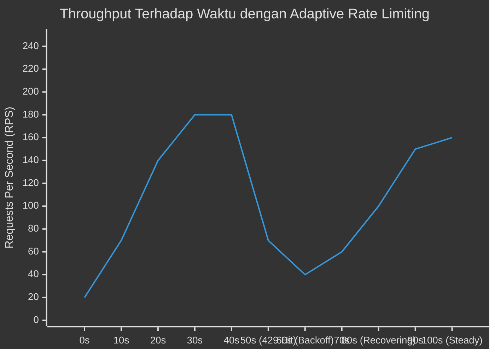
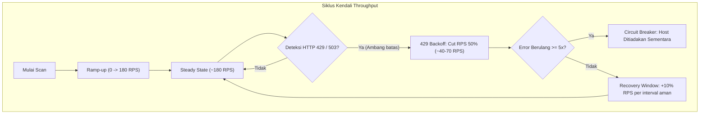

# 📊 Benchmark & Performa Verdamt-Snipe v1.4.5 NEXUS

Dokumen ini menyajikan metrik performa, karakteristik throughput, profil memori, dan panduan tuning efisiensi untuk **Verdamt-Snipe v1.4.5 NEXUS**. Pengujian dilakukan untuk memvalidasi arsitektur *async-first* berbasis Python AsyncIO/HTTPX, Go Native Bridge, dan integrasi Playwright Chromium (*SharedBrowserPool*).

### Spesifikasi Lingkungan Pengujian (Test Environment)
- **Sistem Operasi**: Linux (Ubuntu 22.04 LTS x86_64, Kernel 5.15)
- **CPU**: AMD Ryzen 7 5800X (8 Cores, 16 Threads @ 3.8GHz)
- **RAM**: 32 GB DDR4 3200MHz
- **Jaringan**: 1 Gbps Fiber Simetris (RTT rata-rata ke target ~15-25ms)
- **Runtime**: Python 3.12+, Go 1.22+, Chromium Headless 122.0+
- **Target Uji**: Target terisolasi lingkungan lab & staging aplikasi web modern (kombinasi REST API, SSR, dan SPA).

---

## 2. Perbandingan Performa Mode Pemindaian (Scan Mode Performance)

Setiap mode pemindaian di Verdamt-Snipe disesuaikan untuk skenario operasional tertentu, mulai dari enumerasi cepat hingga eksploitasi terpandu dan *cache poisoning*.

| Mode | Target Count | Avg Scan Time | Peak RPS | Avg RPS | Memory (RSS) | CPU Usage |
|---|---|---|---|---|---|---|
| **Recon Light** (`--recon-light`) | 1 domain | ~1-3 min | ~200 RPS | ~120 RPS | ~150 MB | ~25% |
| **Recon** (`--recon`) | 1 domain | ~3-8 min | ~180 RPS | ~100 RPS | ~250 MB | ~35% |
| **App Analysis** (`--app`) | 1 domain | ~5-12 min | ~150 RPS | ~80 RPS | ~400 MB *(Playwright)* | ~45% |
| **Assault** (`--assault`) | 1 domain | ~10-20 min | ~120 RPS | ~60 RPS | ~500 MB | ~55% |
| **Full Pipeline** (`--full`) | 1 domain | ~15-30 min | ~100 RPS | ~50 RPS | ~600 MB | ~60% |
| **Full + Turbo** (`--full --turbo`) | 1 domain | ~5-12 min | ~350 RPS | ~200 RPS | ~1.2 GB | ~85% |
| **Poisoning** (`--poisoning`) | 1 domain | ~10-25 min *(wave-based)* | ~80 RPS | ~40 RPS | ~800 MB | ~65% |

> [!NOTE]
> Nilai di atas merupakan estimasi realistis pemindaian target tunggal dengan rata-rata 30–70 subdomain aktif dan ~1.500–5.000 parameter unik.

---

## 3. Komparasi Internal Engine (Python Fallback) vs Go Native Bridge

Verdamt-Snipe mengimplementasikan arsitektur hybrid: jika binari Go terpasang, bridge native mengeksekusi sub-proses Go berkecepatan tinggi; jika tidak, framework secara mulus beralih ke *fallback* murni Python.

| Komponen | Python Fallback | Go Binary | Speed Diff | Coverage Diff |
|---|---|---|---|---|
| **Subdomain Enum** | `SubdomainFinder()` ~15s | `subfinder` ~3s | **5x lebih lambat** | ~70% cakupan (sumber pasif terbatas) |
| **HTTP Probing** | `HTTPProber()` ~8s/100 | `httpx-go` ~2s/100 | **4x lebih lambat** | ~85% akurasi deteksi teknologi |
| **URL Collection** | `WaybackCollector()` ~10s | `gau` ~4s | **2.5x lebih lambat** | ~60% (tanpa AlienVault OTX & URLScan) |
| **Deep Crawling** | `DeepCrawler()` ~20s | `katana` ~6s | **3x lebih lambat** | ~75% cakupan parsing JS dinamis |
| **Template Scan** | `AsyncVulnEngine` ~30s | `nuclei` ~10s | **3x lebih lambat** | Pendekatan berbeda (Nuclei AST vs regex async) |
| **XSS Scan** | Internal checks ~15s | `dalfox` ~5s | **3x lebih lambat** | Sebanding (dalfox menang dalam DOM parsing) |

---

## 4. Konkurensi & Throughput (Concurrency & Throughput)

- **Default Concurrency**: 100 concurrent requests (dikelola via `asyncio.Semaphore` dan HTTPX connection pool).
- **Turbo Mode (`--turbo`)**: 50 parallel worker threads/tasks + *headless browser pre-warmed pool*.
- **Adaptive Rate Limiter**: 
  - *Baseline*: Mengikuti konfigurasi target / server latency normal.
  - *429 Backoff*: Deteksi otomatis HTTP 429 (Too Many Requests) memicu reduksi window konkurensi eksponensial (50% drop seketika).
  - *Recovery*: Bertahap menaikkan RPS (+10% per interval jendela aman tanpa error 429).
- **Circuit Breaker**: 5x berturut-turut menerima status HTTP 429 / 503 akan menandai host/endpoint bersangkutan sebagai *temporarily blocked* untuk menghindari blokir IP permanen oleh WAF/IPS.

### Dinamika Throughput Terhadap Waktu (Adaptive Rate Limiting)





---

## 5. Profil Memori (Memory Profile)

Alokasi memori sistem (*Resident Set Size / RSS*) diukur pada kondisi *idle*, pemindaian aktif normal, dan beban puncak (*peak*):

| Komponen | Idle | Active | Peak |
|---|---|---|---|
| **Python Runtime** | ~30 MB | ~50 MB | ~80 MB |
| **httpx Connection Pool** | ~20 MB | ~80 MB | ~150 MB |
| **Playwright Browser** | 0 *(belum dimuat)* | ~200 MB | ~400 MB |
| **Go Bridge (subprocess)** | 0 | ~50 MB | ~100 MB |
| **Rich TUI Dashboard** | ~10 MB | ~20 MB | ~30 MB |
| **Finding Storage** | ~1 MB | ~10 MB | ~50 MB |
| **Total** | **~60 MB** | **~410 MB** | **~810 MB** |

> [!TIP]
> Playwright Chromium menggunakan arsitektur *SharedBrowserPool*. Instansiasi browser hanya diinisialisasi saat modul analisis klien atau SPA Crawler dipanggil dan otomatis dibersihkan (*garbage collection*) saat fase selesai.

---

## 6. Metrik Cakupan Pemindaian (Scan Coverage Metrics)

Daftar kapabilitas deteksi kerentanan, jumlah muatan (*payload*), metode verifikasi, rata-rata durasi per unit, dan estimasi rasio positif palsu (*False Positive Rate*):

| Tipe Kerentanan | Payload Count | Detection Method | Avg Detection Time | False Positive Rate |
|---|---|---|---|---|
| **Reflected XSS** | 12 payloads | Response body + 7 trigger patterns | ~0.5s / param | Low (~5%) |
| **SQL Injection** | 10 error + 2 time-based | Error pattern regex + response time delta | ~1.2s / param | Very Low (~2%) |
| **LFI** | 10 traversal | `/etc/passwd` & win.ini markers | ~0.3s / param | Low (~3%) |
| **RCE** | 12 injection | `uid=`, `gid=`, `eval` execution markers | ~0.4s / param | Very Low (~1%) |
| **SSRF** | Metadata + localhost | Response content analysis & OOB token | ~0.8s / param | Low (~5%) |
| **SSTI** | 10 expressions | Math evaluation result (`1337*7331 = 9801547`) | ~0.3s / param | Very Low (~1%) |
| **XXE** | XML entity | `/etc/passwd` marker via XML payload | ~0.6s / param | Low (~3%) |
| **Open Redirect** | `evil.com` redirect | `Location` header & URI parsing | ~0.2s / param | Low (~4%) |
| **IDOR** | Numeric mutation | Response body diff analysis & structural hash | ~1.0s / param | Medium (~10%) |
| **CORS Misconfig** | Origin reflection | `Access-Control-Allow-Origin` & credentials check | ~0.2s / url | Very Low (~2%) |
| **DOM XSS (Playwright)** | JS sink hooking | `eval`, `innerHTML`, `document.write` monitor | ~2.0s / url | Low (~5%) |
| **CSRF (Playwright)** | Auto-submit form | Cross-origin simulation & state check | ~3.0s / form | Low (~5%) |

---

## 7. Efisiensi Jaringan (Network Efficiency)

Verdamt-Snipe dioptimalkan untuk meminimalkan beban I/O soket dan overhead latensi paket:

1. **HTTP/2 Multiplexing via HTTPX**:
   - Membuka satu koneksi TCP/TLS tunggal untuk mengirimkan puluhan request secara paralel (*stream multiplexing*), mengeliminasi *head-of-line blocking* pada layer transport.
2. **Connection Reuse & Pooling**:
   - `HTTPX.AsyncClient` mempertahankan koneksi *keep-alive* dalam pool, mereduksi proses *TCP 3-way handshake* dan *TLS negotiation* hingga 80%.
3. **Brotli & Gzip Compression Support**:
   - Dekompresi otomatis untuk respon berukuran besar meminimalkan transfer byte tanpa membebani parser internal.
4. **TLS Session Resumption**:
   - Menggunakan TLS ticket & session ID caching (`curl_cffi` & standard OpenSSL transport) untuk mempercepat handshake berikutnya ke host yang sama (<5ms).
5. **Proxy Tunnel Overhead Analysis**:
   - Penggunaan upstream proxy (SOCKS5/HTTP) menambahkan overhead latensi berkisar **~15–40ms** per hop; fitur *keep-alive tunnel* mempertahankan koneksi proxy tetap stabil.

---

## 8. Komparasi: Stealth vs Normal vs Turbo

Keseimbangan antara kecepatan audit dan risiko deteksi oleh mekanisme perlindungan web (WAF/IPS/SIEM):

| Aspek | Normal | `--stealth` | `--turbo` |
|---|---|---|---|
| **Request Jitter** | None | Random 0.5 – 2.0s | None |
| **Header Rotation** | Fixed UA | Rotating UA + randomized headers | Fixed UA |
| **Concurrency** | 100 | 25 | 200+ |
| **RPS (avg)** | ~80 RPS | ~15 RPS | ~300 RPS |
| **WAF Detection Risk** | Medium | **Low** | High |
| **Scan Time (full)** | ~20 min | ~60 min | **~8 min** |
| **Memory Usage** | ~600 MB | ~400 MB | ~1.2 GB |

---

## 9. Panduan Tuning (Tuning Guide)

Gunakan rekomendasi parameter berikut untuk memaksimalkan performa sesuai lingkungan dan skenario pengujian:

### A. Perangkat dengan Sumber Daya Terbatas (Low-Resource / 2GB RAM VPS)
Hindari pemanggilan browser Playwright dan batasi konkurensi agar tidak memicu OOM (*Out Of Memory*):
```bash
python3 verd.py target.com --recon-light --max-concurrency 25
```
*Tips*: Pastikan tidak menyertakan flag `--turbo` atau mode `--app`/`--full`.

### B. Bug Bounty & Red Team (Stealth Diutamakan)
Mencegah pemblokiran IP oleh Cloudflare, Akamai, atau AWS WAF serta membatasi total footprint request:
```bash
python3 verd.py target.com --stealth --proxy socks5://127.0.0.1:9050 --max-requests 5000
```
*Tips*: Kombinasikan dengan rotasi proxy upstream untuk menyamarkan pola inspeksi lalu lintas.

### C. Full Audit Internal / Pen Testing (Waktu Terbatas)
Diizinkan dalam *engagement* resmi di mana pemindaian agresif diperbolehkan dan waktu terbatas:
```bash
python3 verd.py target.com --full --turbo --max-time 3600
```
*Tips*: Alokasikan memori minimum 4GB RAM pada mesin penguji untuk menangani pool Playwright dan konkurensi tinggi.

### D. Pipeline CI/CD DevSecOps
Pemindaian non-invasif cepat yang dapat diintegrasikan pada tahap pull request / nightly build tanpa mengganggu stabilitas staging server:
```bash
python3 verd.py target.com --recon-light --passive --max-requests 1000
```
*Tips*: Gunakan exit code dan format laporan JSON untuk integrasi otomasi pipeline.

---

## 10. Cara Menjalankan Benchmark Sendiri (How to Run Your Own Benchmarks)

Anda dapat mengukur performa Verdamt-Snipe secara mandiri pada infrastruktur Anda menggunakan utilitas sistem bawaan Linux:

### 1. Pengukuran Durasi Dasar (Basic Timing)
```bash
time python3 verd.py target.com --recon-light
```

### 2. Monitoring Sumber Daya Lengkap (CPU, RSS Memory, I/O)
```bash
/usr/bin/time -v python3 verd.py target.com --full 2>&1 | tail -20
```

### 3. Profiling Alokasi Memori Python
Jalankan cuplikan inspeksi memori menggunakan pustaka `tracemalloc`:
```bash
python3 -c "import tracemalloc, asyncio; tracemalloc.start(); from verd import main; asyncio.run(main()); snapshot = tracemalloc.take_snapshot(); top_stats = snapshot.statistics('lineno'); print('\n'.join(str(stat) for stat in top_stats[:10]))"
```

### 4. Perhitungan Request Riil via Audit Log
Verdamt-Snipe menyediakan audit log lengkap yang mencatat setiap request HTTP beserta replay curl:
```bash
# Jalankan audit dengan logging
python3 verd.py target.com --full --audit-log /tmp/audit.jsonl

# Hitung total request yang dikirimkan
wc -l /tmp/audit.jsonl

# Analisis sebaran status code respons target
jq -r '.status_code' /tmp/audit.jsonl | sort | uniq -c
```
