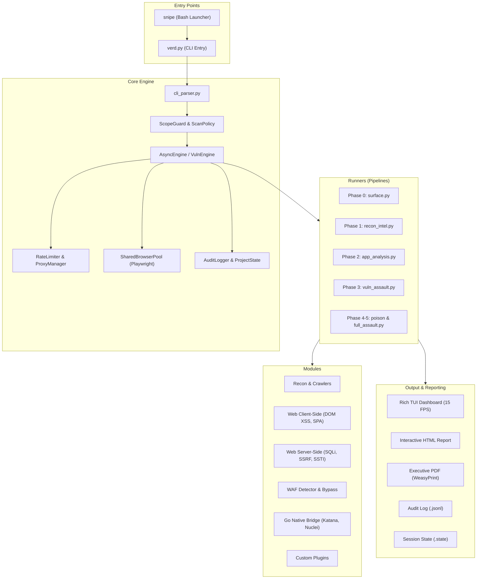
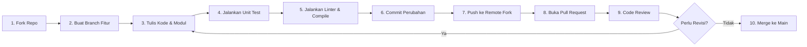

# Contributing to Verdamt-Snipe

Thank you for improving Verdamt-Snipe. This project is for authorized security
assessments, defensive research, and in-scope bug-bounty work only.

## Local setup

Use Python 3.12 or newer, then create an isolated environment and install the
runtime dependencies:

```bash
python3 -m venv .venv
source .venv/bin/activate
python -m pip install --upgrade pip
python -m pip install -r requirements.txt
```

Run the test suite before opening a pull request:

```bash
python -m unittest discover -s tests -v
python -m compileall -q verd.py core modules reports runners tests
```

## Ringkasan Arsitektur (Architecture Overview)

Verdamt-Snipe dirancang menggunakan pendekatan *async-first* modular dengan orkestrasi berbasis Python asyncio, Go native binaries, dan browser automation headless Playwright.



### Struktur Direktori Utama

Untuk membantu kontributor baru memahami letak kode dan navigasi repositori:

| Direktori | Peran & Deskripsi | Kapan Mengubahnya |
| :--- | :--- | :--- |
| `core/` | Mesin inti framework: parser argumen CLI, rate limiter, scope guard, browser pool Playwright, audit log, manajemen sesi, dan state engine. | Mengubah arsitektur dasar, mekanisme koneksi TLS/HTTP, atau sistem logging/state. |
| `modules/` | Modul deteksi kerentanan, crawler, parser, bypass WAF, dan plugin kustom (`web/client_side/`, `web/server_side/`, `waf/`, `custom/`). | Menambahkan deteksi kerentanan baru, teknik payload baru, atau heuristik scanning. |
| `runners/` | Orkestrasi alur pemindaian (pipeline) multi-fase (`surface.py`, `recon_intel.py`, `app_analysis.py`, `vuln_assault.py`, `full_assault.py`, dll). | Menyesuaikan urutan eksekusi fase pengujian, logika mode pemindaian, atau agregasi data antar modul. |
| `reports/` | Generator laporan (`engine.py`, `owasp_mapper.py`, `remediation.py`) untuk format HTML interaktif dan PDF WeasyPrint. | Memperbarui format tampilan laporan, pemetaan OWASP Top 10, atau rekomendasi remediasi. |
| `go/` | Wrapper dan antarmuka biner Go native (subfinder, httpx, katana, nuclei, dalfox, gau). | Menambahkan integrasi tool eksternal baru berbasis Go atau memperbarui parsing outputnya. |
| `tests/` | Rangkaian pengujian unit dan integrasi (22+ berkas pengujian). | Menambahkan test case baru untuk fitur atau regresi yang diperbaiki. |
| `scripts/` | Skrip pendukung otomatisasi dan patch (mis. `patch_ui.py`). | Skrip pemeliharaan lingkungan kerja atau perkakas internal pengembang. |

---

## Alur Kerja Pengembangan (Development Workflow)

Kontributor diharapkan mengikuti siklus kerja kontribusi berikut:




## Changes

- Keep changes focused; do not combine a refactor with an unrelated feature.
- Add or update tests for every behavior change.
- Keep network-facing behavior opt-in and respect the target scope, configured
  rate limits, and authorization boundaries.
- Do not commit credentials, target lists, scan output, or private assessment
  data. The repository's `.gitignore` covers common local artifacts.
- Document new command-line flags, runner modes, or external dependencies in
  `README.md`.

## Pull requests

Describe the problem, the solution, how you tested it, and any operational or
compatibility impact. Maintainers may ask that changes affecting scanning
behavior include a safe local test or mock-based test.

## Standar Kualitas Kode & Pengujian (Code Quality & Testing)

Setiap kontribusi wajib mempertahankan standar stabilitas dan akurasi tinggi karena framework ini beroperasi di lingkungan pengujian keamanan yang sensitif.

### 1. Menjalankan Seluruh Test Suite
Jalankan pengujian unit dan integrasi secara komprehensif sebelum mengajukan PR:

```bash
# Menjalankan seluruh test suite dengan verbose output
python -m unittest discover -s tests -v

# Atau menggunakan pytest jika terpasang
pytest tests/ -v
```

### 2. Menjalankan Berkas Pengujian Tertentu
Untuk mempercepat iterasi pengembangan, Anda dapat menjalankan berkas pengujian spesifik yang relevan dengan modul yang diubah:

```bash
# Uji modul ScopeGuard
python -m unittest tests/test_core.py -v

# Uji parser argumen CLI
python -m unittest tests/test_cli_parser.py -v

# Uji modul browser automation Playwright
python -m unittest tests/test_playwright_suite.py -v

# Uji kebijakan pemindaian dan rate limiter
python -m unittest tests/test_policy.py -v
```

### 3. Verifikasi Kompilasi Kode (Syntax & Compilation Check)
Pastikan tidak ada galat sintaksis di seluruh pohon repositori:

```bash
python -m compileall -q verd.py core modules reports runners tests
```

### 4. Panduan Gaya Penulisan Kode (Code Style Guidelines)
- **Standar PEP 8**: Gunakan indentasi 4 spasi, penamaan modul snake_case, dan nama kelas PascalCase.
- **Type Annotations**: Sertakan *type hinting* (`typing.Dict`, `typing.List`, `typing.Optional`, dll.) pada fungsi baru.
- **Async/Await First**: Hindari pemanggilan I/O blocking (`requests`, `time.sleep()`, file I/O berukuran besar) di dalam event loop asyncio. Gunakan `asyncio.sleep()`, HTTP client asynchronous (`AsyncNetworkEngine`), atau delegasikan ke `asyncio.to_thread()`.
- **Manajemen Logging & UI**: Jangan gunakan `print()` mentah secara sembarangan. Gunakan utilitas UI Rich dari `core.ui` (`ph`, `i`, `s`, `w`, `p`) atau `AuditLogger` agar konsisten dengan Rich TUI Dashboard.
- **Exception Handling**: Tangani exception jaringan (`httpx.RequestError`, `asyncio.TimeoutError`) secara terisolasi tanpa memutus pipeline pemindaian target lainnya.

### 5. Memverifikasi Tidak Ada Regresi (Regression Verification)
- Pastikan perubahan tidak merusak backward compatibility argumen CLI parser (`core/cli_parser.py`).
- Pastikan serialisasi status sesi (`.state` JSON file) tetap valid dan dapat dimuat ulang (*save/resume*).
- Jalankan pemeriksaan statis dengan `python -m unittest tests/test_static_qa.py -v`.

---

## Panduan Pengembangan Modul (Module Development Guide)

### 1. Menambahkan Pemeriksaan Baru ke `AsyncVulnEngine`
Modul `modules/scanners/scanner.py` menangani injeksi dan evaluasi parameter URL berbasis asynchronous.

```python
# Template: Menambahkan check kerentanan ke AsyncVulnEngine
from typing import Optional, Dict
from urllib.parse import urlparse
from runners.shared import inject_query_payload
from core.ui import i, Y, C, N

async def check_custom_vuln(self, url: str, param: str) -> Optional[Dict]:
    """Contoh metode deteksi kerentanan baru (misalnya SSTI / Header Injection)."""
    payloads = ["{{7*7}}", "${7*7}"]
    baseline = await self._send(url)
    baseline_body = baseline.get("body", "")

    for payload in payloads:
        target_url = inject_query_payload(url, param, payload)
        res = await self._send(target_url, timeout=8)
        body = res.get("body", "")

        # Verifikasi respons unik yang tidak ada di baseline
        if "49" in body and "49" not in baseline_body:
            return {
                "type": "ssti",
                "title": "Server-Side Template Injection (SSTI)",
                "url": target_url[:200],
                "param": param,
                "detail": f"Payload '{payload}' dievaluasi menjadi '49'",
                "confidence": "confirmed",
                "status": res.get("status", 0),
            }
    return None
```

### 2. Membuat Modul Playwright Baru di `modules/web/client_side/`
Modul *client-side* memanfaatkan browser headless untuk memverifikasi DOM, interaksi JavaScript, atau kerentanan UI redressing.

```python
# Template: Modul browser client-side (web/client_side/my_inspector.py)
import asyncio
from typing import List, Dict, Any
from urllib.parse import urlparse
from core.ui import ph, i, s, w, R, G, Y, N

try:
    from playwright.async_api import async_playwright
    PLAYWRIGHT_AVAILABLE = True
except ImportError:
    PLAYWRIGHT_AVAILABLE = False


class CustomDOMInspector:
    """Inspeksi kerentanan client-side DOM dengan Playwright headless."""

    def __init__(self, target_url: str):
        self.target_url = target_url
        self.findings: List[Dict[str, Any]] = []

    async def run(self) -> List[Dict[str, Any]]:
        if not PLAYWRIGHT_AVAILABLE:
            w("Playwright tidak terpasang. Melewati inspeksi ini.")
            return []

        ph("CUSTOM DOM INSPECTOR: Memulai audit headless")
        async with async_playwright() as p:
            browser = await p.chromium.launch(headless=True)
            context = await browser.new_context(ignore_https_errors=True)
            page = await context.new_page()

            try:
                await page.goto(self.target_url, wait_until="domcontentloaded", timeout=15000)
                # Evaluasi skrip JavaScript dalam konteks halaman
                result = await page.evaluate("() => window.customSecurityMarker || null")
                if result:
                    self.findings.append({
                        "type": "custom_dom_issue",
                        "title": "Terdeteksi Marker Rentan",
                        "url": self.target_url,
                        "severity": "medium",
                        "evidence": str(result),
                    })
            except Exception as e:
                w(f"Gagal memuat target {self.target_url}: {e}")
            finally:
                await context.close()
                await browser.close()

        return self.findings
```

### 3. Menambahkan Integrasi Biner Go Baru di `core/external_tools.py`
Eksekusi tool Go eksternal dibungkus secara aman melalui *subprocess* dengan isolasi path dan parsing keluaran JSON.

```python
# Template: Menambahkan wrapper binary Go di core/external_tools.py
import json
import shutil
import subprocess
from typing import List, Dict, Optional

def run_custom_go_tool(target: str, timeout: int = 30) -> List[Dict]:
    """Eksekusi wrapper biner Go secara aman dengan pembatasan timeout."""
    binary_path = shutil.which("mygotool")
    if not binary_path:
        return []

    cmd = [
        binary_path,
        "-u", target,
        "-json",
        "-silent"
    ]

    try:
        proc = subprocess.run(
            cmd,
            stdout=subprocess.PIPE,
            stderr=subprocess.PIPE,
            text=True,
            timeout=timeout,
            check=False
        )
        results = []
        for line in proc.stdout.splitlines():
            line = line.strip()
            if line:
                try:
                    results.append(json.loads(line))
                except json.JSONDecodeError:
                    continue
        return results
    except (subprocess.TimeoutExpired, FileNotFoundError, PermissionError):
        return []
```

### 4. Menulis Plugin Kustom di `modules/custom/`
Plugin di direktori `modules/custom/` dideteksi dan dimuat secara otomatis oleh plugin loader (berkas dengan awalan `_` akan dilewati).

```python
# Template: Plugin Kustom (modules/custom/my_header_checker.py)
import asyncio
from typing import List, Dict

class CustomHeaderAuditor:
    """Plugin audit kustom untuk memeriksa header respons keamanan."""

    name = "Custom Security Header Auditor"
    priority = 70  # Prioritas eksekusi (dijalankan setelah fase inti)

    async def run(self, state) -> List[Dict]:
        findings = []
        # Mengambil daftar URL yang telah ditemukan dalam state pemindaian
        for url in list(state.scan_urls)[:15]:
            try:
                res = await state.async_engine.ahttp_send(
                    url, timeout=5, state_context=state.session_manager
                )
                headers = res.get("headers", {})
                if "x-frame-options" not in {k.lower() for k in headers.keys()}:
                    findings.append({
                        "type": "missing_header",
                        "title": "Header X-Frame-Options Tidak Ditemukan",
                        "url": url,
                        "severity": "low",
                        "confidence": "confirmed",
                    })
            except Exception:
                continue

        return findings
```

---

## Panduan Tangkapan Layar & Demo (Screenshot & Demo Guidelines)

Visualisasi membantu pengguna dan maintainer memahami fitur baru serta format keluaran:

1. **Keamanan & Redaksi Data (OPSEC)**:
   - Dilarang keras menyertakan data sensitif, domain klien, kredensial asli, atau URL target nyata dalam screenshot.
   - Gunakan domain dummy atau staging lokal (contoh: `https://example.com`, `http://localhost:8080`, atau target uji internal).
2. **Peralatan yang Direkomendasikan**:
   - **Terminal & TUI Dashboard**: Gunakan [asciinema](https://asciinema.org/) untuk rekaman interaktif sesi terminal atau `agg` untuk mengubah rekaman asciinema menjadi GIF berkualitas tinggi.
   - **Laporan HTML & PDF**: Gunakan alat tangkapan layar browser beresolusi tinggi (misal *full-page screenshot* dari Chromium DevTools).
3. **Penyimpanan Aset Media**:
   - Simpan berkas gambar/GIF dokumentasi di direktori `docs/assets/` atau `assets/`.
   - Optimalkan ukuran file (kompresi gambar PNG/WebP di bawah 1 MB, animasi GIF di bawah 5 MB) agar tidak membebani ukuran clone repositori Git.

