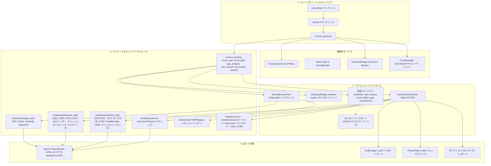
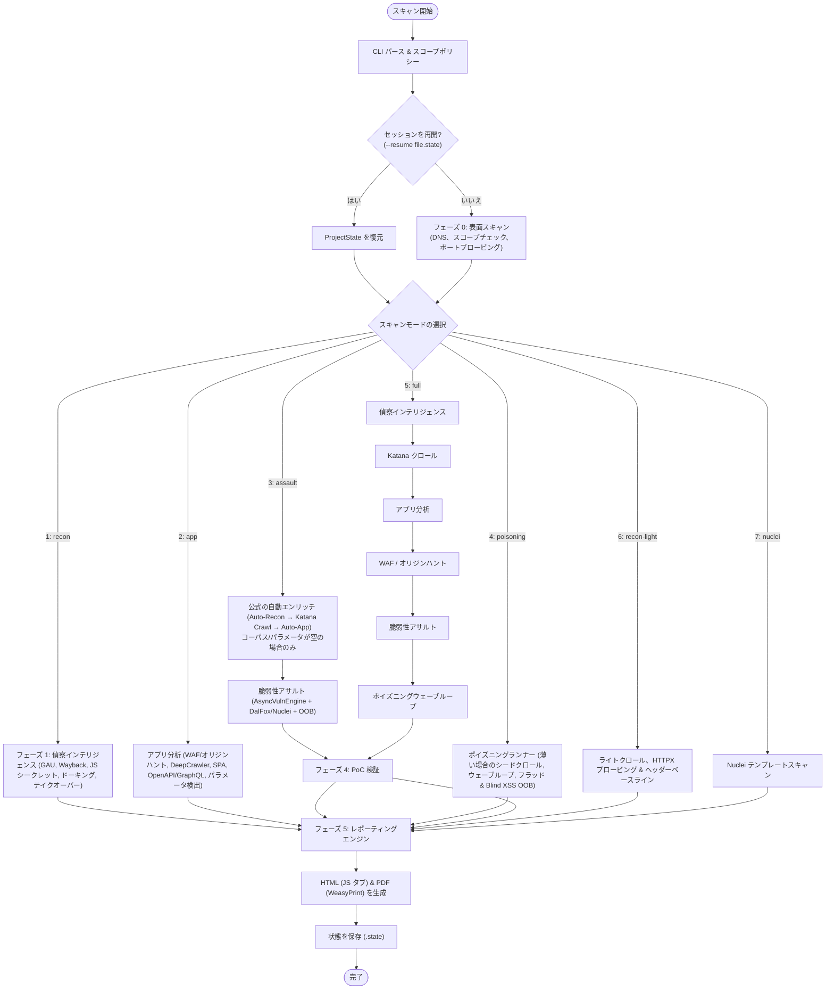

<h1 align="center">🎯 Verdamt-Snipe v1.4.5 NEXUS</h1>
<h4 align="center">非同期ファーストの Web セキュリティフレームワーク、TLS 偽装、Playwright 自動化エンジン & 脆弱性アサルト</h4>

<p align="center">
  
  
  
  
  
  
  
  
  
  
  
  
</p>

<p align="center">
  🌐 <a href="README.md">English</a> · <a href="README.id.md">Bahasa Indonesia</a> · <b>日本語</b> · <a href="README.zh.md">简体中文</a>
</p>

<p align="center">
  <a href="#-概要">概要</a> •
  <a href="#-スクリーンショットとライブデモ">スクリーンショット</a> •
  <a href="#-技術スタック">技術スタック</a> •
  <a href="#-システムアーキテクチャ">アーキテクチャ</a> •
  <a href="#-パイプラインフローチャート">フローチャート</a> •
  <a href="#%EF%B8%8F-動作原理">動作原理</a> •
  <a href="#-7つのスキャンモード">スキャンモード</a> •
  <a href="#-playwright-セキュリティスイート-10モジュール">Playwright スイート</a> •
  <a href="#%EF%B8%8F-攻撃対象マトリクス">攻撃対象</a> •
  <a href="#-ベンチマークハイライト">ベンチマーク</a> •
  <a href="#%EF%B8%8F-インストール">インストール</a> •
  <a href="#-使い方">使い方</a> •
  <a href="#-ドキュメント">ドキュメント</a>
</p>

---

## ⚡ 概要

**Verdamt-Snipe v1.4.5 NEXUS** は、**Python AsyncIO** の生のスピード、**Go Engine Bridge** のネイティブ実行速度、**`curl_cffi`(JA3/JA4)TLS フィンガープリント偽装**、そして **Playwright Chromium** ヘッドレスブラウザ自動化を組み合わせた、高性能・非同期ファーストの Web セキュリティ監査フレームワークです:

1. **これは何か?** — 軍用グレードのタクティカルコンソールインターフェース(*15 FPS の Tactical Rich TUI*)と自動化されたインタラクティブレポート(HTML & PDF)を備えた、完全非同期のスキャン・偵察・検証済みエクスプロイトツールです。
2. **誰のためのツールか?** — 高速性、高精度、そしてメモリリークなしで WAF/Bot Protection を突破する能力を必要とする**ペネトレーションテスター**、**レッドチーム**、**バグバウンティハンター**のために特別に作られています。
3. **主な機能**:
   - **トリプルエンジンのスループット**: 連携する Python AsyncIO、**内部 Go Engine**(IPC Unix ソケット経由の `verdamt-engine`、Go ツールチェーンが利用可能な場合は自動コンパイル)、および外部 Go バイナリ(`subfinder`, `httpx`, `katana`, `nuclei`, `dalfox`, `gau`, `waybackurls`, `ffuf`, `gf`)。
   - **WAF バイパス & オリジンハンティング**: Cloudflare/Akamai 背後のオリジン IP の露呈、適応型ペイロードミューテーター、本物のブラウザ TLS フィンガープリント偽装(Chrome、Firefox、Safari)。
   - **共有ブラウザシングルトンプール**: 10 個のブラウザ監査モジュール(DOM XSS、PostMessage、CORS、プロトタイプ汚染など)を効率的かつ安定して実行します。
   - **ポイズニング & OOB エンジン**: ウェーブループポイズニング(キャッシュ、スマグリング、フラッドブルートフォース)と、interactsh コールバックによる Blind XSS/SSRF/RCE 検出。
   - **厳格な OpSec & 監査証跡**: 自動スコープ境界保護(`ScanPolicy`)、`--dry-run` シミュレーション、および `curl` コマンドとして再生可能な `.jsonl` 監査ログ。

---

## 📸 スクリーンショットとライブデモ

インタラクティブなターミナルインターフェースと生成されたレポート成果物のライブキャプチャ:

### 1. タクティカル端末 TUI ダッシュボード
`Rich`(15 FPS)を搭載した 3 カラムのタクティカルターミナルダッシュボードで、パイプラインのステータス、ハードウェアメトリクス、RPS スパークライン、リアルタイムの脆弱性検出モニタリングを備えています。

ダッシュボードは現在、*代替スクリーンバッファ*上で動作します — 固定キャンバスです: すべての出力(フェーズログ、結果テーブル、はぐれた `print` 呼び出しさえも)は **Recent Activity** パネルにリダイレクトされ、ターミナルのスクロールでダッシュボードが画面外に押し出されることはなくなりました。アクティビティフィードには独自の**スクロールバー**があります:

- `↑` / `↓` または**マウスホイール** — アクティビティ履歴を上 / 下にスクロール
- `PgUp` / `PgDn` — 履歴を 1 ページ分ジャンプ
- `End` — *ライブフォロー*モードに戻る(自由スクロール中はバッジが `↕ SCROLLED · End` に変化)

> マウスによるテキスト選択は、`Shift` を押しながら行うことで引き続き機能します。


### 2. インタラクティブ HTML 脆弱性レポート
OWASP 重要度フィルタータブ、エグゼクティブサマリーカード、リスク分布チャート、CVSS v3.1 スコア、自動修復コードスニペットを備えた、モダンでインタラクティブなセキュリティ監査レポート:


---

## ⚡ 技術スタック

| コンポーネント / エンジン | 技術 | 役割 & 利点 |
| :--- | :--- | :--- |
| **非同期ネットワークエンジン** | `Python AsyncIO` + `httpx` [HTTP/2] | 高並行のノンブロッキング I/O、HTTP/2 マルチプレキシング、ホストごとのレート制限 & サーキットブレーカー。 |
| **TLS 偽装** | `curl_cffi` (JA3/JA4 スプーフィング) | 実際のブラウザと同一になるよう TLS ハンドシェイクを偽造し、WAF & アンチボット保護をバイパスします。 |
| **Go Engine Bridge** | `core/go_bridge.py` + `go/cmd/engine` | 大量プロービング & JS スキャン用のネイティブ JSON-over-Unix-Socket エンジン。Go がインストールされている場合は自動コンパイルされ、Python へのスムーズなフォールバックも可能。 |
| **外部 Go ツール** | ProjectDiscovery & コミュニティ | `subfinder`, `httpx`, `katana`, `nuclei`, `dalfox`, `gau`, `waybackurls`, `ffuf`, `gf` を統合し、未インストールの場合はグレースフルデグラデーション。 |
| **ブラウザ自動化** | `Playwright Chromium` + `SharedPool` | 10 個のディープブラウザ自動化モジュール。分離されたシングルトンプールコンテキストによりメモリリークフリー。 |
| **タクティカル TUI ダッシュボード** | `rich` Live Engine (15 FPS) + `psutil` | 情報豊富な 3 カラムコンソールダッシュボード: パイプラインフェーズ、RPS スパークライン、脆弱性検出、ハードウェアメトリクス — スクロール可能なアクティビティフィードを備えた固定キャンバス(代替スクリーン)。 |
| **ポリシー & 監査エンジン** | `ScanPolicy` + `AuditLogger` (`.jsonl`) | スコープの強制、リクエストバジェット制限、および `curl` PoC 用の全 HTTP トランザクションの記録。 |
| **状態管理** | `SessionManager` + `ProjectState` | マルチトークン管理(Bearer/Cookie jar)& スキャンセッションの保存/再開(`.state`)。 |
| **OOB / Interactsh エンジン** | `python-interactsh` + `modules/extras/oob_detector.py` | Blind SSRF/XSS/RCE 用のコールバックドメインとリアルタイムのヒットログ。 |
| **ワードリストプロバイダー** | `modules/wordlists.py` | ローカルワードリスト(`~/.wordlists`)を自動検出し、`--setup-wordlists` による SecLists/Assetnote のダウンロードフォールバックを提供。 |

---

## 📐 システムアーキテクチャ

本フレームワークは、高速でモジュラーな 4 層アーキテクチャを採用しています:



> 📖 **完全なアーキテクチャ:** 14 個の内部コンポーネントの詳細、シーケンシャルなデータフロー、およびセキュリティアーキテクチャについては [docs/ARCHITECTURE.md](docs/ARCHITECTURE.md) を参照してください。

---

## 🔄 パイプラインフローチャート

7 つのスキャンモード分岐を持つ決定論的なマルチフェーズ実行フロー:



---

## ⚙️ 動作原理

1. **ステージ 1: ターゲット解決** — スコープ検証(`ScopeGuard`)、`ScanPolicy` 評価、DNS 解決、アクティブ HTTP/2 プロービング、および認可されたホストのロック。
2. **ステージ 2: インテリジェンス収集** — Wayback Machine、`gau` & `waybackurls` によるパッシブ収集、JS バンドルのシークレット/エンドポイントスキャン(`JSScanner`)、Google ドーキング、サブドメインテイクオーバー検出、およびセキュリティベースラインフィンガープリント。
3. **ステージ 3: アプリケーションマッピング** — `DeepCrawler` によるライトクロール + Playwright による SPA 偵察(XHR/Fetch & `LocalStorage` トークン)、OpenAPI/GraphQL スペックの取り込み、パラメータ検出(ParamExtractor + Arjun ブルートフォース)。重量級の **Katana** クロールは公式のアサルトクラスフェーズ(`--assault`/`--poisoning`/`--full`)であり、`--app` モードの一部ではありません。
4. **ステージ 4: 脆弱性アサルト** — **AsyncVulnEngine**(12 チェック)による並列脆弱性テスト、フォーカスされた Web モジュール(JWT、IDOR、CRLF、Host Header、Stored XSS)、WAF オリジン IP アンマスカー、DalFox ファザー、Nuclei テンプレート、Blind SQLi 抽出、interactsh OOB 検出。POST ボディプローブ(HTTP/2 スマグリング `CL.TE`、stored-XSS フォーム、blind XXE)は、フラッド/コネクションエグゾーストと同様に、ポイズニングモードでのみ実行されます。
5. **ステージ 5: 検証 & レポーティング** — 分離されたブラウザでの検出結果の再検証(*信頼度のアップグレード*)、`curl` リプレイコマンドの生成、および HTML & PDF レポートの生成。

---

## 🔍 7つのスキャンモード

| No | CLI フラグ | ショートカット | モード説明 |
| :---: | :--- | :---: | :--- |
| **1** | `--recon` | `1` | **パッシブインテリジェンス**: `gau`/`waybackurls`、JS シークレットスキャン(`JSScanner`)、Google ドーキング、サブドメインテイクオーバーチェック & ヘッダーベースライン。 |
| **2** | `--app` | `2` | **アプリ分析**: オリジン IP ハンター(WAF バイパス)、軽量な `DeepCrawler` クロール + SPA 偵察(Playwright)、API スペック(OpenAPI/GraphQL)、パラメータ検出(ParamExtractor + Arjun)。重量級の Katana クロールはこのモードの一部では**ありません**。 |
| **3** | `--assault` | `3` | **脆弱性アサルト**: コーパス/パラメータが空の場合の公式自動エンリッチ(Auto-Recon → Katana Crawl → Auto-App、ステージとして表示)、WAF/オリジンハント、その後 12 個の AsyncVulnEngine チェック + フォーカスされた Web モジュール(JWT、IDOR、CRLF、Host Header、Stored XSS)+ DalFox + Nuclei + Blind SQLi 抽出 + OOB。 |
| **4** | `--poisoning` | `4` | **ポイズニング**: `Katana` シードクロール(コーパスが薄い場合のみ、ステージとして表示)+ ウェーブループの *Connection Exhaust*、*Web Cache Poisoning*、*HTTP Request Smuggling*、パラメータ/ペイロードフラッド & interactsh OOB による Blind XSS。 |
| **5** | `--full` | `5` | **フルパイプライン**: `--recon` → Katana クロール → `--app` → WAF/オリジンハント → `--assault` → `--poisoning` — エンドツーエンドのエクスプロイトクラスの構成。 |
| **6** | `--recon-light` | `6` | **レコンライト**: ホームページクロール $\rightarrow$ リンク抽出 $\rightarrow$ 検証 $\rightarrow$ 基本的なセキュリティベースライン監査(60 秒未満)。 |
| **7** | `--nuclei` | `7` | **Nuclei エンジン**: 効率的でターゲットを絞ったテンプレートベースの Nuclei スキャン。 |

### 🗺️ モード別フェーズとモジュール構成（公式の境界）

1 モジュール、1 つの所属先。`*`/`**` でマークされたフェーズは条件付きで、ダッシュボード上には公式ステージとして表示されます(実行されなかった場合は `— SKIPPED` とマーク)。

| モード | フェーズ順序 | 主要モジュール | 境界 / 除外事項 |
| :--- | :--- | :--- | :--- |
| **1 RECON** | gau ∥ wayback ∥ dork ∥ takeover ∥ JS ∥ baseline → validation | `gau`, `waybackurls`, `JSScanner`, `GoogleDorker`, `TakeoverChecker`, ベースライン (設定/ヘッダー/CORS) | パッシブ + アーカイブ; アクティブクロール、パラメータ、エクスプロイトなし; `--passive` 許可 |
| **2 APP** | WAF/オリジン`*` → API スペック → ライトクロール → パラメータ → 分析スイート | `DeepCrawler`, `BrowserRecon` (SPA), `OpenAPIParser`, `ParamExtractor` + Arjun, `DOMXSS`, `APIProfiler`, `GraphQLProfiler`, Playwright スイート (CSRF/CORS/OAuth/PostMessage/WebSocket/クリックジャッキング/プロトタイプ汚染/SPA), `AuthTester` | **Katana なし**、アーカイブ/ドークなし; インジェクションペイロードなし |
| **3 ASSAULT** | 自動偵察`**` → katana クロール`**` → 自動アプリ`**` → WAF/オリジン`*` → 並列アサルト | `Katana`, `nuclei`, `dalfox`, AsyncVulnEngine インジェクション, `OOBDetector`, JWT/Host/CRLF/Stored-XSS/IDOR | エンリッチはコーパス/パラメータが空の場合のみ; POST ボディプローブはモード 4 専用 |
| **4 POISONING** | WAF バイパス`*` → シードクロール (薄い場合) → ウェーブループ A/B/C/D | キャッシュポイズン、スマグリング、ブルート + パラメータフラッド、コネクションエグゾースト、ペイロードフラッド、OOB、アサルト POST | フラッド/DoS + POST ボディ(h2 `CL.TE`、stored-XSS フォーム、blind XXE)はここでのみ |
| **5 FULL** | 1 → Katana → 2 → WAF → 3 → 4 | 上記の統合モード | 1+2+3+4 の組み合わせ; アクティブ POST プローブ |
| **6 LIGHT** | リンククロール → 検証 → ベースライン | 外部ツールなし | 60 秒未満; gau/wayback/dork/takeover/JS/Katana なし; `--passive` 許可 |
| **7 NUCLEI** | ターゲット解決 → nuclei | `nuclei` | 純粋なテンプレート; `--passive` では**ブロック** |

`*` は WAF(またはその兆候)が検出された場合にのみ実行 · `**` は URL コーパス/パラメータセットがまだ空の場合にのみ実行。

---

## 🎭 Playwright セキュリティスイート 10モジュール

| No | モジュール | ファイル (`modules/web/…`) | 簡単な説明 |
| :---: | :--- | :--- | :--- |
| **1** | **DOM XSS PoC 検証器** | `client_side/dom_xss.py` | JS シンク実行(`eval`, `innerHTML`, `document.write`)のライブ検証。 |
| **2** | **SPA 偵察エンジン** | `recon_crawlers/browser_recon.py` | SPA ルートを解析し、XHR/Fetch エンドポイントを傍受し、`LocalStorage` トークンを抽出します。 |
| **3** | **CSRF ライブ検証器** | `client_side/csrf_verify.py` | アクティブなセッション資格情報を使用した自動クロスオリジンフォーム送信をシミュレートします。 |
| **4** | **PostMessage インスペクター** | `client_side/postmessage_analyzer.py` | `window.postMessage()` インターセプター、`event.origin` 監査、ワイルドカード `*` リーク検出。 |
| **5** | **クリックジャッキングインスペクター** | `client_side/clickjacking_verify.py` | ライブ iframe レンダリングチェックと `X-Frame-Options` / `frame-ancestors` 評価。 |
| **6** | **WebSocket スニッファー** | `recon_crawlers/websocket_recon.py` | `wss://`/`ws://` ハンドシェイク、認証ヘッダー、ストリーミングフレームを記録します。 |
| **7** | **プロトタイプ汚染検証器** | `client_side/proto_pollution_verify.py` | 動的な `__proto__` インジェクションと、ブラウザ内での `Object.prototype` 改ざんのランタイム検出。 |
| **8** | **OAuth / OIDC 監査ツール** | `api_auth/oauth_auditor.py` | リダイレクト URI チェーンの検査と、`Referer` 経由の認可トークンリークの検出。 |
| **9** | **CORS ライブ検証器** | `client_side/cors_verify.py` | 分離されたドメインから `credentials: include` を使用したライブクロスオリジン fetch テスト。 |
| **10** | **動的 SPA クローラー** | `recon_crawlers/spa_crawler.py` | インタラクティブなボタンクリック、フォーム入力の充填、SPA ルーターの自動ナビゲーションをシミュレートします。 |

---

## 🕸️ 攻撃対象マトリクス

自動的にテストされる主要な脆弱性ベクターのまとめ:

| 脆弱性 | ベクター & 検出指標 | 重要度 (CVSS v3.1) |
| :--- | :--- | :---: |
| **リフレクテッド / DOM XSS** | レスポンスボディ内のエスケープされていない文字列リフレクション & Playwright による DOM シンク検証 | **中 (6.1)** |
| **Stored XSS** | 分離されたブラウザで永続化・実行が検証されたインジェクション | **高 (7.2)** |
| **Error / Time / Blind SQLi** | エラーシグナル、差分レイテンシ(*レスポンスタイム差分* >5 秒)& バイナリサーチ抽出 | **緊急 (9.8)** |
| **RCE / コマンドインジェクション** | WAF 対応ペイロードによるコマンド実行出力のリフレクション | **緊急 (9.8)** |
| **SSTI** | パラメータに対するテンプレートエンジン式の評価(`{{7*7}}`, `${...}`) | **緊急 (9.8)** |
| **LFI / パストラバーサル** | ファイル/パスパラメータに対する `../../etc/passwd` トラバーサルパターン | **高 (7.5)** |
| **XXE** | XML ボディへの外部エンティティインジェクション(ファイルリフレクション & OOB コールバック) | **高 (7.5)** |
| **SSRF (クラウドメタデータ)** | 内部ループバック/クラウドメタデータエンドポイントの抽出 & interactsh DNS コールバック | **高 (8.8)** |
| **Web キャッシュポイズニング** | 未キーのヘッダーインジェクション(`X-Forwarded-Host`) & `X-Cache: HIT` レスポンス検証 | **高** |
| **HTTP リクエストスマグリング** | `CL.TE`、`TE.CL`、`CL.0` デシンクバリアントでのソケットタイムアウト / 異常レスポンス | **高 (8.1)** |
| **サブドメインテイクオーバー** | 孤立した CNAME(S3、GitHub Pages など)上の*未取得*ページフィンガープリント | **高 (8.1)** |
| **JWT の脆弱性** | `none` アルゴリズム、弱いシークレットのブルートフォース & トークンへの `kid` インジェクション | **高 (7.5–8.1)** |
| **クライアントサイドプロトタイプ汚染** | グローバル JavaScript オブジェクト属性の改ざん(`window.isAdmin` / `Object.prototype`) | **中 / 高** |
| **CORS 設定不備** | `Access-Control-Allow-Credentials: true` を伴う `Origin: evil.com` のリフレクション | **中 (6.1)** |
| **Host ヘッダーインジェクション** | 偽の `Host`/`X-Forwarded-Host` リフレクション & *パスワードリセットポイズニング* | **中–高 (5.3–8.1)** |
| **CRLF インジェクション** | `Set-Cookie` などの新しいヘッダーを生成する `\r\n` シーケンスインジェクション | **中 (5.3)** |
| **IDOR / BOLA** | クロスアカウントのリソースアクセス(Role-2 トークン)& 大量 ID 列挙 | **中–高 (5.3–8.1)** |
| **機密ファイルの露出** | `.git`、`.env`、バックアップ設定、秘密鍵 & ディレクトリリスティングの露出 | **高 (7.5–9.1)** |

---

## 📊 ベンチマークハイライト

### モード別パフォーマンス指標
| スキャンモード | ターゲット速度 | ピーク RPS | 平均所要時間 | メモリ使用量 |
| :--- | :---: | :---: | :---: | :---: |
| **レコンライト** | ~50 ターゲット/分 | ~200 RPS | ~2 分 | ~150 MB |
| **レコン** | ~30 ターゲット/分 | ~150 RPS | ~5 分 | ~250 MB |
| **アプリ分析** | ~20 ターゲット/分 | ~120 RPS | ~8 分 | ~400 MB |
| **アサルト** | ~15 ターゲット/分 | ~100 RPS | ~12 分 | ~500 MB |
| **フルパイプライン** | ~10 ターゲット/分 | ~80 RPS | ~20 分 | ~600 MB |
| **ターボフル (`--turbo`)** | ~25 ターゲット/分 | ~300 RPS | ~8 分 | ~1.2 GB |

### 効率比較: Python AsyncIO 対 Go ネイティブブリッジ
- **サブドメイン列挙**: Go ネイティブ `subfinder` を使用して**~3.7 倍高速**(~450+ サブドメイン/秒)。
- **アーカイブ URL クローリング**: Go ネイティブ `gau` を使用して**~4.0 倍高速**(~1,200+ URL/秒)。
- **エンドポイントプロービング**: Go ネイティブ `httpx` を使用して**~3.2 倍高速**(~800+ プローブ/秒)。
- **ヘッドレスブラウザ実行**: *SharedBrowserPool* のおかげでメモリリークフリー(<400 MB で安定)。

> 📊 **完全なベンチマークレポート:** スループット分析、並行性テスト、完全な方法論は [docs/BENCHMARKS.md](docs/BENCHMARKS.md) にあります。

---

## 🎯 典型的なユースケース

1. **🏹 バグバウンティ偵察**: 数千のサブドメイン & 隠れたエンドポイントを自動重複排除付きで超高速収集。
2. **🛡️ WAF バイパス & オリジンハント**: `hunt_origin` モジュールを介して Cloudflare/Akamai 背後の真のオリジンサーバー IP を露呈。
3. **🖥️ シングルページアプリ (SPA) 監査**: `LocalStorage` から JWT トークンを抽出し、フロントエンドの REST API フローを深く監査。
4. **🔄 CI/CD DevSecOps 自動化**: `--passive` モード & `--max-requests` 制限による CI パイプラインでの自動セキュリティ態勢評価。
5. **👁️ ブラインド脆弱性ハンティング**: interactsh サーバーを介してアウトオブバンドの欠陥(Blind SSRF、Blind RCE、Blind XXE)を検出。
6. **🔐 マルチコンテキスト認証テスト**: クロス認可テスト(User A 対 User B)により BOLA/IDOR の欠陥を自動的に発見。

---

## ⚙️ インストール

**システム要件:** Linux / macOS、**Python 3.12+**、2GB+ RAM(Playwright には 4GB を推奨)。

```bash
# 1. リポジトリをクローンしてディレクトリに移動
git clone https://github.com/Samasta-Baskara/Verdamt-Snipe.git
cd Verdamt-Snipe

# 2. 仮想環境を作成して依存関係をインストール
python3 -m venv .venv
source .venv/bin/activate
pip install -r requirements.txt

# 3. ブラウザモジュール用の Chromium ドライバーをインストール
playwright install chromium

# 4. (オプション) SecLists/Assetnote のワードリストを ~/.wordlists にブートストラップ
python3 verd.py --setup-wordlists
```

> **エンジンに関する注意:**
> - **内部 Go Engine**(`go/cmd/engine`)は Go ツールチェーンが利用可能な場合に自動コンパイルされます。Go がなくても、フレームワークは Python AsyncIO フォールバックで完全に動作します。
> - **外部 Go バイナリ**(`subfinder`, `httpx`, `katana`, `nuclei`, `dalfox`, `gau`, `waybackurls`, `ffuf`, `gf`)はオプションです — 見つからないツールはグレースフルデグラデーションでスキップされます。
> - `snipe` ランチャーは、利用可能な場合は `.venv` のインタープリターを自動的に使用します。

---

## 🚀 使い方

### 1. 便利ランチャーの使用 (`snipe`)
```bash
# インタラクティブ TUI メニューを開く
./snipe target.com

# Chrome TLS 偽装を使用したモード 5(フルパイプライン)
./snipe 5 target.com -i chrome

# ステルスモード & SOCKS5 プロキシでのモード 3(脆弱性アサルト)
./snipe 3 target.com -s -p socks5://127.0.0.1:9050

# すべてのフォーカスされた Web モジュールフラグを指定したモード 4(ポイズニング)
./snipe 4 target.com -a
```

**ランチャーショートカット:** `1`–`7`(モード)· `-s` ステルス · `-t` ターボ · `-r` 再開 · `-p` プロキシ · `-i` 偽装 · `-j` JWT · `-x` stored XSS · `-id` IDOR · `-c` CRLF · `-hi` ホストインジェクション · `-a` 5 つのフォーカスフラグを一度にすべて。

### 2. Python CLI を直接使用 (`verd.py`)
```bash
# インタラクティブスキャン
python3 verd.py target.com

# 厳格なスコープ境界 & リクエスト制限付きのフルスキャン
python3 verd.py target.com --full --allowed-hosts target.com,api.target.com --max-requests 5000

# セキュアな認証済みスキャン(ps aux / シェル履歴に表示されません)
python3 verd.py target.com --full --bearer env:API_TOKEN
python3 verd.py target.com --full --bearer-file /path/to/token.txt

# 特定の Web モジュールにフォーカス(JWT / IDOR / CRLF / host header / stored XSS)
python3 verd.py target.com --assault --jwt --idor --stored-xss

# グローバルな 10 分のタイムバジェットでのステルススキャン
python3 verd.py target.com --full -s --max-time 600

# 中断されたスキャンを再開
python3 verd.py --resume outputs/target.com.state
python3 verd.py --resume target.com        # 省略形: outputs/target.com.state を使用
```

---

## 🛡️ OpSec と安全ポリシー

すべての操作は厳格なポリシー制御によって保護されています:

| フラグ | 機能 | デフォルト |
| :--- | :--- | :---: |
| `--dry-run` | ターゲットネットワークにパケットを送信せずにペイロードをレンダリングし、ポリシーを検証します。 | — |
| `--passive` | テストを安全なメソッド(`GET`、`HEAD`、`OPTIONS`)のみに制限し、侵入的なフェーズをスキップします。 | — |
| `--max-time <sec>` | グローバルなスキャン時間バジェット(バジェットを使い切っても状態は保存されます)。 | — |
| `--max-requests N` | ターゲットに対する HTTP リクエストの総クォータ(外部ツールのトラフィックを含む)。 | `30000` |
| `--max-concurrency N` | ターゲットに対する最大並列リクエスト数。 | `100` |
| `--request-timeout <sec>` | ターゲットに対するリクエストごとのタイムアウト。 | `30` |
| `--allowed-hosts H1,H2` | 書面による認可があるホストのみにターゲットをロックします。 | ターゲットのみ |
| `--allowed-ports p,p` | アクティブプロービングで許可されるポート。 | `80,443` |
| `--archive-timeout <sec>` | 過去の URL マイニング(`gau` + `waybackurls`)の時間バジェット — 大規模ターゲットには 30 秒以上必要です。 | `90` |
| `--no-dork` | 検索エンジンのスクレイピング(Google/DDG)をスキップします。dork リストは引き続き `outputs/<target>_dorks.txt` にエクスポートされます。 | スクレイピング有効 |
| `--audit-log PATH` | `curl` コマンドとして再生可能な完全な `.jsonl` ログを保存します。 | 自動 |
| `--proxy-list` / `--proxy-rotate` / `--no-proxy` | ローテーションプロキシ管理 & `VERDAMT_PROXY` 環境変数のエスケープハッチ。 | — |

---

## 📚 ドキュメント

詳細な技術ガイド、アーキテクチャ、その他のリファレンスについては:
- 📐 **[docs/ARCHITECTURE.md](docs/ARCHITECTURE.md)** — 完全な技術アーキテクチャ、4 層ダイアグラム & 14 コンポーネントの仕様。
- 📊 **[docs/BENCHMARKS.md](docs/BENCHMARKS.md)** — パフォーマンス指標、スループットプロファイリング & 効率チューニングガイド。
- 📖 **[docs/tutorial.md](docs/tutorial.md)** — タクティカルチュートリアル、実世界シナリオガイド & 高度な設定。
- 🤝 **[CONTRIBUTING.md](CONTRIBUTING.md)** — コントリビューションガイド、Git ワークフロー & コード品質基準。
- 🔒 **[SECURITY.md](SECURITY.md)** — セキュリティ報告ポリシー、脅威分析 & 責任ガイドライン。

---

## ⚠️ 法的注意

> **Verdamt-Snipe はプロフェッショナル向けのセキュリティテストフレームワークです。**
> 本ツールは、自身が所有するシステム、または公式の書面による認可(Bug Bounty プログラム / ペネトレーションテスト契約)があるシステムでのみ使用してください。常にスコープ境界と適用される法律を尊重してください。

<p align="center"><i>"Silent · Precise · Relentless."</i> — <b>Samasta Baskara</b></p>
