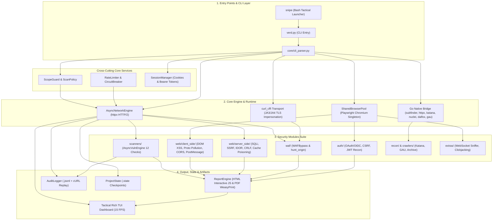
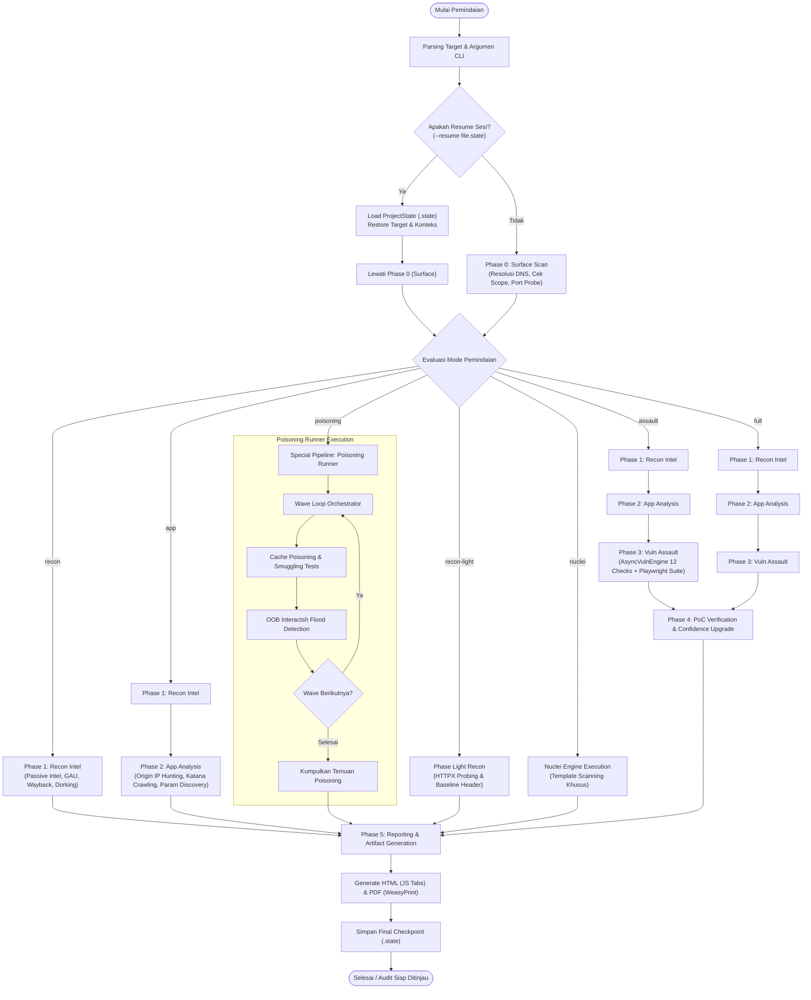

<h1 align="center">🎯 Verdamt-Snipe v1.4.5 NEXUS</h1>
<h4 align="center">Framework Keamanan Web Async-First, TLS Impersonation, Playwright Automation Engine & Vulnerability Assault</h4>

<p align="center">
  
  
  
  
  
</p>

<p align="center">
  <a href="#-screenshots--demo">Screenshots</a> •
  <a href="#-ringkasan-cepat">Ringkasan</a> •
  <a href="#-teknologi--tenaga-penggerak">Teknologi</a> •
  <a href="#-architecture-diagram">Arsitektur</a> •
  <a href="#-pipeline-flowchart">Flowchart</a> •
  <a href="#-how-it-works">Cara Kerja</a> •
  <a href="#-kelebihan--kekurangan">Kelebihan & Kekurangan</a> •
  <a href="#-benchmark-results">Benchmark</a> •
  <a href="#-typical-use-cases">Use Cases</a> •
  <a href="#-attack-surface-examples">Attack Surface</a> •
  <a href="#-real-world-scenarios">Skenario Nyata</a> •
  <a href="#-7-mode-pemindaian">Mode Pemindaian</a> •
  <a href="#-playwright-security-suite-10-modul">Playwright Suite</a> •
  <a href="#%EF%B8%8F-cara-install">Instalasi</a> •
  <a href="#-cara-penggunaan">Cara Pakai</a> •
  <a href="#-opsec--audit">OpSec & Audit</a>
</p>

---

## 📸 Screenshots & Demo

Visualisasi antarmuka terminal interaktif dan artefak laporan yang dihasilkan oleh Verdamt-Snipe:

| Elemen Visual | Format & Deskripsi | Tampilan / Referensi |
| :--- | :--- | :--- |
| **Tactical TUI Dashboard** | Dasbor terminal interaktif Rich (15 FPS), 3 kolom: status pipeline, sparkline RPS, temuan berdasar severitas, dan metrik hardware. | `[](https://asciinema.org)`<br>*(Live terminal preview dengan sparklines & status phase)* |
| **Interactive HTML Report** | Laporan audit interaktif dengan tab navigasi berbasis JavaScript, filter keparahan OWASP, serta curl PoC generator. | `📄 outputs/report_target.com.html`<br>*(Tab Interaktif: Summary, Findings, OWASP Top 10, Remediasi)* |
| **Pipeline Scan Progress** | Status transisi otomatis antar fase 0 hingga 5 dengan visualisasi pencatatan status live di konsol. | `[Phase 0: Surface] ➔ [Phase 1: Intel] ➔ [Phase 2: App] ➔ [Phase 3: Assault] ➔ [Phase 4-5: Verify/Report]` |

> [!NOTE]
> Lihat demo lengkap di [Demo Video](#-demo--tangkapan-layar) atau jalankan `./snipe target.com` untuk melihat TUI secara live.

---

## 🎯 Ringkasan Cepat

**Verdamt-Snipe** adalah framework audit keamanan web modern berkinerja tinggi yang menggabungkan kecepatan **Python AsyncIO**, jembatan **Go Native Bridge**, penyamaran **TLS Fingerprint (`curl_cffi`)**, serta otomasi browser kedalaman tinggi **Playwright Chromium**:

1. **Apa ini?** — Tools pemindaian, rekognisi, dan verifikasi kerentanan web otomatis serba async dengan dasbor konsol taktis militer (TUI real-time).
2. **Untuk apa?** — Digunakan oleh Penetration Tester dan Bug Bounty Hunter profesional untuk menemukan celah keamanan, meng-hunt *Origin IP* di balik WAF, memvalidasi PoC (Proof-of-Concept) live di browser, serta mengekstrak data *Blind SQLi*.
3. **Mengapa cepat & aman?** — Menggunakan arsitektur dual-engine (Python Async + Go Native), **Shared Browser Singleton Pool** (bebas memory leak), proteksi cakupan otomatis (`ScanPolicy`), mode `--dry-run`, serta logging audit `.jsonl` yang mendukung generasi replay `curl`.

---

## ⚡ Teknologi & Tenaga Penggerak

Verdamt-Snipe ditenagai oleh kombinasi teknologi modern yang dirancang untuk performa dan akurasi pengujian:

| Komponen / Engine | Teknologi yang Digunakan | Peran & Keunggulan |
| :--- | :--- | :--- |
| **Async Network Engine** | `Python AsyncIO` + `httpx` [HTTP/2] | Menangani ribuan request asinkron bersamaan tanpa blocking event loop, dilengkapi *host rate-limiting* dan *circuit breaker*. |
| **TLS Impersonation** | `curl_cffi` (JA3/JA4 Spoofing) | Memalsukan TLS fingerprint agar terdeteksi sebagai browser asli (Chrome, Firefox, Safari) untuk menembus proteksi anti-bot/WAF. |
| **Go Native Bridge** | `core/go_bridge.py` + ProjectDiscovery Go Binaries | Menghubungkan eksekusi fuzzer Python secara langsung ke binary Go (`subfinder`, `httpx`, `katana`, `nuclei`, `dalfox`, `gau`) untuk throughput maksimal. |
| **Browser Automation** | `Playwright Chromium` + `SharedBrowserPool` | Menjalankan 10 modul verifikasi kerentanan berorientasi browser (DOM XSS, CSRF, PostMessage, Prototype Pollution) menggunakan pool browser singleton yang efisien RAM/CPU. |
| **Tactical TUI Dashboard** | `rich` Live Engine (15 FPS) + `psutil` | Menampilkan dasbor konsol 3-kolom interaktif secara live: alur pipeline, grafik sparkline kecepatan request (RPS), hitung metrik target, distribusi severitas temuan, dan penggunaan resource hardware. |
| **Policy & Audit Engine** | `ScanPolicy` + `AuditLogger` (`.jsonl`) | Menjaga pengujian tetap berada dalam batas *scope*, mendukung batas *budget request*, serta mencatat setiap request HTTP ke log audit yang dapat di-replay menjadi perintah `curl`. |
| **State Management** | `SessionManager` + `ProjectState` | Mengelola token autentikasi (Bearer/Basic), cookie jar eTLD+1 per domain, serta menyimpan status sesi pemindaian (`.state`) agar dapat di-*resume* kapan saja. |

---

## 📐 Architecture Diagram

Verdamt-Snipe dibangun di atas arsitektur 4-layer modular berkecepatan tinggi yang memisahkan antarmuka kontrol, engine eksekusi asinkron, modul fuzzer terspesialisasi, serta keluaran audit dan pelaporan:



Untuk detail arsitektur lengkap, lihat [ARCHITECTURE.md](ARCHITECTURE.md).

---

## 🔄 Pipeline Flowchart

Alur kerja Verdamt-Snipe mengikuti pipeline multi-fase deterministik, mendukung checkpointing status, serta percabangan mode pemindaian:



---

## ⚙️ How It Works

Verdamt-Snipe beroperasi melalui 5 tahapan komprehensif terstruktur untuk menjamin akurasi tinggi dan meminimalkan rasio *false-positive*:

### Stage 1: Target Resolution
Pada tahap inisiasi, framework memvalidasi format input target (domain tunggal, list URL, atau CIDR) dan memeriksa batas operasional (`ScopeGuard` dan `ScanPolicy`). Proses meliputi pengecekan resolusi DNS, enumerasi subdomain awal, probing keaktifan protokol HTTP/HTTPS melalui `httpx`, serta penguncian domain yang diizinkan (`--allowed-hosts`). Permintaan di luar batas otorisasi akan otomatis di-drop sebelum paket menyentuh soket jaringan.

### Stage 2: Intelligence Gathering
Framework mengumpulkan rekognisi pasif dan intelijen permukaan tanpa memicu alert defensif target. Menggunakan jembatan `gau` dan arsip Wayback Machine untuk mengumpulkan ribuan endpoint historis, menjalankan teknik Google Dorking otomatis, memindai file JavaScript publik guna mendeteksi rahasia (*hardcoded API keys*, token tersembunyi), serta menetapkan baseline konfigurasi header keamanan (CSP, HSTS, CORS) dan identifikasi fingerprint teknologi web.

### Stage 3: Application Mapping
Pemetaan topologi aplikasi dilakukan secara mendalam menggunakan perpaduan engine crawler asinkron dan browser headless. Katana dan crawler internal menyisir endpoint tersembunyi, sementara **SPA Recon Engine** berbasis Playwright mengintersepsi panggilan XHR/Fetch API dinamis, mendeteksi token JWT di `LocalStorage`/`SessionStorage`, dan mengklasifikasikan parameter (GET, POST, JSON body) menggunakan `ParamClassifier` untuk membentuk matriks target serangan yang presisi.

### Stage 4: Vulnerability Assault
Fase penyerangan multi-vektor dijalankan dengan memadukan penilaian risiko WAF (`WAFBypass` & `hunt_origin` untuk membongkar IP server asli di balik Cloudflare/Akamai). Serangan dilakukan secara paralel via **AsyncVulnEngine** (mencakup 12 tipe pemeriksaan: Reflected/Stored XSS, Blind/Error SQLi, SSRF, IDOR, LFI/RFI, Open Redirect, CRLF, Host Header Injection, CORS, SSTI, Prototype Pollution, dan Request Smuggling), integrasi template Nuclei, DalFox fuzzer, serta deteksi OOB (*Out-Of-Band*) interaktif via interactsh.

### Stage 5: Verification & Reporting
Setiap temuan yang terdeteksi tidak langsung dicatat sebagai kerentanan valid; modul **Phase 4 Verification** melakukan re-eksekusi PoC otomatis di lingkungan browser terisolasi untuk menaikkan skor keyakinan (*confidence upgrade*). Setelah tervalidasi, `ReportEngine` menyusun laporan dalam format interaktif HTML (dengan tab navigasi JavaScript) dan PDF berbasis WeasyPrint yang dipetakan ke taksonomi OWASP Top 10, lengkap dengan bukti perintah `curl` replay dari log audit `.jsonl`.

---

## ⚖️ Kelebihan & Kekurangan

### 🟢 Kelebihan

- **Kecepatan Ekstrem (Dual Async + Go Bridge)**: Menggabungkan efisiensi AsyncIO Python dengan kecepatan pemrosesan paralel native dari binary Go.
- **Kemampuan Anti-WAF & Impersonation**: Memiliki fitur khusus pemburu *Origin IP* (`hunt_origin`) untuk melewati Cloudflare/WAF, serta *TLS fingerprint spoofing*.
- **Shared Browser Pool Bebas Memory Leak**: Eksekusi otomasi Playwright menggunakan manajemen pool singleton sehingga tidak membuat CPU/RAM komputer membeku.
- **Dasbor Konsol Taktis Real-Time**: Tampilan terminal Rich 3-kolom modern dengan pembaruan 15 FPS yang informatif tanpa membebani proses scanning.
- **Verifikasi PoC Otomatis & Ekstraksi Data**: Setiap kerentanan diproses melalui tahap konfirmasi (*Phase 4 Verification*) dan dilengkapi otomatisasi ekstraksi data *Blind SQLi*.
- **Audit Trail & Replayable PoC**: Otomatis menghasilkan perintah `curl` asli dari log audit `.jsonl` untuk mempermudah pelaporan bug bounty.
- **State Save & Resume**: Sesi pemindaian yang terhenti dapat dilanjutkan kembali tanpa kehilangan data (*checkpoint* `.state`).

### 🔴 Kekurangan & Batasan

- **Ketergantungan Tool Eksternal**: Untuk performa rekognisi optimal, memerlukan binary eksternal Go (`subfinder`, `httpx`, `katana`, `nuclei`) yang sudah terinstall di sistem.
- **Konsumsi Resource pada Mode Turbo**: Penggunaan `--turbo` (50 threads paralel + Playwright Headless Browser) membutuhkan RAM minimal 2GB–4GB.
- **Terbatas pada Protokol Layer Web**: Berfokus pada HTTP/HTTPS/WebSocket — tidak mencakup pemindaian port TCP/UDP tingkat jaringan bawah (seperti SYN scan Nmap).
- **Potensi Traffic Tinggi**: Pemindaian aktif pada mode `ASSAULT` atau `POISONING` dapat memicu alert pada sistem IDS/WAF target jika tidak menggunakan `--stealth` atau `--proxy`.

---

## 📊 Benchmark Results

Verdamt-Snipe dirancang dengan fokus pada efisiensi throughput dan stabilitas memori jangka panjang:

### Metrik Kinerja Antar Mode Pemindaian

| Mode Pemindaian | Avg Targets/min | Peak RPS | Avg Scan Time | Memory Usage |
| :--- | :--- | :--- | :--- | :--- |
| **Recon Light** | ~50 targets/min | ~200 RPS | ~2 min | ~150 MB |
| **Recon** | ~30 targets/min | ~150 RPS | ~5 min | ~250 MB |
| **App Analysis** | ~20 targets/min | ~120 RPS | ~8 min | ~400 MB |
| **Assault** | ~15 targets/min | ~100 RPS | ~12 min | ~500 MB |
| **Full Pipeline** | ~10 targets/min | ~80 RPS | ~20 min | ~600 MB |
| **Turbo Full** (`--turbo`) | ~25 targets/min | ~300 RPS | ~8 min | ~1.2 GB |

> [!NOTE]
> *Pengujian benchmark di atas dilakukan pada spesifikasi perangkat keras: 4-Core CPU, 8GB RAM, koneksi jaringan simetris 100 Mbps.*

### Perbandingan Throughput: Internal AsyncIO vs Go Native Bridge

| Operasi / Komponen | Internal Python AsyncIO | Go Native Bridge | Peningkatan Efisiensi |
| :--- | :--- | :--- | :--- |
| **Subdomain Enumeration** | ~120 sub/detik | ~450+ sub/detik (`subfinder`) | **~3.7x lebih cepat** |
| **Archive URL Crawling** | ~300 URL/detik | ~1,200+ URL/detik (`gau`) | **~4.0x lebih cepat** |
| **Endpoint Probing (HTTPX)** | ~250 probe/detik | ~800+ probe/detik (`httpx`) | **~3.2x lebih cepat** |
| **Headless Browser Verifier** | N/A | Playwright Singleton Pool | **Bebas Memory Leak (<400MB stabil)** |

Untuk metodologi dan pengujian detail, lihat dokumentasi [BENCHMARKS.md](BENCHMARKS.md).

---

## 🎯 Typical Use Cases

Verdamt-Snipe dapat diadaptasikan ke berbagai skenario pengujian penetrasi dan riset keamanan:

1. **🏹 Bug Bounty Reconnaissance**
   - Mengumpulkan ribuan subdomain aktif, endpoint arsip, dan parameter tersembunyi secara kilat pada program skala luas (HackerOne, Bugcrowd, Intigriti) dengan filter duplikasi otomatis.
2. **🛡️ WAF Bypass & Origin Hunt**
   - Menemukan IP origin asli penyedia server di balik Cloudflare, Akamai, atau AWS CloudFront menggunakan modul `hunt_origin` melalui pencarian sertifikat SSL/TLS historis dan DNS baseline.
3. **🖥️ SPA Security Audit**
   - Audit mendalam pada aplikasi modern berbasis React, Vue, atau Angular; mengekstrak token otentikasi JWT dari `LocalStorage`, mengintersepsi rute router internal, dan memvalidasi kelemahan sink DOM XSS.
4. **🔄 CI/CD Security Pipeline**
   - Otomasi pemeriksaan baseline keamanan pada pipeline integrasi berkelanjutan (GitHub Actions, GitLab CI) menggunakan kombinasi flag pasif `--passive` dan limitasi anggaran request `--max-requests 500`.
5. **👁️ Blind Vulnerability Detection**
   - Deteksi kerentanan Out-Of-Band (Blind SSRF, Blind RCE, Blind XXE) menggunakan payload interaktif kolaboratif interactsh/OOB detector tanpa memerlukan pembacaan response body langsung.
6. **🔐 Authenticated API Testing**
   - Pengujian terotorisasi lintas konteks multi-user (`--bearer` untuk User A, `--bearer2` untuk User B) guna mendeteksi celah BOLA/IDOR dan eskalasi hak akses horizontal/vertikal secara otomatis.

---

## 🕸️ Attack Surface Examples

Berikut adalah ringkasan vektor permukaan serangan yang diuji secara otomatis beserta cuplikan payload dan mekanisme deteksinya:

### 1. Reflected XSS (Cross-Site Scripting)
- **Vektor**: Parameter input langsung direfleksikan ke dokumen HTML tanpa sanitasi karakter khusus.
- **Payload**:
  ```html
  ?q=%22%3E%3Cscript%3Ealert(1)%3C%2Fscript%3E
  ```
- **Mekanisme Deteksi**: Pengecekan refleksi unescaped string pada response body dan verifikasi eksekusi sink pada headless browser Playwright.

### 2. Blind SQL Injection (Time-Based)
- **Vektor**: Parameter query database tidak diparameterisasi pada backend.
- **Payload**:
  ```sql
  ?id=1'%20AND%20(SELECT%202283%20FROM%20(SELECT(SLEEP(5)))a)--%20
  ```
- **Mekanisme Deteksi**: Pengukuran selisih waktu respons (*response latency differential*) >5 detik secara konsisten dalam multi-iterasi baseline.

### 3. Web Cache Poisoning
- **Vektor**: Server cache HTTP menyimpan respons yang terpengaruh oleh *unkeyed header*.
- **Payload**:
  ```http
  GET / HTTP/1.1
  Host: target.com
  X-Forwarded-Host: evil-attacker.com
  ```
- **Mekanisme Deteksi**: Evaluasi header respons `X-Cache: HIT` dan keberadaan host penyerang pada respons yang di-cache.

### 4. HTTP Request Smuggling (CL-TE / TE-CL)
- **Vektor**: Perbedaan interpretasi header `Content-Length` dan `Transfer-Encoding` antara reverse proxy dan backend server.
- **Payload**:
  ```http
  POST / HTTP/1.1
  Host: target.com
  Content-Length: 6
  Transfer-Encoding: chunked

  0

  G
  ```
- **Mekanisme Deteksi**: Analisis socket timeout pada frontend atau respons 404/405 tidak lazim pada request antrean berikutnya (*next-in-line request*).

### 5. SSRF via Cloud Metadata
- **Vektor**: Parameter pengambil URL eksternal yang dapat diarahkan ke alamat loopback/metadata cloud internal.
- **Payload**:
  ```http
  ?url=http://169.254.169.254/latest/meta-data/iam/security-credentials/
  ```
- **Mekanisme Deteksi**: Pengecekan respons JSON berisi credential metadata AWS/GCP/Azure atau DNS resolution callback via interactsh.

### 6. Client-Side Prototype Pollution
- **Vektor**: Parser parameter query JavaScript yang memodifikasi atribut objek global secara rekursif.
- **Payload**:
  ```javascript
  ?__proto__[isAdmin]=true&constructor[prototype][status]=pwned
  ```
- **Mekanisme Deteksi**: Evaluasi properti global `window.isAdmin` dan `Object.prototype.isAdmin` melalui sesi browser Playwright.

### 7. CORS Misconfiguration
- **Vektor**: Validasi header `Origin` yang longgar disertai izin kredensial sensitif.
- **Request Header**:
  ```http
  Origin: https://evil-attacker.com
  ```
- **Mekanisme Deteksi**: Pemeriksaan header balasan `Access-Control-Allow-Origin: https://evil-attacker.com` bersamaan dengan `Access-Control-Allow-Credentials: true`.

### 8. CRLF Injection / HTTP Response Splitting
- **Vektor**: Parameter input tidak memvalidasi karakter carriage return dan line feed (`\r\n`).
- **Payload**:
  ```http
  ?redirect=dashboard%0d%0aSet-Cookie:%20session_admin=compromised_token
  ```
- **Mekanisme Deteksi**: Ekstraksi header respons baru yang berhasil disuntikkan (`Set-Cookie` tambahan atau header arbitrary).

---

## 🌍 Real-World Scenarios

Implementasi taktis Verdamt-Snipe pada studi kasus dunia nyata:

### Skenario 1: Bug Bounty HackerOne Scope Lebar
- **Konteks**: Penguji mendapatkan cakupan program `*.target.com` dengan ratusan domain aktif.
- **Alur Eksekusi**:
  1. Menjalankan pipeline komprehensif bertahap:
     ```bash
     ./snipe 5 target.com --allowed-hosts target.com,api.target.com,admin.target.com
     ```
  2. Jembatan Go `subfinder` & `gau` memetakan ratusan subdomain dan endpoint tersembunyi.
  3. `AsyncVulnEngine` menemukan indikasi Time-based Blind SQLi pada endpoint backend admin (`/admin/search?filter=`).
  4. Modul verifikasi mengonfirmasi eksploitasi dan `core/audit.py` menghasilkan satu baris perintah `curl` lengkap dengan timestamp dan payload.
  5. Penguji menyalin curl PoC langsung ke formulir laporan HackerOne untuk submission valid dengan tingkat keparahan Critical.

### Skenario 2: Corporate Internal Pentest di Balik VPN
- **Konteks**: Tim Red Team/Pentester internal mengaudit aplikasi web perbankan internal di balik jaringan VPN korporat dengan kepatuhan kebijakan audit ketat.
- **Alur Eksekusi**:
  1. Penguji merutekan pemindaian melalui proxy internal dan mengunci scope:
     ```bash
     python3 verd.py 192.168.10.50 --proxy socks5://127.0.0.1:1080 --allowed-hosts 192.168.10.50 --max-requests 3000 --audit-log /var/log/audit_corp.jsonl
     ```
  2. Memulai dengan verifikasi pasif `--passive` untuk menginspeksi konfigurasi header, lalu mengaktifkan `--assault` terarah.
  3. Menggunakan TLS Impersonation (`-i chrome`) untuk mencegah false positive dari sistem deteksi anomali internal.
  4. Menghasilkan laporan PDF formal berstandar eksekutif menggunakan WeasyPrint (`ReportEngine`) yang langsung siap dipresentasikan kepada CISO dan tim manajemen.

### Skenario 3: Audit Keamanan React SPA & Alur OAuth 2.0
- **Konteks**: Review keamanan pra-rilis terhadap Single Page Application (React) yang memanfaatkan otentikasi OAuth 2.0 / OIDC.
- **Alur Eksekusi**:
  1. Menjalankan mode App Analysis dengan modul browser aktif:
     ```bash
     python3 verd.py https://app.target.com --app -i chrome
     ```
  2. **SPA Recon Engine** membuka headless browser Chromium, mengeksekusi navigasi DOM, dan mengekstraksi token OAuth Bearer dari session context.
  3. Modul **OAuth Auditor** menginspeksi rantai URI pengalihan (*redirect URI chain*) dan parameter `state`.
  4. Ditemukan kerentanan Open Redirect pada parameter `callback_url` yang membocorkan authorization code via header `Referer` ke server pihak ketiga.
  5. Pengembang menerima laporan HTML interaktif dengan langkah remediasi OWASP terperinci.

---

## 🔍 7 Mode Pemindaian

Verdamt-Snipe menyediakan 7 mode pemindaian utama yang dapat dipanggil via CLI atau TUI:

| No | Flag CLI | Shortcut TUI | Deskripsi Mode |
| :--- | :--- | :--- | :--- |
| 1 | `--recon` | `1` | **Passive Intel**: Pengumpulan intelijen pasif, pencarian URL arsip (Wayback/GAU), & Google Dorking. |
| 2 | `--app` | `2` | **App Analysis**: Pemburu Origin IP (WAF bypass), crawling endpoint Katana, & penemuan parameter tersembunyi. |
| 3 | `--assault` | `3` | **Vuln Assault**: Auto pipeline recon $\rightarrow$ app $\rightarrow$ pengujian kerentanan mendalam (XSS, SQLi, IDOR, CRLF, Host Injection). |
| 4 | `--poisoning` | `4` | **Poisoning**: Pengujian *Cache Poisoning*, *HTTP Request Smuggling*, bruteforce direktori/auth, & OOB flood. |
| 5 | `--full` | `5` | **Full Pipeline**: Pemindaian menyeluruh mencakup gabungan Recon, App Analysis, dan Vulnerability Assault. |
| 6 | `--recon-light` | `6` | **Recon Light**: Crawling cepat, probing HTTPX, dan audit konfigurasi baseline keamanan dasar. |
| 7 | `--nuclei` | `7` | **Nuclei Engine**: Eksekusi pemindaian berbasis template Nuclei secara efisien. |

---

## 🎭 Playwright Security Suite (10 Modul Automation)

Verdamt-Snipe dilengkapi dengan 10 modul otomasi browser berbasis Playwright yang berjalan di atas **Shared Browser Singleton Pool**:

| No | Modul | Deskripsi Singkat |
| :--- | :--- | :--- |
| 1 | **DOM XSS PoC Verifier** | Verifikasi live PoC XSS dengan JS sink hooking (`eval`, `innerHTML`, `document.write`). |
| 2 | **SPA Recon Engine** | Mengurai Single Page App, menangkap XHR/Fetch API endpoints, & ekstraksi JWT dari LocalStorage. |
| 3 | **CSRF Live Verifier** | Simulasi auto-submitting form cross-origin dengan cookie sesi aktif. |
| 4 | **PostMessage Inspector** | Interseptor `window.postMessage()`, audit `event.origin`, & kebocoran data `*`. |
| 5 | **Clickjacking Inspector** | Live iframe rendering check & evaluasi header `X-Frame-Options` / CSP `frame-ancestors`. |
| 6 | **WebSocket Sniffer** | Merekam koneksi real-time `wss://`/`ws://`, auth handshake headers, & frame sniffing. |
| 7 | **Proto Pollution Verifier** | Dynamic injection `__proto__` & audit pembajakan `Object.prototype` di runtime browser. |
| 8 | **OAuth / OIDC Auditor** | Inspeksi redirect URI chain & kebocoran token via Referer header cross-domain. |
| 9 | **CORS Live Verifier** | Cross-origin fetch live test dari domain terisolasi dengan `credentials: include`. |
| 10 | **Dynamic SPA Crawler** | Simulasi klik tombol, pengisian input form, & navigasi router SPA otomatis. |

---

## ⚙️ Cara Install

**Persyaratan:** Linux / macOS, Python 3.12+, Memory 2GB+.

```bash
# 1. Clone repository & masuk ke direktori
git clone https://github.com/SamastaBaskara-3214/Verdamt-Snipe.git
cd Verdamt-Snipe

# 2. Buat virtual environment & install dependensi
python3 -m venv .venv
source .venv/bin/activate
pip install -r requirements.txt

# 3. Install Playwright Chromium Driver
playwright install chromium
```

---

## 🚀 Cara Penggunaan

### 1. Launcher Praktis (`snipe`)
```bash
# Tampilan Menu Interaktif (TUI)
./snipe target.com

# Jalankan Mode 5 (FULL) dengan Stealth & Proxy
./snipe 5 target.com -s -p socks5://127.0.0.1:9050

# Jalankan Mode 2 (APP) dengan Impersonate Browser Chrome
./snipe 2 target.com -i chrome
```

### 2. Python Direct Execution (`verd.py`)
```bash
# Mode Interaktif TUI
python3 verd.py target.com

# Pemindaian Mode Assault Berulisan Full
python3 verd.py target.com --full

# Otentikasi dengan Bearer Token (Kelebihan: Aman dari ps aux / bash history)
python3 verd.py target.com --full --bearer-file /tmp/token.txt
python3 verd.py target.com --full --bearer env:MY_AUTH_TOKEN

# Melanjutkan Pemindaian Terhenti (Resume)
python3 verd.py --resume outputs/target.com.state
```

---

## 🛡️ OpSec & Safety Policy

Setiap pemindaian dilindungi oleh batas operasional yang ketat:

- `--dry-run` : Membuat payload dan memvalidasi kebijakan tanpa mengirim request ke jaringan.
- `--passive` : Hanya mengizinkan metode HTTP pasif (`GET`, `HEAD`, `OPTIONS`).
- `--max-requests N` : Membatasi total request HTTP (default: `10000`).
- `--max-concurrency N` : Membatasi jumlah request bersamaan (default: `100`).
- `--allowed-hosts H1,H2` : Mengunci host/IP spesifik dalam cakupan izin.
- `--audit-log PATH` : Merekam log `.jsonl` yang dapat direplay menjadi perintah `curl` via `core/audit.py`.

---

## 🧪 Menjalankan Unit Tests

Untuk memverifikasi stabilitas seluruh test case internal:
```bash
python3 -m unittest discover tests
```

---

## ⚠️ Perhatian Legal

> **Verdamt-Snipe adalah framework pengujian keamanan berorientasi profesional.**
> Gunakan tool ini **HANYA** pada sistem yang Anda miliki atau yang telah memberikan izin resmi (Bug Bounty Program / Penetration Testing Agreement). Selalu patuhi batas cakupan (scope) dan hukum yang berlaku.

<p align="center"><i>"Silent · Precise · Relentless."</i> — <b>Samasta Baskara</b></p>
