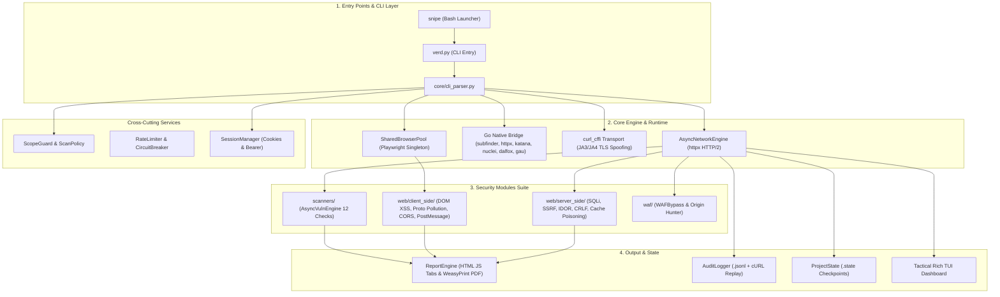
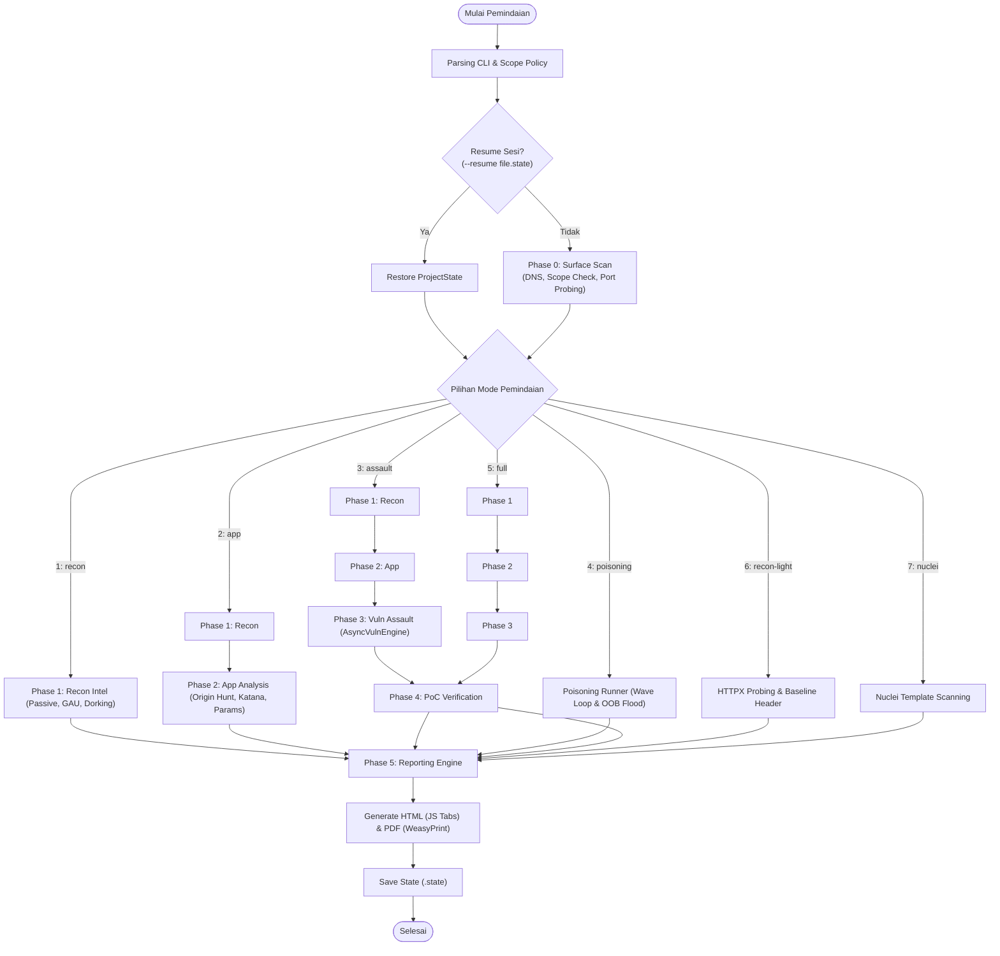

<h1 align="center">🎯 Verdamt-Snipe v1.4.5 NEXUS</h1>
<h4 align="center">Framework Keamanan Web Async-First, TLS Impersonation, Playwright Automation Engine & Vulnerability Assault</h4>

<p align="center">
  
  
  
  
  
  
  
  
  
  
  
  
</p>

<p align="center">
  <a href="#-ringkasan-cepat">Ringkasan</a> •
  <a href="#-screenshots--live-demo">Demo Visual</a> •
  <a href="#-teknologi--tenaga-penggerak">Teknologi</a> •
  <a href="#-arsitektur-sistem">Arsitektur</a> •
  <a href="#-pipeline-flowchart">Flowchart</a> •
  <a href="#-how-it-works">Cara Kerja</a> •
  <a href="#-7-mode-pemindaian">Mode Scan</a> •
  <a href="#-playwright-security-suite-10-modul">Playwright Suite</a> •
  <a href="#-attack-surface-matrix">Attack Surface</a> •
  <a href="#-benchmark-highlights">Benchmark</a> •
  <a href="#%EF%B8%8F-cara-install">Instalasi</a> •
  <a href="#-cara-penggunaan">Penggunaan</a> •
  <a href="#-dokumentasi-lengkap">Dokumentasi</a>
</p>

---

## ⚡ Ringkasan Cepat

**Verdamt-Snipe v1.4.5 NEXUS** adalah framework audit keamanan web asinkron (*async-first*) berkinerja tinggi yang menggabungkan kecepatan **Python AsyncIO**, kecepatan eksekusi native **Go Engine Bridge**, penyamaran sidik jari TLS **`curl_cffi` (JA3/JA4)**, serta otomasi browser headless **Playwright Chromium**:

1. **Apa ini?** — Alat pemindaian, pengintaian (*recon*), dan eksploitasi terverifikasi serba asinkron dengan antarmuka konsol taktis militer (*Tactical Rich TUI 15 FPS*) dan laporan interaktif otomatis (HTML & PDF).
2. **Untuk siapa?** — Dirancang khusus untuk **Penetration Tester**, **Red Team**, dan **Bug Bounty Hunter** yang membutuhkan kecepatan tinggi, akurasi tinggi, serta kapabilitas menembus proteksi WAF/Bot Protection tanpa kebocoran memori.
3. **Fitur Unggulan**:
   - **Dual-Engine Throughput**: Koordinasi AsyncIO Python dan Go Native binaries (`subfinder`, `httpx`, `katana`, `nuclei`, `dalfox`, `gau`).
   - **WAF Bypass & Origin Hunting**: Mengungkap IP origin di balik Cloudflare/Akamai serta penyamaran fingerprint TLS browser asli (Chrome, Firefox, Safari).
   - **Shared Browser Singleton Pool**: Menjalankan 10 modul audit browser (DOM XSS, PostMessage, CORS, Prototype Pollution) secara efisien dan stabil.
   - **OpSec & Audit Trail Ketat**: Proteksi batas scope otomatis (`ScanPolicy`), simulasi `--dry-run`, dan log audit `.jsonl` yang siap di-replay menjadi perintah `curl`.

---

## 📸 Screenshots & Live Demo

Tangkapan layar langsung antarmuka terminal interaktif dan artefak laporan yang dihasilkan:

### 1. Tactical Terminal TUI Dashboard
Dasbor terminal taktis 3-kolom berbasis `Rich` (15 FPS) dengan status pipeline, metrik hardware, sparkline RPS, dan pemantauan temuan kerentanan secara *real-time*:


### 2. Interactive HTML Vulnerability Report
Laporan audit keamanan interaktif modern dengan tab filter keparahan OWASP, kartu ringkasan eksekutif, diagram distribusi risiko, skor CVSS v3.1, dan snippet kode remediasi otomatis:


---

## ⚡ Teknologi & Tenaga Penggerak

| Komponen / Engine | Teknologi | Peran & Keunggulan |
| :--- | :--- | :--- |
| **Async Network Engine** | `Python AsyncIO` + `httpx` [HTTP/2] | Concurrency tinggi non-blocking, multiplexing HTTP/2, host rate-limiting & circuit breaker. |
| **TLS Impersonation** | `curl_cffi` (JA3/JA4 Spoofing) | Memalsukan handshake TLS agar identik dengan browser asli untuk menembus WAF & anti-bot. |
| **Go Native Bridge** | `core/go_bridge.py` + Binary Go | Throughput maksimal untuk recon kilat (`subfinder`, `httpx`, `katana`, `nuclei`, `dalfox`, `gau`). |
| **Browser Automation** | `Playwright Chromium` + `SharedPool` | 10 modul otomasi deep-browser bebas memory leak via singleton pool context terisolasi. |
| **Tactical TUI Dashboard** | `rich` Live Engine (15 FPS) + `psutil` | Dasbor konsol 3-kolom informatif: pipeline phase, sparkline RPS, temuan vuln, dan metrik hardware. |
| **Policy & Audit Engine** | `ScanPolicy` + `AuditLogger` (`.jsonl`) | Scope enforcer, limitasi anggaran request, serta perekaman seluruh transaksi HTTP untuk PoC `curl`. |
| **State Management** | `SessionManager` + `ProjectState` | Manajemen multi-token (Bearer/Cookie jar) & mekanisme save/resume sesi pemindaian (`.state`). |

---

## 📐 Arsitektur Sistem

Framework ini mengadopsi arsitektur 4-layer modular berkecepatan tinggi:



> 📖 **Arsitektur Lengkap:** Rincian 14 komponen internal, alur data sekvensial, dan security architecture tersedia di [docs/ARCHITECTURE.md](docs/ARCHITECTURE.md).

---

## 🔄 Pipeline Flowchart

Alur eksekusi multi-fase deterministik dengan percabangan 7 mode pemindaian:



---

## ⚙️ Cara Kerja (How It Works)

1. **Stage 1: Target Resolution** — Validasi cakupan (`ScopeGuard`), evaluasi `ScanPolicy`, resolusi DNS, probing HTTP/2 aktif, dan penguncian host terotorisasi.
2. **Stage 2: Intelligence Gathering** — Pengumpulan pasif via Wayback Machine & `gau`, pencarian rahasia JS publik, Google dorking, dan baseline fingerprint keamanan.
3. **Stage 3: Application Mapping** — Crawling endpoint tersembunyi via Katana, inspeksi XHR/Fetch dinamis via Playwright, serta ekstraksi JWT dari `LocalStorage`.
4. **Stage 4: Vulnerability Assault** — Uji kerentanan paralel via **AsyncVulnEngine** (12 jenis serangan), pembongkar Origin IP WAF, fuzzer DalFox, template Nuclei, dan deteksi OOB interactsh.
5. **Stage 5: Verification & Reporting** — Validasi ulang temuan di browser terisolasi (*confidence upgrade*), pembuatan perintah `curl` replay, serta generasi laporan HTML dan PDF.

---

## 🔍 7 Mode Pemindaian

| No | Flag CLI | Shortcut | Deskripsi Mode |
| :---: | :--- | :---: | :--- |
| **1** | `--recon` | `1` | **Passive Intel**: Pengumpulan intelijen pasif, endpoint arsip (Wayback/GAU), & dorking. |
| **2** | `--app` | `2` | **App Analysis**: Pemburu Origin IP (WAF bypass), crawling Katana, & discovery parameter. |
| **3** | `--assault` | `3` | **Vuln Assault**: Recon $\rightarrow$ App $\rightarrow$ Pengujian kerentanan mendalam (XSS, SQLi, IDOR, SSRF). |
| **4** | `--poisoning` | `4` | **Poisoning**: Pengujian *Web Cache Poisoning*, *HTTP Request Smuggling*, & deteksi OOB interactsh. |
| **5** | `--full` | `5` | **Full Pipeline**: Pipeline komprehensif end-to-end mencakup seluruh fase pemindaian. |
| **6** | `--recon-light` | `6` | **Recon Light**: Probing kilat HTTPX, ekstraksi judul, dan audit baseline keamanan dasar. |
| **7** | `--nuclei` | `7` | **Nuclei Engine**: Eksekusi pemindaian berbasis template Nuclei secara efisien dan terarah. |

---

## 🎭 Playwright Security Suite (10 Modul)

| No | Modul | Deskripsi Singkat |
| :---: | :--- | :--- |
| **1** | **DOM XSS PoC Verifier** | Verifikasi live eksekusi sink JS (`eval`, `innerHTML`, `document.write`). |
| **2** | **SPA Recon Engine** | Mengurai rute SPA, intersepsi endpoint XHR/Fetch, & ekstraksi token `LocalStorage`. |
| **3** | **CSRF Live Verifier** | Simulasi penyerahan form cross-origin otomatis dengan kredensial sesi aktif. |
| **4** | **PostMessage Inspector** | Interseptor `window.postMessage()`, audit `event.origin`, dan kebocoran wildcard `*`. |
| **5** | **Clickjacking Inspector** | Pengecekan rendering iframe live dan evaluasi `X-Frame-Options` / `frame-ancestors`. |
| **6** | **WebSocket Sniffer** | Perekam handshake `wss://`/`ws://`, header autentikasi, dan frame streaming. |
| **7** | **Proto Pollution Verifier** | Injeksi dinamis `__proto__` dan deteksi modifikasi `Object.prototype` di runtime browser. |
| **8** | **OAuth / OIDC Auditor** | Inspeksi redirect URI chain dan deteksi kebocoran token otorisasi via `Referer`. |
| **9** | **CORS Live Verifier** | Uji fetch cross-origin live dari domain terisolasi dengan `credentials: include`. |
| **10** | **Dynamic SPA Crawler** | Simulasi klik tombol interaktif, pengisian input form, dan navigasi router SPA otomatis. |

---

## 🕸️ Attack Surface Matrix

Berikut ringkasan vektor kerentanan utama yang diuji secara otomatis:

| Kerentanan | Vektor & Indikator Deteksi | Keparahan |
| :--- | :--- | :---: |
| **Reflected / Stored XSS** | Refleksi unescaped string pada response body & eksekusi sink DOM Playwright | **High / Critical** |
| **Blind / Error SQLi** | Differential latency (*response time differential* >5 detik) & binary search extract | **Critical (9.8)** |
| **Web Cache Poisoning** | Injeksi unkeyed header (`X-Forwarded-Host`) & verifikasi respons `X-Cache: HIT` | **High (7.5)** |
| **HTTP Request Smuggling** | Socket timeout / respons abnormal pada varian desinkronisasi `CL-TE` & `TE-CL` | **High (8.1)** |
| **SSRF (Cloud Metadata)** | Ekstraksi endpoint internal loopback/metadata cloud & DNS callback interactsh | **High (8.8)** |
| **Client-Side Proto Pollution** | Modifikasi atribut objek JavaScript global (`window.isAdmin` / `Object.prototype`) | **Medium / High** |
| **CORS Misconfiguration** | Refleksi `Origin: evil.com` dengan izin `Access-Control-Allow-Credentials: true` | **Medium (6.1)** |
| **CRLF Injection** | Injeksi sequence `\r\n` yang menghasilkan header baru seperti `Set-Cookie` | **Medium (5.3)** |

---

## 📊 Benchmark Highlights

### Metrik Kinerja Antar Mode
| Mode Pemindaian | Kecepatan Target | Peak RPS | Rata-rata Durasi | Konsumsi Memori |
| :--- | :---: | :---: | :---: | :---: |
| **Recon Light** | ~50 targets/min | ~200 RPS | ~2 menit | ~150 MB |
| **Recon** | ~30 targets/min | ~150 RPS | ~5 menit | ~250 MB |
| **App Analysis** | ~20 targets/min | ~120 RPS | ~8 menit | ~400 MB |
| **Assault** | ~15 targets/min | ~100 RPS | ~12 menit | ~500 MB |
| **Full Pipeline** | ~10 targets/min | ~80 RPS | ~20 menit | ~600 MB |
| **Turbo Full (`--turbo`)** | ~25 targets/min | ~300 RPS | ~8 menit | ~1.2 GB |

### Perbandingan Efisiensi: Python AsyncIO vs Go Native Bridge
- **Subdomain Enumeration**: **~3.7x lebih cepat** menggunakan Go Native `subfinder` (~450+ sub/detik).
- **Archive URL Crawling**: **~4.0x lebih cepat** menggunakan Go Native `gau` (~1,200+ URL/detik).
- **Endpoint Probing**: **~3.2x lebih cepat** menggunakan Go Native `httpx` (~800+ probe/detik).
- **Headless Browser Execution**: Bebas memory leak (<400 MB stabil) berkat *SharedBrowserPool*.

> 📊 **Laporan Benchmark Penuh:** Analisis throughput, uji konkurensi, dan metodologi lengkap di [docs/BENCHMARKS.md](docs/BENCHMARKS.md).

---

## 🎯 Typical Use Cases

1. **🏹 Bug Bounty Recon**: Pengumpulan kilat ribuan subdomain & endpoint tersembunyi dengan filter duplikasi otomatis.
2. **🛡️ WAF Bypass & Origin Hunt**: Mengungkap alamat IP origin server asli di balik Cloudflare/Akamai via modul `hunt_origin`.
3. **🖥️ Single Page App (SPA) Audit**: Ekstraksi token JWT dari `LocalStorage` dan audit mendalam alur REST API frontend.
4. **🔄 Otomasi CI/CD DevSecOps**: Evaluasi postur keamanan otomatis pada pipeline CI dengan mode `--passive` & batasan `--max-requests`.
5. **👁️ Blind Vulnerability Hunting**: Deteksi celah Out-Of-Band (Blind SSRF, Blind RCE, Blind XXE) via interactsh server.
6. **🔐 Multi-Context Auth Testing**: Pengujian otorisasi silang (User A vs User B) untuk menemukan celah BOLA/IDOR otomatis.

---

## ⚙️ Cara Install

**Persyaratan Sistem:** Linux / macOS, **Python 3.12+**, RAM 2GB+ (4GB disarankan untuk Playwright).

```bash
# 1. Clone repositori & masuk ke direktori
git clone https://github.com/SamastaBaskara-3214/Verdamt-Snipe.git
cd Verdamt-Snipe

# 2. Buat virtual environment & install dependensi
python3 -m venv .venv
source .venv/bin/activate
pip install -r requirements.txt

# 3. Pasang Chromium Driver untuk modul browser
playwright install chromium
```

---

## 🚀 Cara Penggunaan

### 1. Menggunakan Launcher Praktis (`snipe`)
```bash
# Buka Menu Interaktif TUI
./snipe target.com

# Mode 5 (Full Pipeline) dengan TLS Impersonation Chrome
./snipe 5 target.com -i chrome

# Mode 3 (Vuln Assault) dengan mode Stealth & Proxy SOCKS5
./snipe 3 target.com -s -p socks5://127.0.0.1:9050
```

### 2. Menggunakan Python CLI Langsung (`verd.py`)
```bash
# Pemindaian interaktif
python3 verd.py target.com

# Full Scan dengan batas scope ketat & limit request
python3 verd.py target.com --full --allowed-hosts target.com,api.target.com --max-requests 5000

# Pemindaian terotentikasi aman (tanpa terlihat di ps aux / riwayat shell)
python3 verd.py target.com --full --bearer env:API_TOKEN
python3 verd.py target.com --full --bearer-file /path/to/token.txt

# Melanjutkan pemindaian yang terhenti (Resume)
python3 verd.py --resume outputs/target.com.state
```

---

## 🛡️ OpSec & Safety Policy

Setiap operasi dilindungi oleh kontrol kebijakan yang ketat:
- `--dry-run` : Merender payload & memvalidasi kebijakan tanpa mengirim paket ke jaringan target.
- `--passive` : Membatasi pengujian hanya pada metode aman (`GET`, `HEAD`, `OPTIONS`).
- `--max-requests N` : Membatasi kuota total request HTTP (default: `10000`).
- `--max-concurrency N` : Membatasi request paralel (default: `100`).
- `--allowed-hosts H1,H2` : Mengunci target hanya pada host yang memiliki otorisasi tertulis.
- `--audit-log PATH` : Menyimpan log `.jsonl` lengkap yang dapat di-replay menjadi perintah `curl`.

---

## 📚 Dokumentasi Lengkap

Untuk panduan teknis mendalam, arsitektur, dan referensi lainnya:
- 📐 **[docs/ARCHITECTURE.md](docs/ARCHITECTURE.md)** — Arsitektur teknis lengkap, diagram 4-layer, & spesifikasi 14 komponen.
- 📊 **[docs/BENCHMARKS.md](docs/BENCHMARKS.md)** — Metrik performa, throughput profiling, & panduan tuning efisiensi.
- 📖 **[docs/tutorial.md](docs/tutorial.md)** — Tutorial taktis, panduan skenario nyata, & konfigurasi lanjutan.
- 🤝 **[CONTRIBUTING.md](CONTRIBUTING.md)** — Panduan kontribusi, alur kerja git, & standar kualitas kode.
- 🔒 **[SECURITY.md](SECURITY.md)** — Kebijakan pelaporan keamanan, analisis ancaman, & panduan tanggung jawab.

---

## ⚠️ Perhatian Legal

> **Verdamt-Snipe adalah framework pengujian keamanan berorientasi profesional.**  
> Gunakan alat ini **HANYA** pada sistem yang Anda miliki atau yang telah memberikan otorisasi tertulis resmi (Bug Bounty Program / Penetration Testing Agreement). Selalu patuhi batas cakupan (*scope*) dan regulasi hukum yang berlaku.

<p align="center"><i>"Silent · Precise · Relentless."</i> — <b>Samasta Baskara</b></p>
