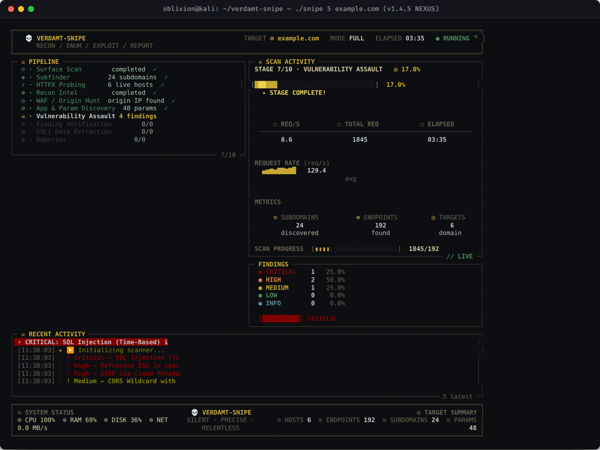
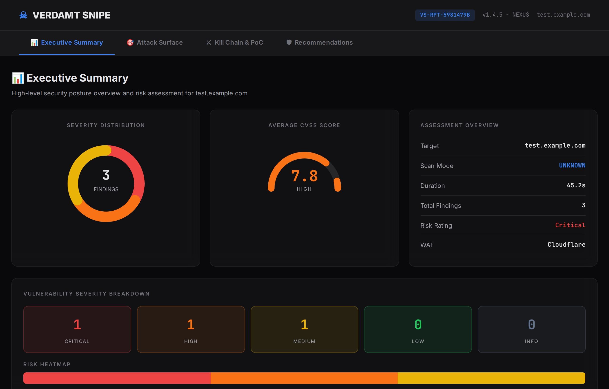
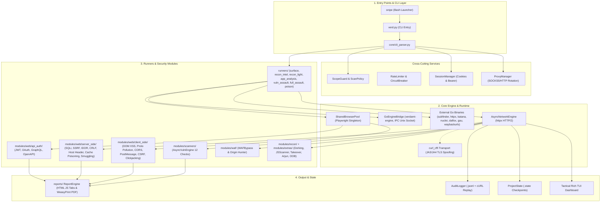
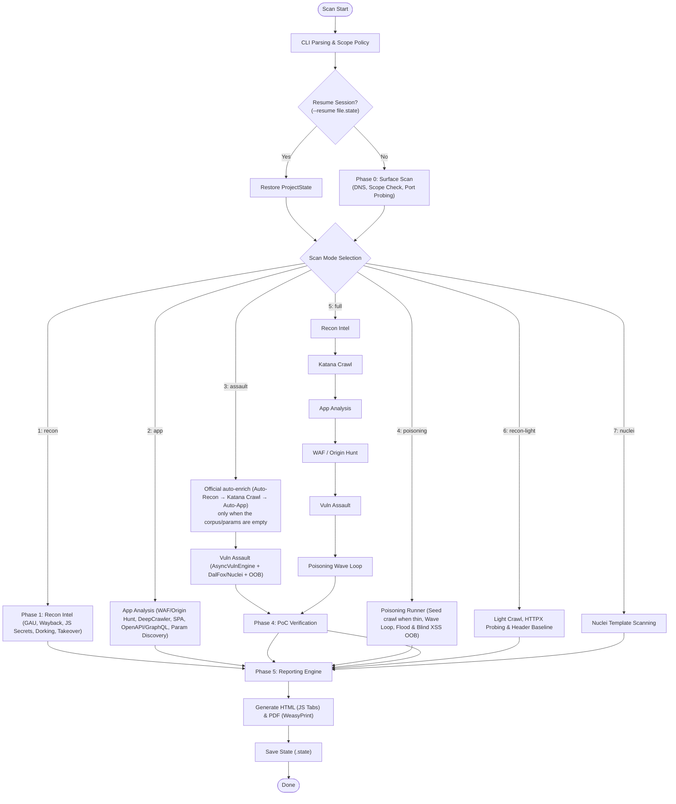

<h1 align="center">🎯 Verdamt-Snipe v1.4.5 NEXUS</h1>
<h4 align="center">Async-First Web Security Framework, TLS Impersonation, Playwright Automation Engine & Vulnerability Assault</h4>

<p align="center">
  
  
  
  
  
  
  
  
  
  
  
  
</p>

<p align="center">
  🌐 <b>English</b> · <a href="README.id.md">Bahasa Indonesia</a> · <a href="README.ja.md">日本語</a> · <a href="README.zh.md">简体中文</a>
</p>

<p align="center">
  <a href="#-quick-overview">Overview</a> •
  <a href="#-screenshots--live-demo">Screenshots</a> •
  <a href="#-technology-stack">Technology</a> •
  <a href="#-system-architecture">Architecture</a> •
  <a href="#-pipeline-flowchart">Flowchart</a> •
  <a href="#%EF%B8%8F-how-it-works">How It Works</a> •
  <a href="#-7-scan-modes">Scan Modes</a> •
  <a href="#-playwright-security-suite-10-modules">Playwright Suite</a> •
  <a href="#%EF%B8%8F-attack-surface-matrix">Attack Surface</a> •
  <a href="#-benchmark-highlights">Benchmarks</a> •
  <a href="#%EF%B8%8F-installation">Installation</a> •
  <a href="#-usage">Usage</a> •
  <a href="#-documentation">Documentation</a>
</p>

---

## ⚡ Quick Overview

**Verdamt-Snipe v1.4.5 NEXUS** is a high-performance, async-first web security auditing framework that combines the raw speed of **Python AsyncIO**, the native execution speed of the **Go Engine Bridge**, **`curl_cffi` (JA3/JA4) TLS fingerprint impersonation**, and **Playwright Chromium** headless browser automation:

1. **What is it?** — An all-async scanning, reconnaissance, and verified-exploitation tool with a military-grade tactical console interface (*Tactical Rich TUI at 15 FPS*) and automated interactive reports (HTML & PDF).
2. **Who is it for?** — Built specifically for **Penetration Testers**, **Red Teams**, and **Bug Bounty Hunters** who need high speed, high accuracy, and the ability to break through WAF/Bot Protection without memory leaks.
3. **Key Features**:
   - **Triple-Engine Throughput**: Coordinated Python AsyncIO, the **internal Go Engine** (`verdamt-engine` over an IPC Unix Socket, auto-compiled when the Go toolchain is available), and external Go binaries (`subfinder`, `httpx`, `katana`, `nuclei`, `dalfox`, `gau`, `waybackurls`, `ffuf`, `gf`).
   - **WAF Bypass & Origin Hunting**: Uncover origin IPs behind Cloudflare/Akamai, adaptive payload mutators, and genuine browser TLS fingerprint impersonation (Chrome, Firefox, Safari).
   - **Shared Browser Singleton Pool**: Runs 10 browser audit modules (DOM XSS, PostMessage, CORS, Prototype Pollution, etc.) efficiently and stably.
   - **Poisoning & OOB Engine**: Wave-loop poisoning (cache, smuggling, flood bruteforce) and Blind XSS/SSRF/RCE detection via interactsh callbacks.
   - **Strict OpSec & Audit Trail**: Automatic scope boundary protection (`ScanPolicy`), `--dry-run` simulation, and `.jsonl` audit logs ready to be replayed as `curl` commands.

---

## 📸 Screenshots & Live Demo

Live captures of the interactive terminal interface and the generated report artifacts:

### 1. Tactical Terminal TUI Dashboard
A 3-column tactical terminal dashboard powered by `Rich` (15 FPS) with pipeline status, hardware metrics, RPS sparklines, and real-time vulnerability findings monitoring.

The dashboard now runs on an *alternate screen buffer* — a fixed canvas: all output (phase logs, result tables, even stray `print` calls) is redirected into the **Recent Activity** panel, and terminal scrolling can no longer push the dashboard off-screen. The activity feed has its own **scrollbar**:

- `↑` / `↓` or **mouse wheel** — scroll the activity history up / down
- `PgUp` / `PgDn` — jump one page of history
- `End` — return to *live follow* mode (the badge changes to `↕ SCROLLED · End` when free-scrolling)

> Mouse text selection still works by holding `Shift`.



### 2. Interactive HTML Vulnerability Report
A modern, interactive security audit report with OWASP severity filter tabs, executive summary cards, risk distribution charts, CVSS v3.1 scores, and automatic remediation code snippets:



---

## ⚡ Technology Stack

| Component / Engine | Technology | Role & Advantage |
| :--- | :--- | :--- |
| **Async Network Engine** | `Python AsyncIO` + `httpx` [HTTP/2] | High-concurrency non-blocking I/O, HTTP/2 multiplexing, per-host rate limiting & circuit breaker. |
| **TLS Impersonation** | `curl_cffi` (JA3/JA4 Spoofing) | Forges TLS handshakes to be identical to real browsers, bypassing WAF & anti-bot protections. |
| **Go Engine Bridge** | `core/go_bridge.py` + `go/cmd/engine` | Native JSON-over-Unix-Socket engine for mass probing & JS scanning; auto-compiles when Go is installed, smooth fallback to Python. |
| **External Go Tooling** | ProjectDiscovery & community | Integrates `subfinder`, `httpx`, `katana`, `nuclei`, `dalfox`, `gau`, `waybackurls`, `ffuf`, `gf` with graceful degradation when not installed. |
| **Browser Automation** | `Playwright Chromium` + `SharedPool` | 10 deep-browser automation modules, memory-leak free thanks to isolated singleton pool contexts. |
| **Tactical TUI Dashboard** | `rich` Live Engine (15 FPS) + `psutil` | Informative 3-column console dashboard: pipeline phase, RPS sparkline, vuln findings, hardware metrics — fixed canvas (alternate screen) with a scrollable activity feed. |
| **Policy & Audit Engine** | `ScanPolicy` + `AuditLogger` (`.jsonl`) | Scope enforcer, request budget limits, and recording of every HTTP transaction for `curl` PoCs. |
| **State Management** | `SessionManager` + `ProjectState` | Multi-token management (Bearer/Cookie jar) & scan session save/resume (`.state`). |
| **OOB / Interactsh Engine** | `python-interactsh` + `modules/extras/oob_detector.py` | Callback domains for Blind SSRF/XSS/RCE with real-time hit logging. |
| **Wordlist Provider** | `modules/wordlists.py` | Auto-detects local wordlists (`~/.wordlists`) with a SecLists/Assetnote download fallback via `--setup-wordlists`. |

---

## 📐 System Architecture

The framework adopts a high-speed, modular 4-layer architecture:



> 📖 **Full Architecture:** Details on the 14 internal components, the sequential data flow, and the security architecture are available in [docs/ARCHITECTURE.md](docs/ARCHITECTURE.md).

---

## 🔄 Pipeline Flowchart

Deterministic multi-phase execution flow with 7 scan-mode branches:



---

## ⚙️ How It Works

1. **Stage 1: Target Resolution** — Scope validation (`ScopeGuard`), `ScanPolicy` evaluation, DNS resolution, active HTTP/2 probing, and locking of authorized hosts.
2. **Stage 2: Intelligence Gathering** — Passive collection via the Wayback Machine, `gau` & `waybackurls`, secret/endpoint scanning of JS bundles (`JSScanner`), Google dorking, subdomain takeover detection, and a security baseline fingerprint.
3. **Stage 3: Application Mapping** — Light crawling via `DeepCrawler` + SPA reconnaissance via Playwright (XHR/Fetch & `LocalStorage` tokens), OpenAPI/GraphQL spec ingestion, and parameter discovery (ParamExtractor + Arjun brute-force). Heavy **Katana** crawling is an official assault-class phase (`--assault`/`--poisoning`/`--full`), not part of `--app` mode.
4. **Stage 4: Vulnerability Assault** — Parallel vulnerability testing via the **AsyncVulnEngine** (12 checks), focused web modules (JWT, IDOR, CRLF, Host Header, Stored XSS), the WAF origin-IP unmasker, the DalFox fuzzer, Nuclei templates, Blind SQLi extraction, and interactsh OOB detection. POST-body probes (HTTP/2 smuggling `CL.TE`, stored-XSS forms, blind XXE) only run in poisoning mode — just like flood/connection-exhaust.
5. **Stage 5: Verification & Reporting** — Re-validation of findings in an isolated browser (*confidence upgrade*), `curl` replay command generation, and HTML & PDF report generation.

---

## 🔍 7 Scan Modes

| No | CLI Flag | Shortcut | Mode Description |
| :---: | :--- | :---: | :--- |
| **1** | `--recon` | `1` | **Passive Intel**: `gau`/`waybackurls`, JS secret scanning (`JSScanner`), Google dorking, subdomain takeover checks, & header baseline. |
| **2** | `--app` | `2` | **App Analysis**: Origin IP hunter (WAF bypass), light `DeepCrawler` crawl + SPA reconnaissance (Playwright), API specs (OpenAPI/GraphQL), parameter discovery (ParamExtractor + Arjun). Heavy Katana crawling is **not** part of this mode. |
| **3** | `--assault` | `3` | **Vuln Assault**: official auto-enrich when the corpus/params are empty (Auto-Recon → Katana Crawl → Auto-App, shown as stages), WAF/Origin Hunt, then 12 AsyncVulnEngine checks + focused web modules (JWT, IDOR, CRLF, Host Header, Stored XSS) + DalFox + Nuclei + Blind SQLi extraction + OOB. |
| **4** | `--poisoning` | `4` | **Poisoning**: `Katana` seed crawl (only when the corpus is thin, shown as a stage) + wave-loop *Connection Exhaust*, *Web Cache Poisoning*, *HTTP Request Smuggling*, param/payload flood, & Blind XSS via interactsh OOB. |
| **5** | `--full` | `5` | **Full Pipeline**: `--recon` → Katana Crawl → `--app` → WAF/Origin Hunt → `--assault` → `--poisoning` — an end-to-end, exploit-class composition. |
| **6** | `--recon-light` | `6` | **Recon Light**: Homepage crawl $\rightarrow$ link extraction $\rightarrow$ validation $\rightarrow$ basic security baseline audit (<60 seconds). |
| **7** | `--nuclei` | `7` | **Nuclei Engine**: Efficient, targeted template-based Nuclei scanning. |

### 🗺️ Phase & Module Map per Mode (official boundaries)

One module, one home. Phases marked `*`/`**` are conditional and still appear as official stages on the dashboard (marked `— SKIPPED` when not executed).

| Mode | Phase order | Key modules | Boundaries / exclusions |
| :--- | :--- | :--- | :--- |
| **1 RECON** | gau ∥ wayback ∥ dork ∥ takeover ∥ JS ∥ baseline → validation | `gau`, `waybackurls`, `JSScanner`, `GoogleDorker`, `TakeoverChecker`, baseline (config/header/CORS) | passive + archive; no active crawling, params, or exploitation; `--passive` allowed |
| **2 APP** | WAF/origin`*` → API spec → light crawl → params → analysis suite | `DeepCrawler`, `BrowserRecon` (SPA), `OpenAPIParser`, `ParamExtractor` + Arjun, `DOMXSS`, `APIProfiler`, `GraphQLProfiler`, Playwright suite (CSRF/CORS/OAuth/PostMessage/WebSocket/Clickjacking/Proto-Pollution/SPA), `AuthTester` | **no Katana**, no archive/dork; no injection payloads |
| **3 ASSAULT** | auto-recon`**` → katana crawl`**` → auto-app`**` → WAF/origin`*` → parallel assault | `Katana`, `nuclei`, `dalfox`, AsyncVulnEngine injection, `OOBDetector`, JWT/Host/CRLF/Stored-XSS/IDOR | enrichment only when the corpus/params are empty; POST-body probes exclusive to mode 4 |
| **4 POISONING** | WAF bypass`*` → seed crawl (when thin) → wave loop A/B/C/D | cache poison, smuggling, brute + param flood, connection exhaust, payload flood, OOB, assault POST | flood/DoS + POST-body (h2 `CL.TE`, stored-XSS form, blind XXE) only here |
| **5 FULL** | 1 → Katana → 2 → WAF → 3 → 4 | the combined modes above | composition of 1+2+3+4; active POST probes |
| **6 LIGHT** | link-crawl → validation → baseline | no external tools | <60 seconds; no gau/wayback/dork/takeover/JS/Katana; `--passive` allowed |
| **7 NUCLEI** | target resolution → nuclei | `nuclei` | pure templates; **blocked under `--passive`** |

`*` executed only when a WAF (or its indications) is detected · `**` executed only when the URL corpus/parameter set is still empty.

---

## 🎭 Playwright Security Suite (10 Modules)

| No | Module | File (`modules/web/…`) | Brief Description |
| :---: | :--- | :--- | :--- |
| **1** | **DOM XSS PoC Verifier** | `client_side/dom_xss.py` | Live verification of JS sink execution (`eval`, `innerHTML`, `document.write`). |
| **2** | **SPA Recon Engine** | `recon_crawlers/browser_recon.py` | Parses SPA routes, intercepts XHR/Fetch endpoints, & extracts `LocalStorage` tokens. |
| **3** | **CSRF Live Verifier** | `client_side/csrf_verify.py` | Simulates automatic cross-origin form submission with active session credentials. |
| **4** | **PostMessage Inspector** | `client_side/postmessage_analyzer.py` | `window.postMessage()` interceptor, `event.origin` auditing, and wildcard `*` leak detection. |
| **5** | **Clickjacking Inspector** | `client_side/clickjacking_verify.py` | Live iframe rendering checks and `X-Frame-Options` / `frame-ancestors` evaluation. |
| **6** | **WebSocket Sniffer** | `recon_crawlers/websocket_recon.py` | Records `wss://`/`ws://` handshakes, authentication headers, and streaming frames. |
| **7** | **Proto Pollution Verifier** | `client_side/proto_pollution_verify.py` | Dynamic `__proto__` injection and runtime detection of `Object.prototype` tampering in the browser. |
| **8** | **OAuth / OIDC Auditor** | `api_auth/oauth_auditor.py` | Redirect URI chain inspection and detection of authorization token leakage via `Referer`. |
| **9** | **CORS Live Verifier** | `client_side/cors_verify.py` | Live cross-origin fetch testing from an isolated domain with `credentials: include`. |
| **10** | **Dynamic SPA Crawler** | `recon_crawlers/spa_crawler.py` | Simulates interactive button clicks, form input filling, and automatic SPA router navigation. |

---

## 🕸️ Attack Surface Matrix

A summary of the main vulnerability vectors that are automatically tested:

| Vulnerability | Vector & Detection Indicator | Severity (CVSS v3.1) |
| :--- | :--- | :---: |
| **Reflected / DOM XSS** | Unescaped string reflection in the response body & DOM sink verification via Playwright | **Medium (6.1)** |
| **Stored XSS** | Verified injection persisted & executed in an isolated browser | **High (7.2)** |
| **Error / Time / Blind SQLi** | Error signals, differential latency (*response time differential* >5 seconds) & binary search extraction | **Critical (9.8)** |
| **RCE / Command Injection** | Command execution output reflection with WAF-aware payloads | **Critical (9.8)** |
| **SSTI** | Template engine expression evaluation (`{{7*7}}`, `${...}`) on parameters | **Critical (9.8)** |
| **LFI / Path Traversal** | `../../etc/passwd` traversal patterns on file/path parameters | **High (7.5)** |
| **XXE** | External entity injection in XML bodies (file reflection & OOB callback) | **High (7.5)** |
| **SSRF (Cloud Metadata)** | Internal loopback/cloud metadata endpoint extraction & interactsh DNS callbacks | **High (8.8)** |
| **Web Cache Poisoning** | Unkeyed header injection (`X-Forwarded-Host`) & `X-Cache: HIT` response verification | **High** |
| **HTTP Request Smuggling** | Socket timeouts / abnormal responses on `CL.TE`, `TE.CL`, & `CL.0` desync variants | **High (8.1)** |
| **Subdomain Takeover** | *Unclaimed* page fingerprints on orphan CNAMEs (S3, GitHub Pages, etc.) | **High (8.1)** |
| **JWT Weakness** | `none` algorithm, weak-secret brute-force, & `kid` injection on tokens | **High (7.5–8.1)** |
| **Client-Side Proto Pollution** | Tampering with global JavaScript object attributes (`window.isAdmin` / `Object.prototype`) | **Medium / High** |
| **CORS Misconfiguration** | `Origin: evil.com` reflection with `Access-Control-Allow-Credentials: true` | **Medium (6.1)** |
| **Host Header Injection** | Fake `Host`/`X-Forwarded-Host` reflection & *password reset poisoning* | **Medium–High (5.3–8.1)** |
| **CRLF Injection** | `\r\n` sequence injection producing new headers such as `Set-Cookie` | **Medium (5.3)** |
| **IDOR / BOLA** | Cross-account resource access (Role-2 token) & mass ID enumeration | **Medium–High (5.3–8.1)** |
| **Sensitive File Exposure** | Exposure of `.git`, `.env`, backup configs, private keys, & directory listings | **High (7.5–9.1)** |

---

## 📊 Benchmark Highlights

### Cross-Mode Performance Metrics
| Scan Mode | Target Speed | Peak RPS | Average Duration | Memory Usage |
| :--- | :---: | :---: | :---: | :---: |
| **Recon Light** | ~50 targets/min | ~200 RPS | ~2 minutes | ~150 MB |
| **Recon** | ~30 targets/min | ~150 RPS | ~5 minutes | ~250 MB |
| **App Analysis** | ~20 targets/min | ~120 RPS | ~8 minutes | ~400 MB |
| **Assault** | ~15 targets/min | ~100 RPS | ~12 minutes | ~500 MB |
| **Full Pipeline** | ~10 targets/min | ~80 RPS | ~20 minutes | ~600 MB |
| **Turbo Full (`--turbo`)** | ~25 targets/min | ~300 RPS | ~8 minutes | ~1.2 GB |

### Efficiency Comparison: Python AsyncIO vs Go Native Bridge
- **Subdomain Enumeration**: **~3.7x faster** using Go Native `subfinder` (~450+ subs/second).
- **Archive URL Crawling**: **~4.0x faster** using Go Native `gau` (~1,200+ URLs/second).
- **Endpoint Probing**: **~3.2x faster** using Go Native `httpx` (~800+ probes/second).
- **Headless Browser Execution**: Memory-leak free (<400 MB stable) thanks to the *SharedBrowserPool*.

> 📊 **Full Benchmark Report:** Throughput analysis, concurrency tests, and the complete methodology are in [docs/BENCHMARKS.md](docs/BENCHMARKS.md).

---

## 🎯 Typical Use Cases

1. **🏹 Bug Bounty Recon**: Lightning-fast collection of thousands of subdomains & hidden endpoints with automatic de-duplication.
2. **🛡️ WAF Bypass & Origin Hunt**: Reveal the real origin server IP behind Cloudflare/Akamai via the `hunt_origin` module.
3. **🖥️ Single Page App (SPA) Audit**: Extract JWT tokens from `LocalStorage` and deeply audit the frontend REST API flow.
4. **🔄 CI/CD DevSecOps Automation**: Automatic security posture evaluation in CI pipelines with `--passive` mode & `--max-requests` limits.
5. **👁️ Blind Vulnerability Hunting**: Detect Out-Of-Band flaws (Blind SSRF, Blind RCE, Blind XXE) via an interactsh server.
6. **🔐 Multi-Context Auth Testing**: Cross-authorization testing (User A vs User B) to automatically find BOLA/IDOR flaws.

---

## ⚙️ Installation

**System Requirements:** Linux / macOS / Windows, **Python 3.12+**, 2GB+ RAM (4GB recommended for Playwright).

### Linux / macOS

```bash
# 1. Clone the repository & enter the directory
git clone https://github.com/Samasta-Baskara/Verdamt-Snipe.git
cd Verdamt-Snipe

# 2. Create a virtual environment & install dependencies
python3 -m venv .venv
source .venv/bin/activate
pip install -r requirements.txt

# 3. Install the Chromium driver for browser modules
playwright install chromium

# 4. (Optional) Bootstrap the SecLists/Assetnote wordlists into ~/.wordlists
python3 verd.py --setup-wordlists
```

### Windows (PowerShell)

> Requires [Python 3.12+](https://www.python.org/downloads/) (tick **"Add python.exe to PATH"** during setup) and [Git](https://git-scm.com/download/win).

```powershell
# 1. Clone the repository & enter the directory
git clone https://github.com/Samasta-Baskara/Verdamt-Snipe.git
cd Verdamt-Snipe

# 2. Create a virtual environment & install dependencies
py -3.12 -m venv .venv
.\.venv\Scripts\Activate.ps1
pip install -r requirements.txt

# 3. Install the Chromium driver for browser modules
playwright install chromium

# 4. (Optional) Bootstrap the SecLists/Assetnote wordlists into %USERPROFILE%\.wordlists
py -3.12 verd.py --setup-wordlists
```

If PowerShell refuses to run the activation script (one-time, per-user):
```powershell
Set-ExecutionPolicy -Scope CurrentUser RemoteSigned
```
Or skip activation entirely and call the venv interpreter directly: `.\.venv\Scripts\python.exe verd.py <target>`.

> **Windows notes:**
> - Use **`python` / `py`** instead of `python3`, and **`.\.venv\Scripts\python.exe`** instead of `./snipe` (the `snipe` launcher is a Bash script — run it under [Git Bash](https://git-scm.com/download/win) or WSL if you prefer it).
> - **PDF reports** need GTK/Pango (`weasyprint`), which is not pip-installable on Windows — that dependency is auto-skipped via a `sys_platform` marker, so **HTML reports work, PDF is skipped**. To restore PDF, install the GTK stack (e.g. via [MSYS2](https://www.msys2.org/)) and `pip install weasyprint`.
> - **Go Engine** (`verdamt-engine`) uses a Unix-domain socket and auto-compiles only where the Go toolchain + POSIX sockets exist; on Windows the framework **automatically falls back to the Python AsyncIO engine** — everything still works, just without the native speed boost. The external Go binaries (`subfinder`, `httpx`, `katana`, etc.) ship Windows builds and are picked up from `%PATH%` / `%USERPROFILE%\go\bin` as usual.
> - Terminal mouse-wheel scrolling for the activity feed is handled by `rich`; if your console host drops it, the `↑`/`↓` keys and `PgUp`/`PgDn` still work.

> **Engine notes:**
> - The **internal Go Engine** (`go/cmd/engine`) is auto-compiled when the Go toolchain is available; without Go, the framework still runs fully via the Python AsyncIO fallback.
> - **External Go binaries** (`subfinder`, `httpx`, `katana`, `nuclei`, `dalfox`, `gau`, `waybackurls`, `ffuf`, `gf`) are optional — missing tools are skipped with graceful degradation.
> - The `snipe` launcher automatically uses the interpreter from `.venv` when available.

---

## 🚀 Usage

### 1. Using the Convenience Launcher (`snipe`)
```bash
# Open the interactive TUI menu
./snipe target.com

# Mode 5 (Full Pipeline) with Chrome TLS impersonation
./snipe 5 target.com -i chrome

# Mode 3 (Vuln Assault) in Stealth mode & SOCKS5 proxy
./snipe 3 target.com -s -p socks5://127.0.0.1:9050

# Mode 4 (Poisoning) with all focused web-module flags
./snipe 4 target.com -a
```

**Launcher shortcuts:** `1`–`7` (modes) · `-s` stealth · `-t` turbo · `-r` resume · `-p` proxy · `-i` impersonation · `-j` JWT · `-x` stored XSS · `-id` IDOR · `-c` CRLF · `-hi` host injection · `-a` all five focus flags at once.

### 2. Using the Python CLI Directly (`verd.py`)
```bash
# Interactive scan
python3 verd.py target.com

# Full scan with a strict scope boundary & request limit
python3 verd.py target.com --full --allowed-hosts target.com,api.target.com --max-requests 5000

# Secure authenticated scan (never visible in ps aux / shell history)
python3 verd.py target.com --full --bearer env:API_TOKEN
python3 verd.py target.com --full --bearer-file /path/to/token.txt

# Focus on specific web modules (JWT / IDOR / CRLF / host header / stored XSS)
python3 verd.py target.com --assault --jwt --idor --stored-xss

# Stealth scan with a global 10-minute time budget
python3 verd.py target.com --full -s --max-time 600

# Resume an interrupted scan
python3 verd.py --resume outputs/target.com.state
python3 verd.py --resume target.com        # shorthand: uses outputs/target.com.state
```

---

## 🛡️ OpSec & Safety Policy

Every operation is protected by strict policy controls:

| Flag | Function | Default |
| :--- | :--- | :---: |
| `--dry-run` | Renders payloads & validates policy without sending packets to the target network. | — |
| `--passive` | Restricts testing to safe methods only (`GET`, `HEAD`, `OPTIONS`) & skips intrusive phases. | — |
| `--max-time <sec>` | Global scan time budget (state is still saved when the budget runs out). | — |
| `--max-requests N` | Total HTTP request quota against the target (including external tool traffic). | `30000` |
| `--max-concurrency N` | Maximum parallel requests against the target. | `100` |
| `--request-timeout <sec>` | Per-request timeout against the target. | `30` |
| `--allowed-hosts H1,H2` | Locks the target to hosts with written authorization only. | target only |
| `--allowed-ports p,p` | Ports allowed for active probing. | `80,443` |
| `--archive-timeout <sec>` | Time budget for historical URL mining (`gau` + `waybackurls`) — large targets need more than 30 seconds. | `90` |
| `--no-dork` | Skips search engine scraping (Google/DDG); the dork list is still exported to `outputs/<target>_dorks.txt`. | scraping active |
| `--audit-log PATH` | Saves a complete `.jsonl` log that can be replayed as `curl` commands. | automatic |
| `--proxy-list` / `--proxy-rotate` / `--no-proxy` | Rotating proxy management & the `VERDAMT_PROXY` env escape-hatch. | — |

---

## 📚 Documentation

For in-depth technical guides, architecture, and other references:
- 📐 **[docs/ARCHITECTURE.md](docs/ARCHITECTURE.md)** — Complete technical architecture, 4-layer diagrams, & the 14-component specification.
- 📊 **[docs/BENCHMARKS.md](docs/BENCHMARKS.md)** — Performance metrics, throughput profiling, & efficiency tuning guide.
- 📖 **[docs/tutorial.md](docs/tutorial.md)** — Tactical tutorials, real-world scenario guides, & advanced configuration.
- 🤝 **[CONTRIBUTING.md](CONTRIBUTING.md)** — Contribution guide, git workflow, & code quality standards.
- 🔒 **[SECURITY.md](SECURITY.md)** — Security reporting policy, threat analysis, & responsibility guidelines.

---

## ⚠️ Legal Notice

> **Verdamt-Snipe is a professionally-oriented security testing framework.**
> Use this tool **ONLY** on systems you own or for which you have official written authorization (Bug Bounty Program / Penetration Testing Agreement). Always respect scope boundaries and applicable laws.

<p align="center"><i>"Silent · Precise · Relentless."</i> — <b>Samasta Baskara</b></p>
