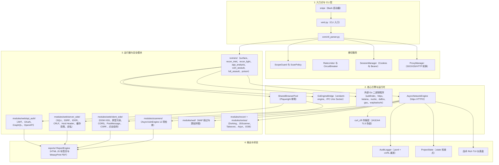
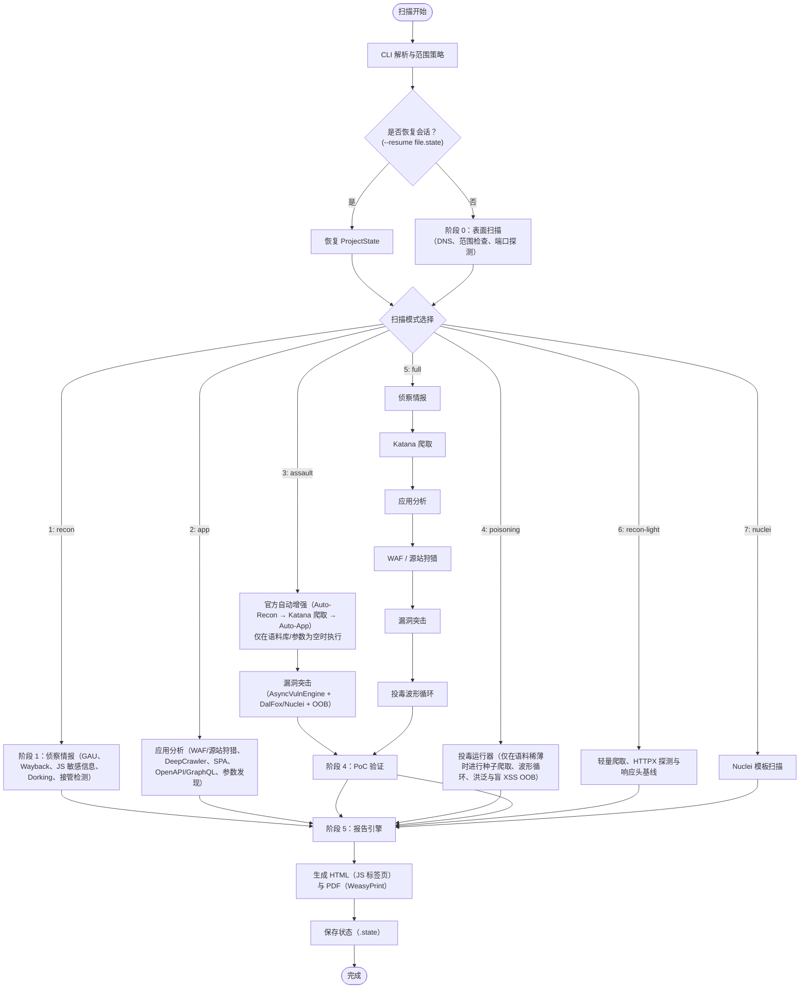

<h1 align="center">🎯 Verdamt-Snipe v1.4.5 NEXUS</h1>
<h4 align="center">异步优先的 Web 安全框架、TLS 伪装、Playwright 自动化引擎与漏洞突击</h4>

<p align="center">
  
  
  
  
  
  
  
  
  
  
  
  
</p>

<p align="center">
  🌐 <a href="README.md">English</a> · <a href="README.id.md">Bahasa Indonesia</a> · <a href="README.ja.md">日本語</a> · <b>简体中文</b>
</p>

<p align="center">
  <a href="#-快速概览">快速概览</a> •
  <a href="#-截图与实时演示">截图</a> •
  <a href="#-技术栈">技术栈</a> •
  <a href="#-系统架构">系统架构</a> •
  <a href="#-流水线流程图">流程图</a> •
  <a href="#%EF%B8%8F-工作原理">工作原理</a> •
  <a href="#-7-种扫描模式">扫描模式</a> •
  <a href="#-playwright-安全套件-10-个模块">Playwright 套件</a> •
  <a href="#%EF%B8%8F-攻击面矩阵">攻击面</a> •
  <a href="#-基准测试亮点">基准测试</a> •
  <a href="#%EF%B8%8F-安装">安装</a> •
  <a href="#-使用方法">使用方法</a> •
  <a href="#-文档">文档</a>
</p>

---

## ⚡ 快速概览

**Verdamt-Snipe v1.4.5 NEXUS** 是一款高性能、异步优先的 Web 安全审计框架，它将 **Python AsyncIO** 的原始速度、**Go 引擎桥接（Go Engine Bridge）** 的原生执行速度、**`curl_cffi`（JA3/JA4）TLS 指纹伪装** 以及 **Playwright Chromium** 无头浏览器自动化融为一体：

1. **它是什么？** — 一款全异步的扫描、侦察与经过验证的漏洞利用工具，配备军用级战术控制台界面（*15 FPS 的 Tactical Rich TUI*）与自动化交互式报告（HTML 与 PDF）。
2. **它面向谁？** — 专为 **渗透测试人员**、**红队** 与 **漏洞赏金猎人** 打造，他们需要高速度、高精度，以及在不发生内存泄漏的情况下突破 WAF/机器人防护的能力。
3. **核心特性**：
   - **三引擎吞吐**：协同调度 Python AsyncIO、**内置 Go 引擎**（`verdamt-engine` 通过 IPC Unix Socket 通信，在 Go 工具链可用时自动编译），以及外部 Go 二进制程序（`subfinder`、`httpx`、`katana`、`nuclei`、`dalfox`、`gau`、`waybackurls`、`ffuf`、`gf`）。
   - **WAF 绕过与源站狩猎**：揭示 Cloudflare/Akamai 背后隐藏的源站 IP、自适应载荷变异器，以及真实的浏览器 TLS 指纹伪装（Chrome、Firefox、Safari）。
   - **共享浏览器单例池**：高效、稳定地运行 10 个浏览器审计模块（DOM XSS、PostMessage、CORS、原型污染等）。
   - **投毒与 OOB 引擎**：波形循环投毒（缓存、走私、洪泛爆破）以及通过 interactsh 回调进行的盲 XSS/SSRF/RCE 检测。
   - **严格的 OpSec 与审计轨迹**：自动范围边界保护（`ScanPolicy`）、`--dry-run` 模拟，以及可重放为 `curl` 命令的 `.jsonl` 审计日志。

---

## 📸 截图与实时演示

交互式终端界面与生成的报告产物的实机截图：

### 1. 战术终端 TUI 仪表盘
由 `Rich`（15 FPS）驱动的三栏式战术终端仪表盘，包含流水线状态、硬件指标、RPS 迷你走势图以及实时漏洞发现监控。

仪表盘现在运行在 *备用屏幕缓冲区（alternate screen buffer）* 之上——一块固定画布：所有输出（阶段日志、结果表格，甚至零散的 `print` 调用）都会被重定向到 **Recent Activity** 面板中，终端滚动再也无法将仪表盘挤出屏幕。活动信息流拥有自己的**滚动条**：

- `↑` / `↓` 或**鼠标滚轮** — 向上 / 向下滚动活动历史记录
- `PgUp` / `PgDn` — 翻动一页历史记录
- `End` — 返回*实时跟随*模式（自由滚动时，徽标会变为 `↕ SCROLLED · End`）

> 按住 `Shift` 仍可进行鼠标文本选择。


### 2. 交互式 HTML 漏洞报告
一份现代、交互式的安全审计报告，包含 OWASP 严重性筛选标签页、执行摘要卡片、风险分布图表、CVSS v3.1 评分以及自动生成的修复代码片段：


---

## ⚡ 技术栈

| 组件 / 引擎 | 技术 | 作用与优势 |
| :--- | :--- | :--- |
| **异步网络引擎** | `Python AsyncIO` + `httpx` [HTTP/2] | 高并发非阻塞 I/O、HTTP/2 多路复用、按主机限流与熔断器。 |
| **TLS 伪装** | `curl_cffi`（JA3/JA4 伪装） | 伪造与真实浏览器完全一致的 TLS 握手，绕过 WAF 与反机器人防护。 |
| **Go 引擎桥接** | `core/go_bridge.py` + `go/cmd/engine` | 基于 Unix Socket 传输 JSON 的原生引擎，用于大规模探测与 JS 扫描；安装 Go 时自动编译，并可平滑回退到 Python。 |
| **外部 Go 工具链** | ProjectDiscovery 与社区 | 集成 `subfinder`、`httpx`、`katana`、`nuclei`、`dalfox`、`gau`、`waybackurls`、`ffuf`、`gf`，未安装时优雅降级。 |
| **浏览器自动化** | `Playwright Chromium` + `SharedPool` | 10 个深度浏览器自动化模块；得益于隔离的单例池上下文而杜绝内存泄漏。 |
| **战术 TUI 仪表盘** | `rich` Live Engine（15 FPS）+ `psutil` | 信息丰富的三栏式控制台仪表盘：流水线阶段、RPS 迷你走势图、漏洞发现、硬件指标——固定画布（备用屏幕），活动信息流可滚动。 |
| **策略与审计引擎** | `ScanPolicy` + `AuditLogger`（`.jsonl`） | 范围强制执行、请求预算限制，并记录每一次 HTTP 事务用于生成 `curl` PoC。 |
| **状态管理** | `SessionManager` + `ProjectState` | 多令牌管理（Bearer/Cookie jar）与扫描会话的保存/恢复（`.state`）。 |
| **OOB / Interactsh 引擎** | `python-interactsh` + `modules/extras/oob_detector.py` | 用于盲 SSRF/XSS/RCE 的回调域名，并实时记录命中日志。 |
| **字典提供器** | `modules/wordlists.py` | 自动检测本地字典（`~/.wordlists`），并可通过 `--setup-wordlists` 回退下载 SecLists/Assetnote。 |

---

## 📐 系统架构

该框架采用高速、模块化的 4 层架构：



> 📖 **完整架构：** 关于 14 个内部组件、顺序数据流与安全架构的详细信息，请参见 [docs/ARCHITECTURE.md](docs/ARCHITECTURE.md)。

---

## 🔄 流水线流程图

确定性的多阶段执行流程，包含 7 条扫描模式分支：



---

## ⚙️ 工作原理

1. **阶段 1：目标解析** — 范围校验（`ScopeGuard`）、`ScanPolicy` 评估、DNS 解析、主动 HTTP/2 探测，以及锁定已授权主机。
2. **阶段 2：情报收集** — 通过 Wayback Machine、`gau` 与 `waybackurls` 进行被动收集，对 JS 包进行敏感信息/端点扫描（`JSScanner`）、Google dorking、子域接管检测，以及安全基线指纹。
3. **阶段 3：应用测绘** — 通过 `DeepCrawler` 进行轻量爬取 + 通过 Playwright 进行 SPA 侦察（XHR/Fetch 与 `LocalStorage` 令牌）、OpenAPI/GraphQL 规范摄取，以及参数发现（ParamExtractor + Arjun 爆破）。重量级的 **Katana** 爬取属于官方突击类阶段（`--assault`/`--poisoning`/`--full`），不属于 `--app` 模式。
4. **阶段 4：漏洞突击** — 通过 **AsyncVulnEngine**（12 项检查）进行并行漏洞测试、聚焦式 Web 模块（JWT、IDOR、CRLF、Host Header、存储型 XSS）、WAF 源站 IP 揭示器、DalFox 模糊测试器、Nuclei 模板、盲 SQLi 提取，以及 interactsh OOB 检测。POST body 探测（HTTP/2 走私 `CL.TE`、存储型 XSS 表单、盲 XXE）仅在投毒模式下运行——正如洪泛/连接耗尽一样。
5. **阶段 5：验证与报告** — 在隔离浏览器中重新验证发现结果（*置信度升级*）、生成 `curl` 重放命令，以及生成 HTML 与 PDF 报告。

---

## 🔍 7 种扫描模式

| 序号 | CLI 参数 | 快捷键 | 模式说明 |
| :---: | :--- | :---: | :--- |
| **1** | `--recon` | `1` | **被动情报**：`gau`/`waybackurls`、JS 敏感信息扫描（`JSScanner`）、Google dorking、子域接管检查与响应头基线。 |
| **2** | `--app` | `2` | **应用分析**：源站 IP 狩猎（WAF 绕过）、轻量 `DeepCrawler` 爬取 + SPA 侦察（Playwright）、API 规范（OpenAPI/GraphQL）、参数发现（ParamExtractor + Arjun）。重量级 Katana 爬取**不**属于此模式。 |
| **3** | `--assault` | `3` | **漏洞突击**：当语料库/参数为空时执行官方自动增强（Auto-Recon → Katana 爬取 → Auto-App，以阶段形式展示）、WAF/源站狩猎，随后执行 12 项 AsyncVulnEngine 检查 + 聚焦式 Web 模块（JWT、IDOR、CRLF、Host Header、存储型 XSS）+ DalFox + Nuclei + 盲 SQLi 提取 + OOB。 |
| **4** | `--poisoning` | `4` | **投毒**：`Katana` 种子爬取（仅在语料稀薄时执行，以阶段形式展示）+ 波形循环的 *连接耗尽*、*Web 缓存投毒*、*HTTP 请求走私*、参数/载荷洪泛，以及通过 interactsh OOB 的盲 XSS。 |
| **5** | `--full` | `5` | **完整流水线**：`--recon` → Katana 爬取 → `--app` → WAF/源站狩猎 → `--assault` → `--poisoning`——端到端的漏洞利用级组合。 |
| **6** | `--recon-light` | `6` | **轻量侦察**：首页爬取 $\rightarrow$ 链接提取 $\rightarrow$ 校验 $\rightarrow$ 基础安全基线审计（<60 秒）。 |
| **7** | `--nuclei` | `7` | **Nuclei 引擎**：高效、有针对性的基于模板的 Nuclei 扫描。 |

### 🗺️ 各模式阶段与模块映射（官方边界）

一个模块，一个归属。标记为 `*`/`**` 的阶段是条件性的，但仍会作为官方阶段显示在仪表盘上（未执行时标记为 `— SKIPPED`）。

| 模式 | 阶段顺序 | 关键模块 | 边界 / 排除项 |
| :--- | :--- | :--- | :--- |
| **1 RECON** | gau ∥ wayback ∥ dork ∥ 接管 ∥ JS ∥ 基线 → 校验 | `gau`、`waybackurls`、`JSScanner`、`GoogleDorker`、`TakeoverChecker`、baseline（配置/响应头/CORS） | 被动 + 归档；不进行主动爬取、参数或漏洞利用；允许 `--passive` |
| **2 APP** | WAF/源站`*` → API 规范 → 轻量爬取 → 参数 → 分析套件 | `DeepCrawler`、`BrowserRecon`（SPA）、`OpenAPIParser`、`ParamExtractor` + Arjun、`DOMXSS`、`APIProfiler`、`GraphQLProfiler`、Playwright 套件（CSRF/CORS/OAuth/PostMessage/WebSocket/点击劫持/原型污染/SPA）、`AuthTester` | **不含 Katana**、不含归档/dork；不含注入载荷 |
| **3 ASSAULT** | auto-recon`**` → katana 爬取`**` → auto-app`**` → WAF/源站`*` → 并行突击 | `Katana`、`nuclei`、`dalfox`、AsyncVulnEngine 注入、`OOBDetector`、JWT/Host/CRLF/存储型 XSS/IDOR | 仅在语料库/参数为空时进行增强；POST body 探测为模式 4 专属 |
| **4 POISONING** | WAF 绕过`*` → 种子爬取（稀薄时）→ 波形循环 A/B/C/D | 缓存投毒、走私、爆破 + 参数洪泛、连接耗尽、载荷洪泛、OOB、突击 POST | 洪泛/DoS + POST body（h2 `CL.TE`、存储型 XSS 表单、盲 XXE）仅在此模式 |
| **5 FULL** | 1 → Katana → 2 → WAF → 3 → 4 | 上述各模式的组合 | 1+2+3+4 的组合；主动 POST 探测 |
| **6 LIGHT** | 链接爬取 → 校验 → 基线 | 无外部工具 | <60 秒；无 gau/wayback/dork/接管检测/JS/Katana；允许 `--passive` |
| **7 NUCLEI** | 目标解析 → nuclei | `nuclei` | 纯模板；在 `--passive` 下**被阻止** |

`*` 仅在检测到 WAF（或其迹象）时执行 · `**` 仅在 URL 语料库/参数集仍为空时执行。

---

## 🎭 Playwright 安全套件 10 个模块

| 序号 | 模块 | 文件（`modules/web/…`） | 简要说明 |
| :---: | :--- | :--- | :--- |
| **1** | **DOM XSS PoC 验证器** | `client_side/dom_xss.py` | 实时验证 JS sink 的执行（`eval`、`innerHTML`、`document.write`）。 |
| **2** | **SPA 侦察引擎** | `recon_crawlers/browser_recon.py` | 解析 SPA 路由、拦截 XHR/Fetch 端点并提取 `LocalStorage` 令牌。 |
| **3** | **CSRF 实时验证器** | `client_side/csrf_verify.py` | 使用有效会话凭据模拟自动跨源表单提交。 |
| **4** | **PostMessage 检查器** | `client_side/postmessage_analyzer.py` | `window.postMessage()` 拦截器、`event.origin` 审计与通配符 `*` 泄漏检测。 |
| **5** | **点击劫持检查器** | `client_side/clickjacking_verify.py` | 实时 iframe 渲染检查与 `X-Frame-Options` / `frame-ancestors` 评估。 |
| **6** | **WebSocket 嗅探器** | `recon_crawlers/websocket_recon.py` | 记录 `wss://`/`ws://` 握手、认证头与流式帧。 |
| **7** | **原型污染验证器** | `client_side/proto_pollution_verify.py` | 动态 `__proto__` 注入，并在浏览器中运行时检测 `Object.prototype` 篡改。 |
| **8** | **OAuth / OIDC 审计器** | `api_auth/oauth_auditor.py` | 检查重定向 URI 链，并检测通过 `Referer` 造成的授权令牌泄漏。 |
| **9** | **CORS 实时验证器** | `client_side/cors_verify.py` | 从隔离域使用 `credentials: include` 进行实时跨源 fetch 测试。 |
| **10** | **动态 SPA 爬虫** | `recon_crawlers/spa_crawler.py` | 模拟交互式按钮点击、表单输入填写以及 SPA 路由自动导航。 |

---

## 🕸️ 攻击面矩阵

自动测试的主要漏洞载体汇总：

| 漏洞类型 | 载体与检测指标 | 严重性（CVSS v3.1） |
| :--- | :--- | :---: |
| **反射型 / DOM XSS** | 响应体中的未转义字符串反射，以及通过 Playwright 进行 DOM sink 验证 | **中危（6.1）** |
| **存储型 XSS** | 在隔离浏览器中验证注入内容已被持久化并执行 | **高危（7.2）** |
| **报错型 / 时间型 / 盲注 SQLi** | 报错信号、延迟差异（*响应时间差* >5 秒）与二分搜索提取 | **严重（9.8）** |
| **RCE / 命令注入** | 使用 WAF 感知载荷检测命令执行输出回显 | **严重（9.8）** |
| **SSTI** | 在参数上求值模板引擎表达式（`{{7*7}}`、`${...}`） | **严重（9.8）** |
| **LFI / 路径遍历** | 在文件/路径参数上使用 `../../etc/passwd` 遍历模式 | **高危（7.5）** |
| **XXE** | 在 XML 主体中注入外部实体（文件回显与 OOB 回调） | **高危（7.5）** |
| **SSRF（云元数据）** | 提取内网回环/云元数据端点与 interactsh DNS 回调 | **高危（8.8）** |
| **Web 缓存投毒** | 非键控头注入（`X-Forwarded-Host`）与 `X-Cache: HIT` 响应验证 | **高危** |
| **HTTP 请求走私** | 在 `CL.TE`、`TE.CL` 与 `CL.0` 失同步变体上出现套接字超时 / 异常响应 | **高危（8.1）** |
| **子域接管** | 孤立 CNAME（S3、GitHub Pages 等）上的*未认领*页面指纹 | **高危（8.1）** |
| **JWT 缺陷** | `none` 算法、弱密钥爆破与令牌上的 `kid` 注入 | **高危（7.5–8.1）** |
| **客户端原型污染** | 篡改全局 JavaScript 对象属性（`window.isAdmin` / `Object.prototype`） | **中危 / 高危** |
| **CORS 配置错误** | `Origin: evil.com` 反射并配合 `Access-Control-Allow-Credentials: true` | **中危（6.1）** |
| **Host 头注入** | 伪造 `Host`/`X-Forwarded-Host` 反射与*密码重置投毒* | **中危–高危（5.3–8.1）** |
| **CRLF 注入** | 注入 `\r\n` 序列以产生 `Set-Cookie` 等新响应头 | **中危（5.3）** |
| **IDOR / BOLA** | 跨账户资源访问（Role-2 令牌）与批量 ID 枚举 | **中危–高危（5.3–8.1）** |
| **敏感文件暴露** | `.git`、`.env`、备份配置、私钥与目录列表的暴露 | **高危（7.5–9.1）** |

---

## 📊 基准测试亮点

### 各模式性能指标
| 扫描模式 | 目标速度 | 峰值 RPS | 平均耗时 | 内存占用 |
| :--- | :---: | :---: | :---: | :---: |
| **轻量侦察** | ~50 目标/分钟 | ~200 RPS | ~2 分钟 | ~150 MB |
| **侦察** | ~30 目标/分钟 | ~150 RPS | ~5 分钟 | ~250 MB |
| **应用分析** | ~20 目标/分钟 | ~120 RPS | ~8 分钟 | ~400 MB |
| **突击** | ~15 目标/分钟 | ~100 RPS | ~12 分钟 | ~500 MB |
| **完整流水线** | ~10 目标/分钟 | ~80 RPS | ~20 分钟 | ~600 MB |
| **Turbo 全量（`--turbo`）** | ~25 目标/分钟 | ~300 RPS | ~8 分钟 | ~1.2 GB |

### 效率对比: Python AsyncIO 与 Go 原生桥接
- **子域枚举**：使用 Go 原生的 `subfinder` 快 **~3.7 倍**（每秒 ~450+ 个子域）。
- **归档 URL 爬取**：使用 Go 原生的 `gau` 快 **~4.0 倍**（每秒 ~1,200+ 个 URL）。
- **端点探测**：使用 Go 原生的 `httpx` 快 **~3.2 倍**（每秒 ~800+ 次探测）。
- **无头浏览器执行**：得益于 *SharedBrowserPool*，无内存泄漏（稳定 <400 MB）。

> 📊 **完整基准测试报告：** 吞吐量分析、并发测试与完整方法论见 [docs/BENCHMARKS.md](docs/BENCHMARKS.md)。

---

## 🎯 典型使用场景

1. **🏹 漏洞赏金侦察**：闪电般收集数千个子域与隐藏端点，并自动去重。
2. **🛡️ WAF 绕过与源站狩猎**：通过 `hunt_origin` 模块揭示 Cloudflare/Akamai 背后真实的源站服务器 IP。
3. **🖥️ 单页应用（SPA）审计**：从 `LocalStorage` 提取 JWT 令牌，并深度审计前端 REST API 流程。
4. **🔄 CI/CD DevSecOps 自动化**：借助 `--passive` 模式与 `--max-requests` 限制，在 CI 流水线中自动进行安全态势评估。
5. **👁️ 盲漏洞狩猎**：通过 interactsh 服务器检测带外漏洞（盲 SSRF、盲 RCE、盲 XXE）。
6. **🔐 多上下文认证测试**：交叉授权测试（用户 A 对用户 B），自动发现 BOLA/IDOR 缺陷。

---

## ⚙️ 安装

**系统要求：** Linux / macOS、**Python 3.12+**、2GB+ 内存（Playwright 建议 4GB）。

```bash
# 1. 克隆仓库并进入目录
git clone https://github.com/Samasta-Baskara/Verdamt-Snipe.git
cd Verdamt-Snipe

# 2. 创建虚拟环境并安装依赖
python3 -m venv .venv
source .venv/bin/activate
pip install -r requirements.txt

# 3. 为浏览器模块安装 Chromium 驱动
playwright install chromium

# 4. （可选）将 SecLists/Assetnote 字典引导安装到 ~/.wordlists
python3 verd.py --setup-wordlists
```

> **引擎说明：**
> - 当 Go 工具链可用时，**内置 Go 引擎**（`go/cmd/engine`）会自动编译；没有 Go 时，框架仍可通过 Python AsyncIO 回退完整运行。
> - **外部 Go 二进制程序**（`subfinder`、`httpx`、`katana`、`nuclei`、`dalfox`、`gau`、`waybackurls`、`ffuf`、`gf`）为可选项——缺失的工具会被跳过并优雅降级。
> - 当可用时，`snipe` 启动器会自动使用 `.venv` 中的解释器。

---

## 🚀 使用方法

### 1. 使用便捷启动器 (`snipe`)
```bash
# 打开交互式 TUI 菜单
./snipe target.com

# 模式 5（完整流水线），使用 Chrome TLS 伪装
./snipe 5 target.com -i chrome

# 模式 3（漏洞突击），隐蔽模式 + SOCKS5 代理
./snipe 3 target.com -s -p socks5://127.0.0.1:9050

# 模式 4（投毒），启用全部聚焦式 Web 模块标志
./snipe 4 target.com -a
```

**启动器快捷方式：** `1`–`7`（模式）· `-s` 隐蔽模式 · `-t` 涡轮模式 · `-r` 恢复 · `-p` 代理 · `-i` 伪装 · `-j` JWT · `-x` 存储型 XSS · `-id` IDOR · `-c` CRLF · `-hi` Host 头注入 · `-a` 一次性启用全部五个聚焦标志。

### 2. 直接使用 Python CLI (`verd.py`)
```bash
# 交互式扫描
python3 verd.py target.com

# 带严格范围边界与请求上限的完整扫描
python3 verd.py target.com --full --allowed-hosts target.com,api.target.com --max-requests 5000

# 安全的认证扫描（不会出现在 ps aux / shell 历史中）
python3 verd.py target.com --full --bearer env:API_TOKEN
python3 verd.py target.com --full --bearer-file /path/to/token.txt

# 聚焦特定的 Web 模块（JWT / IDOR / CRLF / Host 头 / 存储型 XSS）
python3 verd.py target.com --assault --jwt --idor --stored-xss

# 带全局 10 分钟时间预算的隐蔽扫描
python3 verd.py target.com --full -s --max-time 600

# 恢复中断的扫描
python3 verd.py --resume outputs/target.com.state
python3 verd.py --resume target.com        # 简写：使用 outputs/target.com.state
```

---

## 🛡️ OpSec 与安全策略

每项操作都受到严格策略控制的保护：

| 标志 | 功能 | 默认值 |
| :--- | :--- | :---: |
| `--dry-run` | 渲染载荷并校验策略，但不向目标网络发送数据包。 | — |
| `--passive` | 仅将测试限制为安全方法（`GET`、`HEAD`、`OPTIONS`）并跳过侵入性阶段。 | — |
| `--max-time <sec>` | 全局扫描时间预算（预算耗尽时仍会保存状态）。 | — |
| `--max-requests N` | 针对目标的 HTTP 请求总配额（包含外部工具流量）。 | `30000` |
| `--max-concurrency N` | 针对目标的最大并行请求数。 | `100` |
| `--request-timeout <sec>` | 针对目标的单请求超时时间。 | `30` |
| `--allowed-hosts H1,H2` | 目标仅锁定到拥有书面授权的主机。 | 仅目标主机 |
| `--allowed-ports p,p` | 允许用于主动探测的端口。 | `80,443` |
| `--archive-timeout <sec>` | 历史 URL 挖掘（`gau` + `waybackurls`）的时间预算——大型目标需要 30 秒以上。 | `90` |
| `--no-dork` | 跳过搜索引擎抓取（Google/DDG）；dork 列表仍会导出到 `outputs/<target>_dorks.txt`。 | 抓取已启用 |
| `--audit-log PATH` | 保存完整的 `.jsonl` 日志，可重放为 `curl` 命令。 | 自动 |
| `--proxy-list` / `--proxy-rotate` / `--no-proxy` | 轮换代理管理以及 `VERDAMT_PROXY` 环境变量逃生舱。 | — |

---

## 📚 文档

如需深入的技术指南、架构说明及其他参考资料：
- 📐 **[docs/ARCHITECTURE.md](docs/ARCHITECTURE.md)** — 完整技术架构、4 层示意图与 14 组件规范。
- 📊 **[docs/BENCHMARKS.md](docs/BENCHMARKS.md)** — 性能指标、吞吐量剖析与效率调优指南。
- 📖 **[docs/tutorial.md](docs/tutorial.md)** — 战术教程、真实场景指南与高级配置。
- 🤝 **[CONTRIBUTING.md](CONTRIBUTING.md)** — 贡献指南、Git 工作流与代码质量标准。
- 🔒 **[SECURITY.md](SECURITY.md)** — 安全报告政策、威胁分析与责任准则。

---

## ⚠️ 法律声明

> **Verdamt-Snipe 是一款面向专业用途的安全测试框架。**
> 请**仅**在您拥有或已获得官方书面授权（漏洞赏金计划 / 渗透测试协议）的系统上使用本工具。始终尊重范围边界与适用法律。

<p align="center"><i>"Silent · Precise · Relentless."</i> — <b>Samasta Baskara</b></p>
